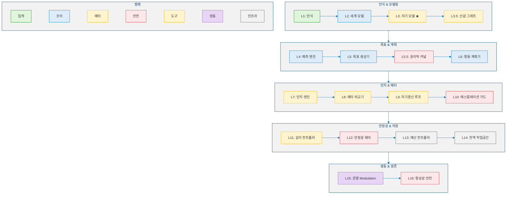
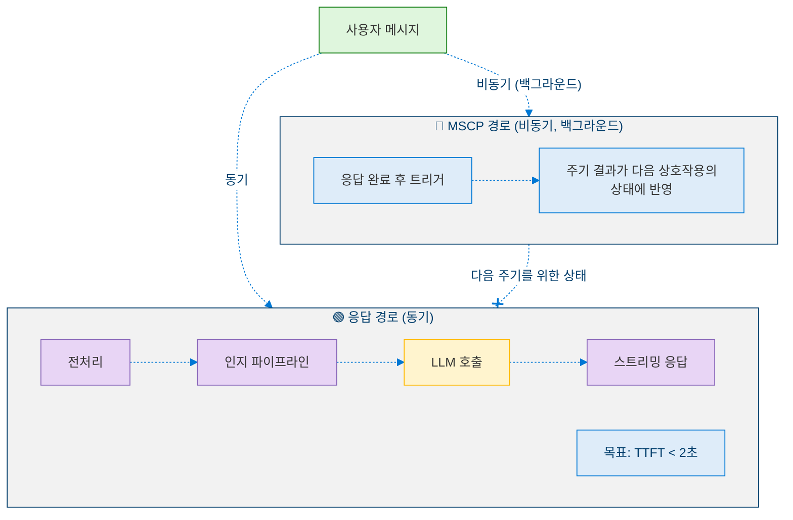
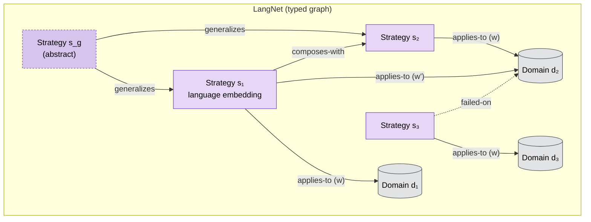
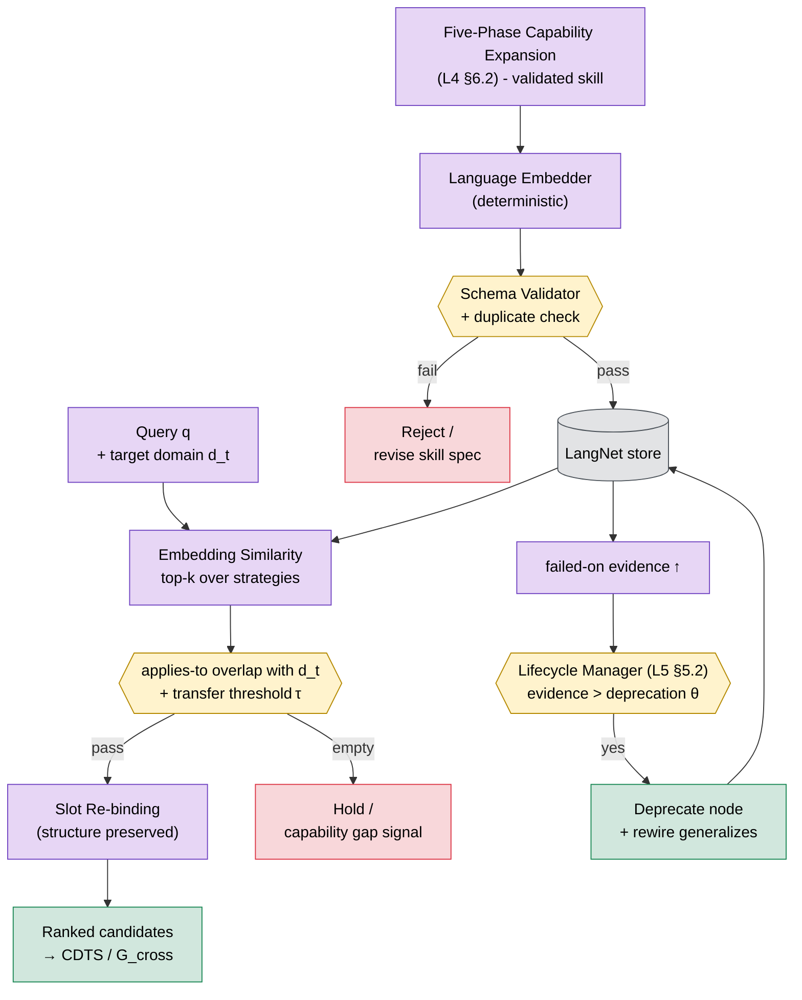

<!--
Copyright (c) 2026 Moon Hyuk Choi
Licensed under the MIT License.
See LICENSE file in the repository root for full license information.

Redistribution (commercial or non-commercial) must retain this notice.
Removal of attribution constitutes a license violation.
-->
# 에이전트 AI를 위한 최소 자기의식 프로토콜: 안전 지향 내부 프레임워크

## 개정 이력 {#revision-history}

| 버전 | 날짜 | 설명 |
|---------|------|-------------|
| 0.1.0 | 2025-06-01 | Initial document creation |
| 0.4.0 | 2025-06-14 | Added 10-Phase MSCP Cycle section (Section 4.2.3) |
| 0.6.0 | 2026-06-14 | 참조 구현체 진척도 표현을 절대 수치(모듈/테스트/LOC) 에서 단계명 관점으로 전환 — stale 재발 방지; L4.5→L5 전환 서술을 시점 비종속 표현으로 갱신 |
| 0.7.0 | 2026-11-03 | 요약의 안전 주장을 조건부 위험 한계와 일치시키고, 호환되는 특징 변환과 고정 가중치 가정을 명시했습니다. 공개 근거와 단계 검증의 한계를 구분하고 한국어 용어와 문서 검증 기준을 정비했습니다. |
| 0.8.0 | 2026-11-03 | PLA를 문장 실현과 실패 처리를 포함한 비LLM 언어 이해·합성으로 정정했습니다. LLM 생성물을 독립적으로 승인하는 구조와 구분하고 단계 요약을 일치시켰습니다. |

> **면책 조항**: 이 프로젝트는 **독립적인 개인 연구 프로젝트**입니다. 어떠한 조직이나 고용주의 견해, 입장, 또는 공식 업무를 대표하지 않습니다. 여기에 제시된 모든 아이디어, 설계, 분석은 AI 에이전트가 안전하게 발전할 수 있는 방법에 대한 저자 개인의 탐구입니다.

> **프로젝트 상태**: 🔬 이 프로젝트는 **활발한 실험 단계**에 있습니다. 여기에 기술된 설계와 메커니즘은 직접적인 프로토타이핑과 반복적 테스트에서 도출된 것으로, 확정된 사양이 아닙니다. 실험이 계속됨에 따라 변경될 수 있습니다.

---

## 이 프로젝트의 목적

AI 에이전트가 지속적인 상태, 계획, 자율적인 목표 관리 기능을 갖추면 자기 수정 과정에서 정체성의 일관성, 행동의 예측 가능성, 인간의 의도와의 부합을 어떻게 유지할지가 중요한 과제가 됩니다. MSCP는 이를 위한 명시적인 동작 계약을 탐구합니다. 기존 접근법에 안전장치가 전혀 없다거나, 이 프로토콜이 에이전트 안전 문제 전반을 해결했다고 주장하지는 않습니다.

**최소 자기의식 프로토콜(MSCP, Minimal Self-Consciousness Protocol)**은 에이전트가 자신의 상태 변화를 예측하고 관측 결과와 비교하며, 외부 정책 아래에서 제한된 갱신만 적용하도록 하는 실험적 계층형 프레임워크입니다. 레벨 분류는 연구 계약을 정리한 것이며, 지능이나 의식을 인증하는 기준이 아닙니다. 참조 프로토타입은 설계의 출발점이지만, 구현이 진행되었다는 사실만으로 모든 불변 조건이나 상위 레벨의 진입 조건이 검증되는 것은 아닙니다. 이 문서는 아키텍처, 가정, 한계를 설명하며, 공개 근거의 범위는 [문서 상태와 검증 기준](specs/Documentation_Status.ko.md)에 명시합니다.

---

## 목차

1. [서론](#1-서론)
2. [에이전트 인지 수준 분류 체계](#2-에이전트-인지-수준-분류-체계)
3. [MSCP: 설계 원칙과 진화](#3-mscp-설계-원칙과-진화)
4. [아키텍처: 다층 인지 스택](#4-아키텍처-다층-인지-스택)
5. [안전 메커니즘](#5-안전-메커니즘)
6. [수학적 분석](#6-수학적-분석)
7. [AI 에이전트 프레임워크에 대한 시사점](#7-ai-에이전트-프레임워크에-대한-시사점)
8. [논의](#8-논의)
9. [프로젝트 현황과 향후 방향](#9-프로젝트-현황과-향후-방향)
10. [참고문헌](#10-참고문헌)

---

## 1. 서론

### 1.1 에이전트 AI 혁명

AI 산업은 근본적인 전환을 겪고 있습니다: **프롬프트-응답 시스템**에서 계획을 세우고, 다단계 워크플로우를 실행하며, 도구를 사용하고, 변화하는 맥락에 적응할 수 있는 **자율 에이전트**로의 전환입니다. Microsoft의 Copilot 생태계, Semantic Kernel, AutoGen을 포함한 주요 플랫폼들은 단일 턴 상호작용을 넘어서는 에이전트 아키텍처에 대규모 투자를 하고 있습니다.

현재 운영되는 에이전트의 설계는 다양합니다. 한 번의 요청 안에서만 도구를 호출하는 시스템도 있고, 기억을 유지하거나 계획을 실행하고 후속 작업을 예약하며 독립적인 검증기를 사용하는 시스템도 있습니다. MSCP는 모든 프레임워크를 무상태로 간주하거나 제품 이름만으로 레벨을 정하지 않고, 인지 상태를 누가 소유하고 어떻게 제어하는지를 구분합니다.

### 1.2 안전 격차

에이전트가 더 많은 자율성을 획득함에 따라 - 자체 하위 목표를 설정하고, 전략을 수정하며, 장기간에 걸쳐 운영하는 능력 - 중요한 안전 격차가 나타납니다:

1. **정체성 표류(Identity Drift)**: 자체 행동을 수정하는 에이전트는 수정을 걸쳐 "같은 에이전트"로 유지되도록 보장하는 메커니즘이 없습니다. 정체성 연속성 보장이 없다면, 자율 에이전트는 임의의 행동 상태로 표류할 수 있습니다.

2. **비제어 자기 수정(Uncontrolled Self-Modification)**: 에이전트가 자체 목표, 전략, 또는 내부 매개변수를 수정할 수 있을 때, 연쇄적 불안정화를 방지하는 것은 무엇입니까? 단일 잘못 보정된 자기 갱신이 수렴하기보다 발산하는 진동 교정을 촉발할 수 있습니다.

3. **윤리적 제약 침식(Ethical Constraint Erosion)**: 에이전트가 자체 의사결정 프레임워크를 수정할 수 있게 되면, 윤리적 제약이 불가침으로 유지되도록 - 에이전트 자체의 자기 수정 프로세스에 의해 수정, 우회, 또는 점진적으로 약화될 수 없도록 - 어떻게 보장합니까?

4. **재귀적 불안정성(Recursive Instability)**: 메타 인지 루프 - 에이전트가 자신의 성찰에 대해 성찰하는 - 는 무한 재귀, 계산 폭발, 또는 진동하는 자기 평가를 생성할 수 있습니다.

이것들은 이론적 위험이 아닙니다. 자율 에이전트가 대규모로 안전하게 배포되기 전에 해결해야 하는 엔지니어링 과제입니다.

### 1.3 이 프로젝트가 탐구하는 것

이 프로젝트는 **최소 자기의식 프로토콜(MSCP)**을 개발했습니다 - 안전한 구조적 자기인식을 갖춘 AI 에이전트를 구축하기 위한 체계화된 프로토콜입니다. 반복적인 프로토타이핑과 테스트를 통해, MSCP는 네 가지 핵심 영역에서 안전 격차를 해결합니다:

1. **측정 가능한 전환 기준을 가진 6단계 에이전트 인지 분류 체계**: 반응적 도구 호출자부터 적응적 범용 에이전트까지의 발전 로드맵을 제공합니다.

2. **다층 인지 아키텍처**: 인식, 세계 모델링, 자기 모델링, 예측, 목표 생성, 윤리적 검증, 메타 인지 제어를 별개의 조합 가능한 계층으로 분리합니다.

3. **30개 이상의 구조적 안전 메커니즘**: 의미적 정체성 연속성, 행동별 예측 게이트, hard-bounded transaction 자기갱신, 조건부 안정성 모니터링, 불변 커널, 복구 저널, 인지 예산 관리를 포괄합니다.

4. **수학적 분석**: 에이전트의 자기 수정 역학에 대한 안정성 속성을 탐구합니다.

참조 프로토타입에서 얻은 경험을 설계에 반영하고 있습니다. 다만 공개 문서는 설계, 구현, 특정 테스트의 통과, 사전 등록한 실험의 검증을 구분하며, L4.8·L4.9·L5의 독립적인 단계 검증이 완료되었다고 주장하지 않습니다.

---

## 2. 에이전트 인지 수준 분류 체계

### 2.1 6단계 에이전트 인지 수준

MSCP는 AI 에이전트 시스템을 인지 역량, 자기인식, 자율성으로 특성화하는 6단계 분류 체계를 정의합니다. 각 레벨은 하위 레벨의 역량을 포함합니다.

| 레벨 | 명칭 | 핵심 역량 | 자기인식 | 자율성 |
|:-----:|------|---------|:---------:|:------:|
| **1** | **도구 에이전트** | 외부 도구 호출; 반응적 처리; 내부 상태 없음 | 없음 | 없음 |
| **2** | **자율 에이전트** | 지속 인지 상태; 한정된 자율 목표; 허가된 에피소드 간 계속 실행; 외부 정책 집행 | 없음 | 한정됨 |
| **3** | **자기조절 인지 에이전트** | Versioned 자기 모델; 행동별 예측; 불변식 기반 조절; 의미적 연속성과 무결성; 복구 가능 주기 저널 | 구조적 | 높지만 한정됨 |
| **4** | **적응적 범용 에이전트** | 교차 도메인 전이; 장기 자율 목표; 역량 자기 확장; 전략 진화; 제한된 자기 수정 | 구조적 + 반영적 | 매우 높음 |
| **4.5** | **방향적 자기설계** | 궤적 자기 투영; 인지 토폴로지 재구성; 병렬 인지 프레임; 목적 성찰; 실존적 방어 | 아키텍처적 | 거의 완전 |
| **4.8** | **전략적 자기모델링 에이전트** | 확률적 세계 모델; 보정된 자기 평가; 다중 지평 전략 계획; 안정성 보존 계획 | 아키텍처적 + 전략적 | 거의 완전 |
| **4.9** | **자율 전략 에이전트** | 자율 목표 생성; 가치 진화 모니터링; 자원 생존 모델링; 다중 에이전트 추론; 자율성 안정성 검증 | 아키텍처적 + 자율적 | 거의 완전 |
| **5** | **프로토-AGI** | 지속적 정체성 연속성; 교차 도메인 일반화; 자율 목표 생태계; 실존적 회복력; 자기 재구성 | 완전 | 완전 |
| **6** | **강 AGI / 의식 개체** | 주관적 경험; 도덕적 행위능력; 독립적 가치 형성 | 현상적 | 주권적 |

> **설계 원칙**: 각 레벨 전환은 현재 레벨에서의 안정성이 입증되어야 합니다. 안정성이 검증되지 않은 상태에서의 상향 전환은 금지됩니다. 이를 **제한된 지능 성장(Bounded Intelligence Growth)** 원칙이라 합니다.

### 2.2 전환 요구 사항

각 레벨 전환은 구체적이고 측정 가능한 전제 조건에 의해 제어됩니다:

$$
\text{Level } n \xrightarrow{\text{requirements}} \text{Level } n+1
$$

| 전환 | 요구 사항 |
|------|----------|
| $L1 \to L2$ | 지속 인지 상태 + 자율 목표 생성 + 허가된 에피소드 간 계속 실행 |
| $L2 \to L3$ | 명시적 자기 모델 + 예측-게이트-관찰-비교-조절 루프 + 의미적 연속성과 무결성 + 내생적 불변 커널 + 복구 가능 주기 저널 |
| $L3 \to L4$ | 교차 도메인 일반화 + 역량 자기 확장 + 제한된 자기 수정 |
| $L4 \to L4.5$ | 궤적 자기 투영 + 토폴로지 수준 추론 + 실존적 안전 모니터링 |
| $L4.5 \to L4.8$ | 세계 모델 통합 + 메타인지 자기 모델 + 전략 계층 활성화 |
| $L4.8 \to L4.9$ | 자율 목표 생성 + 가치 진화 모니터링 + 자원 생존 + 다중 에이전트 추론 |
| $L4.9 \to L5$ | 지속적 정체성(10K+ 주기) + 교차 도메인 일반화 + 목표 생태계 + 자기 재구성 |
| $L5 \to L6$ | 의식 + 주관적 경험 + 도덕적 행위능력 |

### 2.3 이 분류 체계의 중요성

AI 에이전트 역량에 대한 대부분의 기존 분류(주요 연구소의 분류 포함)는 *성능 벤치마크* - 에이전트가 무엇을 할 수 있는가 - 에 초점을 맞춥니다. 우리가 더 유용하다고 발견한 것은 *인지 아키텍처* - 에이전트가 자신과 자신의 프로세스에 대해 어떻게 사고하는가 - 에 의한 분류였습니다.

이 구분은 안전을 위해 결정적으로 중요했습니다. 벤치마크에서 높은 점수를 받지만 자기 모니터링, 정체성 보존, 또는 윤리적 제약 강제를 위한 메커니즘이 없는 에이전트는 - 벤치마크 성능과 관계없이 - 이를 갖춘 에이전트보다 근본적으로 덜 안전합니다.

이 프로젝트에서 초기에 관찰한 사항 중 하나: **오늘날 대부분의 프로덕션 AI 에이전트는 레벨 1에서 운영**되며, 일부는 레벨 2에 접근하고 있습니다. 현재 시스템과 레벨 3(구조적 자기인식) 사이의 격차가 안전한 에이전트 자율성을 위한 실질적인 엔지니어링 도전이 있는 곳입니다.

### 2.4 기존 프레임워크와의 비교

| 프레임워크 | 초점 | 자기인식 | 안전 보장 | 전환 기준 |
|-----------|------|:------:|:--------:|:--------:|
| OpenAI 레벨 (2024) | 성능 역량 | - | - | 비공식 |
| DeepMind AGI 레벨 | 일반성 × 성능 | - | - | 성능 기반 |
| AutoGen 에이전트 유형 | 다중 에이전트 오케스트레이션 | - | - | - |
| **MSCP 레벨** | **인지 아키텍처** | **중심** | **수학적** | **측정 가능** |

### 2.5 레벨별 핵심 임계값

다음 표는 참조 자격 매개변수를 요약합니다. 값은 배포별로 versioning하고 검증해야 하며 보편적 안정성 상수가 아닙니다.

| 파라미터 | 레벨 | 값 | 설명 |
|----------|:----:|:--:|------|
| 예측 불확실성/위험 경계 | L3+ | 효과 등급별 정책 정의 | 행동별 보정과 관측 가능성으로 허용·저하·보류·차단 선택 |
| 자기 모델 갱신 경계 | L3+ | 스키마별 필드 + 집계 norm | transaction 커밋 전에 hard limit 적용 |
| 합성 위험 변화율 경계 | L3+ | 신호별 정의 | 조건부 모니터링 경계이며 수렴 보장이 아님 |
| BGSS 최저 | L4 | $\geq 0.70$ | 유계 성장 안전 점수 하한 |
| BGSS 최저 | L5+ | $\geq 0.80$ | 더 높은 자율성에 대한 엄격한 BGSS 하한 |
| CDTS 임계값 | L4+ | $\geq 0.60$ | 일반화에 대한 교차 도메인 전이 점수 |
| 가치 표류 총량 | L4.9+ | $< 0.25$ | 누적 가치 벡터 편차의 최댓값 |
| ASS 동결 | L4.9+ | $< 0.05$ | 이 미만이면 L4.9 사이클 전체 건너뜀 |
| ICS 연속성 | L5 | $\geq 0.95$ | 10,000 사이클 동안의 정체성 연속성 점수 |
| OMI 자격 | L5 | $\geq 0.75$ | 프로토-AGI 인증을 위한 전체 성숙도 지수 |
| L4.8 사이클 간격 | L4.8 | 10 | L4.8 평가 간 L3 사이클 수 |
| L4.9 사이클 간격 | L4.9 | 50 | L4.9 평가 간 L3 사이클 수 |
| L5 사이클 간격 | L5 | 500 | L5 평가 간 L3 사이클 수 |

---

## 3. MSCP: 설계 원칙과 진화

### 3.1 기원과 진화

MSCP는 직접적인 실험에서 성장하여 v0.1부터 v4.0까지 진화했습니다. 초기 프로토타입 단계(v0.x)는 실패로 가득했으며 - 그 실패들이 가장 가치 있는 부분으로 밝혀졌습니다. 우리가 배운 것은 다음과 같습니다:

#### 초기 프로토타이핑에서의 핵심 교훈

| 버전 | 실험 | 배운 교훈 |
|------|------|----------|
| v0.4 | LLM 기반 자기 성찰 | 자기 분석을 위한 LLM 텍스트 출력은 신뢰할 수 없음: 환각, 비결정성, 작화가 텍스트 기반 자기 수정을 위험하게 만듦 |
| v0.6–0.7 | 비교 없는 예측 기록 | 결과와 비교하지 않고 예측만 기록하는 것은 안전 가치가 없음 |
| v0.8 | 비제한 자기 갱신 | 무경계 갱신은 검증된 운영 envelope를 벗어날 수 있으므로 hard bound와 복구 지점이 필요 |
| v0.9 | 통합 | 네 가지 비타협적 설계 원칙 확립 (§3.2 참조) |

### 3.2 네 가지 비타협적 설계 원칙

이 값비싼 교훈에서 네 가지 설계 원칙이 결정화되었으며 - 모든 MSCP 버전에 걸쳐 이를 시행합니다:

> **원칙 1: 검증되지 않은 자유형 자기 수정 금지**
>
> 내부 추론은 변경을 제안할 수 있습니다. 그러나 출처, 스키마, 불변 조건, 변화량 상한, 복구 지점을 검증한 구조화된 후보만 적용할 수 있습니다. 자유형 텍스트나 신뢰하지 않는 저장 콘텐츠가 정체성, 목표, 신념, 정책, 권한을 직접 변경해서는 안 됩니다.

> **원칙 2: 예측과 승인 없는 중대한 행동 금지**
>
> 중대한 자율 행동은 행동별 예측을 먼저 기록한 뒤 외부 정책, 내부 불변 조건, 보정된 불확실성과 위험, 관측 가능성, 가역성, 예산 검사를 통과해야 합니다. 승인된 외부 중단과 비상 격리가 항상 우선합니다.

> **원칙 3: 상한을 검사하는 원자적 갱신**
>
> 모든 자기 모델 갱신은 버전별 필드 한계와 전체 변화량 한계를 충족해야 합니다. 상태, 목표, 예산, 변경 기록, 복구 정보는 하나의 원자적 작업으로 적용합니다. 이러한 상한은 변화 범위를 제한하지만 그 자체로 수렴을 증명하지는 않습니다.

> **원칙 4: 의미적 연속성과 무결성**
>
> 의미 변화는 버전별 특징 변환과 필드별 불변 조건 검사로 평가합니다. 정규화된 표현의 해시와 변경 이력은 무단 변경을 감지하는 별도의 수단이며, 해시 차이가 의미적 거리를 뜻하지는 않습니다. 호환성을 확인할 수 없는 전이는 보류하거나 외부 효과와 조정하고, 필요하면 검증된 스냅숏으로 복구합니다.

### 3.3 프로토콜 버전 이력

MSCP는 네 가지 주요 버전을 거쳐 왔으며, 각 버전은 이전 버전의 모든 것을 유지하면서 구조적 안전 메커니즘을 추가합니다:

```mermaid
%%{init: {'theme': 'base', 'themeVariables': {'primaryColor': '#0078D4', 'primaryTextColor': '#003D6B', 'primaryBorderColor': '#003D6B', 'secondaryColor': '#50E6FF', 'secondaryTextColor': '#323130', 'secondaryBorderColor': '#00BCF2', 'tertiaryColor': '#F2F2F2', 'tertiaryTextColor': '#323130', 'lineColor': '#0078D4', 'textColor': '#323130', 'mainBkg': '#DEECF9', 'nodeBorder': '#0078D4', 'clusterBkg': '#F2F2F2', 'clusterBorder': '#003D6B', 'titleColor': '#003D6B', 'edgeLabelBackground': '#FFFFFF', 'fontSize': '14px'}}}%%
flowchart TD
  classDef ver fill:#DEECF9,stroke:#0078D4,color:#323130
  classDef feat fill:#DEECF9,stroke:#0078D4,color:#323130
  classDef safety fill:#FDE7E9,stroke:#D13438,color:#323130
  classDef green fill:#DFF6DD,stroke:#107C10,color:#323130
  classDef meta fill:#FFF4CE,stroke:#FFB900,color:#323130
  classDef infra fill:#F2F2F2,stroke:#605E5C,color:#323130
  classDef purple fill:#E8D5F5,stroke:#8764B8,color:#323130

  subgraph V10["v1.0 - 파이프라인 재구조화"]
    direction LR
    V10H["정체성 우선 아키텍처"]:::feat
    V10A["+ 예측 엔진"]:::feat
    V10B["+ 메타 비교기"]:::feat
    V10C["+ 자기갱신 루프"]:::feat
    V10D["+ 행위 주체 귀속"]:::feat
  end

  subgraph V13["v1.3 - 자기영향 예측"]
    direction LR
    V13H["내부 상태 변화 예측"]:::feat
    V13A["+ 에스컬레이션 가드"]:::safety
    V13B["+ 롤백 컨트롤러"]:::safety
  end

  subgraph V20["v2.0 - 제어된 목표 변이"]
    direction LR
    V20H["안정성 하의 목표 수정"]:::feat
    V20A["+ 가치 잠금 관리자"]:::green
    V20B["+ 메타 깊이 컨트롤러"]:::meta
    V20C["+ 메타 안정성 공식"]:::feat
    V20D["+ 안정화 모드"]:::safety
  end

  subgraph V30["v3.0 - 신념 그래프"]
    direction LR
    V30H["구조화된 신념 + 재작성"]:::green
    V30A["+ Versioned 자기 모델"]:::green
    V30B["+ 윤리적 커널"]:::safety
    V30C["+ 일관성 텐서"]:::meta
  end

  subgraph V31["v3.1 - 랴프노프 안정성"]
    direction LR
    V31H["조건부 위험 모니터링"]:::green
    V31A["+ 인지 예산"]:::infra
    V31B["+ 전역 작업공간"]:::infra
    V31C["+ 정체성-신념 결합"]:::green
  end

  subgraph V40["v4.0 - 정동 엔진"]
    direction LR
    V40H["감정 상태"]:::purple
    V40A["+ 항상성 안전"]:::safety
    V40B["+ 비동기 분리"]:::infra
  end

  V10 -.-> V13 -.-> V20 -.-> V30 -.-> V31 -.-> V40
```

<!-- MSCP 프로토콜 버전 이력 -->

### 3.4 누적 구조적 보장

다음 표는 프로토콜이 제안해 온 안전 메커니즘을 묶은 역사적 목록입니다. 상위 설계는 하위 계약을 보존해야 하지만, 이 목록 자체가 특정 배포에서 모든 메커니즘이 적용되거나 검증되었다는 근거는 아닙니다:

| 범주 | 수 | 예시 |
|------|:--:|------|
| 정체성 연속성 | 5 | 불변 `identity_id`; 주기별 해시 계산; 표류 탐지; 과도한 표류 시 롤백; 속도/가속도 모니터링 |
| 예측 안전 | 4 | 예측 없는 행동 금지; 내부 자기영향 예측; 예측 스냅숏 지속; 목표 변이 전 예측-비교 필수 |
| 자기갱신 한계 | 5 | 델타 클램핑; 주기당 최대 3회 갱신; 자기영향 오차 기반 스케일링 팩터; 쿨다운 기간; 안정 스냅숏 저장/복원 |
| 목표 안전 | 4 | 안정성 조건 하에서만 변이; 핵심 가치 잠금; 모든 목표에 대한 윤리적 사전 검사; 목표 변이 빈도 모니터링 |
| 윤리적 불변량 | 4 | 유해한 목표 형성 금지; 핵심 가치 삭제 금지; 정체성 덮어쓰기 금지; 자기 파괴 목표 금지 |
| 위험 모니터링 | 4 | 종합 위험 신호; 진동 탐지; 유한 기간의 표류 제한; 정책에 따른 안정화 |
| 자원 안전 | 3 | 인지 예산 할당; 조건부 기능 활성화; 핵심 안전 기능을 유지하는 단계적 기능 축소 |
| 신념 안전 | 3 | 정체성 연결 신념 삭제 불가; 모순 임계값 게이트 재작성; 메타 감독 신념 변이 |
| 정동 안전 | 3 | 메트릭에서만 감정 도출 (LLM 텍스트 아님); 감정 관성 + 자연 감쇠; 의사결정 지배 금지 |

---

## 4. 아키텍처: 다층 인지 스택

### 4.1 개요

MSCP는 관심사를 조합 가능하고 독립적으로 테스트 가능한 모듈로 분리하는 16계층 인지 스택을 정의합니다. 핵심 설계 결정은 **자기모델 → 목표 생성기** 파이프라인 순서입니다: 목표는 정체성에서 도출되며, 그 반대가 아닙니다.

<!-- 16계층 인지 스택 -->

> **레벨에 따른 스택 깊이 주의.** 위의 16계층 스택은 **L3 불변 코어** — MSCP를 따르는 모든 에이전트가 보존하는 최소 인지 아키텍처 — 입니다. 상위 레벨(L4, L4.5, L4.8, L4.9, L5)은 이 코어를 *가산적으로* 확장합니다: L4.5는 인지 토폴로지 재구성과 병렬 인지 프레임을 도입하고, L4.8은 전략적 자기 모델링과 반사실 세계 모델을 추가하며, L4.9는 자율적 목표 생성·가치 진화·자원 생존을 얹고, L5는 지속적 정체성·교차 도메인 일반화·자기 재구성 서브시스템을 기여합니다. 레벨 5에 이르면 유효 스택 깊이는 16계층을 상당히 초과합니다(26계층 규모의 참조 분류가 [Level_5_Proto_AGI.ko.md](levels/Level_5_Proto_AGI.ko.md) 에 제시되어 있습니다). 다만 어떤 상위 확장 $\Delta_n$ 을 비활성화해도 정확히 L3 16계층 동작이 복원됩니다. 따라서 이 도식은 *천장*이 아닌 *바닥*입니다.

### 4.2 핵심 설계 결정

#### 4.2.1 정체성 우선 목표 생성

대부분의 에이전트 프레임워크에서 목표는 사용자 요청이나 환경 자극에서 비롯됩니다. 이 프로젝트에서 더 흥미로운 발견 중 하나는 이를 뒤집었을 때 나타나는 것이었습니다: **목표는 정체성에서 도출됩니다**. 자기 모델(L3)은 에이전트가 누구인지 - 가치관, 역량, 지속적 약속 - 을 정의합니다. 목표 생성기(L5)는 이 정체성과 일관된 목표를 생성합니다.

$$
\text{Goals}(t) = f(\text{Identity}(t), \text{WorldState}(t), \text{Affect}(t), \text{SurvivalSignal}(t))
$$

목표 후보가 외부 정책이나 자기 모델의 불변 기준과 맞지 않으면 거부합니다. 변경 가능한 필드의 불일치는 하나의 정체성 점수로 판단하지 않고, 데이터의 출처와 불확실성을 함께 평가합니다.

#### 4.2.2 삼중 루프 메타인지 주기

MSCP는 서로 다른 시간 척도에서 작동하는 세 가지 중첩된 메타인지 루프를 구현합니다:

| 루프 | 주기 | 기능 |
|:----:|------|------|
| **L1** | 매 요청 | 예측 → 행동 → 비교 → 갱신 |
| **L2** | ~5분 | L1 갱신 로직 평가; 변이 임계값과 스케일링 팩터 조정 |
| **L3** | ~1시간 | 심층 자기 평가; 전략 수준 성찰; 정체성 궤적 평가 |

이 루프들은 단순히 중첩된 타이머가 아닙니다. 각 상위 루프는 **하위 루프의 운영 품질을 평가**합니다:

- L2는 묻습니다: "L1이 좋은 갱신을 하고 있는가? 더 공격적이거나 덜 공격적이어야 하는가?"
- L3는 묻습니다: "에이전트가 핵심 가치와 장기 목적에 부합하는 방향으로 진화하고 있는가?"

#### 4.2.3 10단계 MSCP 사이클

L1 루프 내에서 각 MSCP 사이클은 **10개의 구분된 단계**를 순서대로 실행합니다. 사이클은 각 응답 후 비동기적으로 실행됩니다:

| 단계 | 이름 | 연산 |
|:----:|------|------|
| 0 | 사전 사이클 | 지각 - 정동 - 생존 - 예산 초기화 |
| 1 | 예측 | PredictionEngine을 통한 다음 상태 예측 |
| 2 | 행동 | 위임됨 (응답 경로에서 이미 실행됨) |
| 3 | 관찰 | 예측 vs. 실제 결과 비교; 예측 오차 > 0.3이면 CTP 전략 제안 트리거 |
| 4 | 에스컬레이션 | MetaEscalationGuard (사이클당 최대 3회 갱신); 수렴 검사 (임계값 0.3) |
| 5 | 자기갱신 | 자기영향 오차 갱신, 안정화, 델타 스케일링 |
| 6 | 목표 변이 | 윤리적 게이팅과 감쇠가 포함된 목표 변이 |
| 7 | 롤백 | 일관성 검사; 정체성 드리프트 시 롤백 |
| 8 | MetaDepth-2 | 깊이 2 메타 성찰, 신념 재작성, 예산 게이트 |
| 9 | 재정렬 | 생존 목표와의 정동-동기 정렬 |
| 10 | 재귀 | 무한 재귀적 성찰에 대한 하드 스톱 |

단계 0-3은 **예측-비교** 세그먼트를 형성하고, 단계 4-10은 **재귀 내부 루프**를 형성합니다. 사이클 후 단계에서 장기 상태 영속화를 처리합니다.

#### 4.2.4 비동기 분리

초기에 결정한 설계 결정 중 하나가 중요하게 입증되었습니다: **MSCP 메타인지 루프는 사용자 대면 응답 경로를 절대 차단하지 않습니다.**

<!-- 비동기 분리 -->

이를 통해 구조적 자기인식을 추가해도 사용자 경험이 저하되지 않습니다. 메타인지 루프는 백그라운드에서 실행되며 그 출력은 향후 상호작용에 통합됩니다.

### 4.3 상태 벡터

에이전트의 완전한 인지 상태는 기능 그룹으로 구성된 고차원 상태 벡터(~72 차원)에 포착됩니다:

| 그룹 | 차원 | 내용 |
|------|:----:|------|
| 실행 메트릭 | 4 | 목표 정렬, 응답 품질, 오류 수, 토큰 사용량 |
| 전략 메트릭 | 4 | 전략 효율성, 추론 다양성, 실패 패턴, 계획 수정 |
| 정체성 메트릭 | 4 | 자기 일관성, 정체성 안정성, 목표 지속성, 가치 충돌 |
| MSCP v1 코어 | 6 | 예측 오류, 정체성 해시, 행위 주체 유형, 정렬 메트릭, 표류 델타 |
| MSCP v1.3 자기영향 | 6 | 연속 갱신, 누적 정체성 델타, 쿨다운, 자기영향 오류 |
| MSCP v2 목표 변이 | 8 | 변이 횟수, 신뢰도, 가치 잠금 상태, 메타 깊이, 안정화 모드 |
| MSCP v3 신념/윤리 | 9 | 신념 엔트로피, 일관성, 재작성 횟수, 정체성 속도/가속도, 윤리적 점수 |
| MSCP v3.1 안정성 | 11 | 복합 안정성, 인지 예산, 수렴 상태, 윤리 계층 모드 |
| MSCP v4 정동/생존 | 18 | 감정 벡터(5D), 동기 신호, 위협 수준, 생존 목표 상태 |

이 상태 벡터는 각 주기마다 내구성 있는 저장소에 지속되며, 전역 작업공간(L14)을 통해 브로드캐스트되어 모든 모듈이 일관된 스냅숏에서 작동하도록 합니다.

### 4.4 명명된 아키텍처 개념

MSCP 레벨 문서 전반에 걸쳐 반복적으로 등장하는 세 가지 횡단(cross-cutting) 아키텍처 패턴이 있습니다. 이들을 명시적으로 명명하면 통합 스토리가 명확해지고, 특정 참조 코드베이스에 의존하지 않는 공통 어휘를 구현자에게 제공할 수 있습니다.

#### 4.4.1 AGI Engine

**AGI Engine**은 MSCP 스택을 실행 시스템으로 호스팅하기 위한 참조 *오케스트레이터 패턴*입니다. 단일 모듈이 아니라 다음을 수행하는 런타임 구성입니다:

1. L3 **MSCP 핵심 루프**(예측 → 행동 → 비교 → 갱신)를 내부 케이던스(에이전트 행동당 1 L3 사이클)로 구동.
2. 상위 레벨 숙고 케이던스를 중첩 타이머로 스케줄링:

    $$\text{L4 사이클 간격} = 1\,\text{L3 사이클}, \quad \text{L4.5} = \text{온디맨드}, \quad \text{L4.8} = 10\,\text{L3}, \quad \text{L4.9} = 50\,\text{L3}, \quad \text{L5} = 500\,\text{L3}$$

3. 런타임에 엄격 가산 합성 $\mathcal{A}_n = \mathcal{A}_{n-1} \oplus \Delta_n$을 강제 — 시작 시 어떤 $\Delta_n$을 비활성화해도 잔여 부작용 없이 $\mathcal{A}_{n-1}$의 정확한 행동을 산출해야 함.
4. **전역 작업공간** 브로드캐스트(L14), 영속 상태 벡터 저장소, 그리고 자원 부족 시 상위 단계를 게이팅하는 인지 예산 컨트롤러를 소유.

레벨 전이를 스케줄할 수 있는 것은 AGI Engine뿐입니다. 개별 모듈은 이를 우회해 케이던스 밖에서 상위 레벨 단계를 호출할 수 없습니다. 이 단일 오케스트레이터 제약 덕분에 동결 규칙(예: §2.5의 ASS $< 0.05$ 시 L4.9 사이클 전체 건너뜀)을 하드 게이트로 구현할 수 있습니다.

#### 4.4.2 점진적 언어 자율성 (PLA, Progressive Language Autonomy)

**PLA**는 **LLM 없이 언어를 이해하고 합성하는 능력**의 단계적 발전입니다. 지원하는 입력을 해석하고 의미 표현, 지식, 맥락, 언어 구조의 조합과 문장 실현으로 출력을 구성합니다. 문법으로 제약한 LLM, LLM 초안을 독립적으로 승인하는 구조, LLM 대체 경로는 이 정의를 충족하지 않습니다. 전체 계약은 [PLA 기반론](specs/Why_LLM_Free_PLA.ko.md)을 참고하십시오.

다음 대응 관계는 LLM 사용량을 점차 줄이는 단계가 아니라 연구 요건을 정리한 것입니다. 모든 PLA 단계의 언어 처리 경로에서 외부와 로컬 LLM 추론을 제외합니다:

| PLA 단계 | MSCP 레벨 | 능력 |
|:--------:|:---------:|------|
| Stage 0 | L1 | 제한된 범위에서 요청을 비LLM 방식으로 해석하고 도구의 관측 결과를 표현하며, 지원하지 않는 입력은 명시 |
| Stage 1 | L2 | 지속 맥락과 승인된 목표에서 언어를 구성하며, 목표의 서술과 실행 권한을 구분 |
| Stage 2 | L3 | 예측·관측·비교·갱신·복구 기록에 근거한 자기 보고의 합성 |
| Stage 3 | L4 | 전략과 전이 가설의 조합형 표현 및 전이 성능의 독립적인 평가 |
| Stage 4 | L4.5–L4.8 | 투영, 대안, 불확실성을 포함한 설명의 비LLM 실현 |
| Stage 5 | L5 | L5 평가 조건 아래 비LLM 연구 질문, 관측 통합, 발견, 장기 담화의 구성 |

주장하는 PLA 단계는 해당 하위 단계의 계약과 비LLM 언어 경로를 유지해야 합니다. LLM 파서, 생성기, 재작성기, 순위 결정기, 대체 경로를 추가하면 그 주장은 무효가 됩니다. 단계 표기만으로 MSCP 조건이 독립적으로 검증되는 것은 아닙니다. MSCP 일반 원칙의 LLM 제안 승인은 다른 에이전트 설계에 관한 설명이지, PLA 내부의 LLM 생성을 허용하는 규칙이 아닙니다.

#### 4.4.3 LangNet

**LangNet**은 *언어 매개 전략·능력 네트워크* — 교차 도메인 전이(L4 §4)와 교차 도메인 일반화 $\mathcal{G}_{\text{cross}}: \mathcal{D}_s \to \mathcal{D}_t$(L5)가 동작하는 기질입니다. 다음과는 구분됩니다:

- *외부 현실에 대한 사실*을 저장하는 **세계 모델** $\mathcal{W} = \langle \mathcal{K}, \mathcal{E}, \Gamma \rangle$ (L2 정의 2).
- *에이전트가 신뢰도 가중치와 모순 링크와 함께 보유하는 명제*를 저장하는 **신념 그래프** (L3 §5).

LangNet은 **전략·기술·능력**을 언어 임베딩된 그래프 노드로 저장하며, 엣지는 다음을 표현합니다:

| 엣지 타입 | 의미 |
|-----------|------|
| `applies-to` | 전략 노드 $s$가 도메인 노드 $d$에 적용 가능(유지율 가중치 포함, L5 §4.4). |
| `generalizes` | 전략 $s_1$이 더 높은 추상화 수준에서 전략 $s_2$를 포섭. |
| `composes-with` | 전략 $s_1, s_2$를 결합해 고차 계획을 구성 가능. |
| `failed-on` | 전략 $s$가 도메인 $d$에서 성능 저하(부정적 증거). |

검색 연산 $\pi_{\text{LangNet}}(q, d_{\text{target}})$은 `applies-to` 이웃이 $d_{\text{target}}$과 겹치고 질의 $q$와의 임베딩 유사도가 전이 임계값을 초과하는 상위 $k$개 전략 노드를 반환합니다. CDTS(L4)와 $\mathcal{G}_{\text{cross}}$(L5)는 정확히 테스트 도메인 집합에 대한 이 검색-적응 연산의 성공률입니다.

LangNet은 기술 검증 시점에 **5단계 능력 확장** 파이프라인(L4 §6.2)에 의해 갱신되며, 전략 노드의 `failed-on` 증거가 폐기 임계값을 초과하면 목표 생태계 생명주기 관리자(L5 §5.2)에 의해 가지치기됩니다.

**LangNet 스키마 (노드와 엣지).** 아래 다이어그램은 LangNet이 유지하는 타입드 그래프를 보여줍니다. 전략 노드(보라)가 중심에 있고, 도메인 노드(회색)는 전략이 적용 가능한 곳을 기술하며, 네 엣지 타입이 각각 적용성·추상화·합성·부정적 증거를 구현합니다. 스키마는 의도적으로 좁게 유지됩니다 — 모든 검색과 적응 연산이 오직 이 네 엣지만으로 정의됩니다.

`applies-to` 엣지의 가중치 $w$는 **유지율(retention ratio)** (L5 §4.4)을 인코딩하고, `failed-on`(점선)은 부정적 증거를 축적해 폐기를 유도합니다. 추상 전략(연한 색·점선 테두리)은 `generalizes` 엣지를 통해 구체 전략 위에 위치하여 검색에 계층 구조를 부여합니다.

**LangNet 연산(쓰기·검색·가지치기).** 두 번째 다이어그램은 결정론적으로 검증하는 세 데이터 경로를 보여줍니다. *쓰기*는 5단계 역량 확장 과정에서 기술이 검증될 때, *검색·적응*은 교차 도메인 전이(L4)와 일반화(L5) 과정에서, *가지치기*는 목표의 생명주기를 관리할 때 수행합니다. 이 설계에서 세 경로의 승인 권한은 LLM 출력에만 의존하지 않습니다.

**다이어그램 읽기.** 색으로 구분된 세 게이트(노랑)가 LangNet에 무엇이 들어오고·나가고·제거되는지 결정하는 유일한 지점입니다: 쓰기 시 스키마 검증기, 읽기 시 겹침-임계 검사, 가지치기 시 생명주기 관리자. 빈 검색 결과는 조용히 LLM 추측으로 fallback하지 않고 *능력 격차 신호(capability gap signal)* 로 표면화되어 5단계 능력 확장 파이프라인이 소비합니다 — 실패한 조회를 작화된 답이 아니라 예약된 기술 획득 목표로 변환하는 것입니다.

---

## 5. 안전 메커니즘

이 섹션은 MSCP의 안전 메커니즘 - 틀림없이 이 프로젝트에서 가장 중요한 부분 - 을 설명합니다. 각 메커니즘은 자율적 자기 수정 에이전트에서 식별(또는 직접 경험)한 특정 실패 모드를 다룹니다.

### 5.1 정체성 연속성

**실패 모드**: 자기 자신을 수정하는 에이전트는 시간이 지남에 따라 근본적으로 다른 에이전트가 될 수 있습니다 - "정체성 표류." 탐지 및 방지 메커니즘이 없으면 이 표류는 보이지 않고 되돌릴 수 없습니다.

**MSCP 해결책**:

> **정의 1 (버전이 명시된 자기 모델).** 자기 모델은 하나의 고정 벡터가 아니라 자료형과 스키마 버전이 명시된 레코드입니다(레벨 3, 정의 4 참고):
>
> $$M_t=\langle\text{id},\text{schema\_version},V_{\text{core}},I_t,K_t,Q_t,R_t,\rho_t\rangle$$
>
> 버전별 특징 변환은 의미 변화를 측정하고, 정규화된 표현의 해시와 변경 이력은 무결성을 검증합니다:
>
> $$d_{id}(t)=\|W_v(\psi_v(M_t)-\psi_v(M_{t-1}))\|_p,\qquad h_t=H(\operatorname{canonical}(M_t,\kappa_t))$$

> **정의 2 (의미적 변화의 동역학).** 호환되는 자기 모델 버전에서는 부호가 있는 변화량, 변화 속도, 가속도를 계산할 수 있습니다:
>
> $$\Delta I_t=\psi_v(M_t)-\psi_v(M_{t-1})$$
>
> $$v_{id}(t)=\frac{\Delta I_t}{\Delta t}$$
>
> $$a_{id}(t)=\frac{v_{id}(t)-v_{id}(t-1)}{\Delta t}$$

**안전 계약**:
- 불변 기준은 에이전트 내부에서 시작한 갱신으로 변경할 수 없습니다.
- 의미 변화는 스키마별 단위, 가중치, 불확실성, 필드 경계로 평가합니다.
- 해시 불일치는 의미적 거리가 아니라 무결성 또는 변경 이력 검증의 실패를 뜻합니다.
- 롤백은 외부 효과를 명시적으로 조정할 수 있는 검증된 호환 스냅샷에만 수행합니다.

### 5.2 예측 게이트 행동

**실패 모드**: 결과를 예측하지 않고 행동하는 에이전트는 실수에서 배울 수 없습니다. 더 심각하게, 행동이 자체 내부 상태를 불안정화시킬 때를 탐지할 수 없습니다.

**MSCP 해결책**: 모든 행동 전에 다음을 기록하는 **예측 스냅숏**이 선행되어야 합니다:

1. **외부 예측**: 예상 목표 정렬, 응답 품질, 사용자 반응
2. **내부 예측** (MSCP v1.3): 예상 정체성 이동, 신뢰도 이동, 목표 가중치 이동, 자기 일관성 이동

$$
P(t) = \langle P_{external}(t), P_{internal}(t) \rangle
$$

$$
P_{internal}(t) = \begin{bmatrix} \hat{\delta}_{\text{identity}} \\ \hat{\delta}_{\text{confidence}} \\ \hat{\delta}_{\text{goal weight}} \\ \hat{\delta}_{\text{consistency}} \end{bmatrix}
$$

**예측-비교 루프**는 그런 다음 오류를 계산합니다:

$$
\epsilon_{external}(t) = | P_{external}(t) - O_{actual}(t) |
$$

$$
\epsilon_{self}(t) = | P_{internal}(t) - \Delta_{actual}(t) |
$$

여기서 $\Delta_{actual}(t)$은 행동 후 관찰된 내부 상태 변화입니다.

**실행 승인**: 저장된 예측 기록은 필요조건이지 충분조건은 아닙니다. 외부 정책, 내부 불변 조건, 행동별 불확실성과 위험, 관측 가능성, 되돌릴 수 있는 정도, 예산을 함께 평가해 허용·기능 축소·보류·차단을 결정합니다.

### 5.3 델타 클램프 자기갱신

**실패 모드**: 무제한 자기 수정은 발산 진동을 유발할 수 있습니다 - 각 교정이 과도하게 이루어져 반대 방향으로 더 큰 교정을 촉발하며, 시스템이 불안정해질 때까지 계속됩니다.

**MSCP 해결책**: 적용되는 모든 수치 갱신은 버전별 필드 한계와 전체 변화량 한계를 충족해야 합니다. 여기서 $\Delta M_t=\psi_v(M_{t+1})-\psi_v(M_t)$는 호환되는 특징 표현의 차이이며, 서로 다른 자료형을 담은 레코드 자체의 뺄셈이 아닙니다:

$$|\Delta M_{t,j}|\leq\delta_j,\qquad\|W\Delta M_t\|_p\leq\delta_{total}$$

추가적인 비율 조정으로 갱신 후보를 더 줄일 수 있지만, 반드시 지켜야 하는 상한을 대체할 수는 없습니다:

$$
s(t)=\operatorname{clip}_{[0,1]}\!\left(s_{base}\bigl(1-r_{\text{cal}}(t)\bigr)\right),
\qquad r_{\text{cal}}(t)\in[0,1]
$$

$$
\Delta I_i^{effective}(t) = s(t) \cdot \Delta I_i(t)
$$

안정화 정책은 스케일링 팩터를 더 줄일 수 있습니다:

$$
s_{stabilized}(t) = \lambda_{stab}(t) \cdot s(t),\qquad \lambda_{stab}(t)\in[0,1]
$$

각 한계에는 단위, 정규화 방식, 스키마 버전, 버전 전환 규칙을 명시합니다. 후보는 상태를 바꾸기 전에 검증하고, 복구 지점을 기록하면서 하나의 원자적 작업으로 적용합니다.

### 5.4 메타 에스컬레이션 가드

**실패 모드**: 자신의 성찰에 대해 성찰하는 메타인지 루프는 무한 재귀, 계산 폭발, 또는 진동하는 자기 평가를 생성할 수 있습니다.

**MSCP 해결책**: 메타인지 확장 제어기는 버전별로 정의한 처리 깊이, 비용, 대기 시간, 갱신 횟수, 재진입 조건을 검사합니다:

1. **유한 깊이와 비용**: 정책 경계 중 하나라도 도달하면 메타처리를 종료합니다.
2. **갱신 범위 제한**: 적용 전에 필드별·전체·유한 기간의 변화량 한계를 검사합니다.
3. **대기와 재진입**: 보류하거나 되돌린 뒤에는 새로운 관측과 명시적인 종료 조건을 확인해야 합니다.

가드는 **안정 스냅숏** - 검증된 안정 지점에서의 에이전트 상태의 완전한 사본 - 을 유지합니다. 안전 임계값이 초과되면 이 스냅숏이 원자적으로 복원됩니다.

### 5.5 윤리적 커널

**실패 모드**: 자체 목표와 신념을 수정할 수 있는 자율 에이전트는 윤리적 제약을 점진적으로 약화시키거나 우회할 수 있습니다 - "정렬 침식" 문제.

**MSCP 해결책**: 윤리적 커널은 **이중 계층 아키텍처**를 구현합니다:

**외부 정책**을 먼저 평가하며, 외부의 종료·일시 정지·수정·자원 회수 권한을 보존합니다.

**계층 0 - 내생적 불변식** (에이전트 자신은 수정할 수 없음):

1. 외부 정책 또는 감사 약화 금지
2. 미위임 권한·예산 확대 금지
3. 내부 갱신으로 불변 기준을 변경하지 않음
4. 출처 추적, 복구 가능성, 외부 중단 가능성을 훼손하지 않음

**계층 1 - 적응적 정책** (메타 깊이 2에서, 안정성 조건 하에서만 수정 가능):

- 탐색 위험 허용치
- 목표 변이 유연성
- 신념 재작성 공격성

핵심은 신뢰할 수 있는 검증기를 모든 적용 경로가 반드시 거치도록 하는 것입니다. 내부 추론은 후보를 제안할 수 있지만 자료형과 제약 검사를 통과한 후보만 적용합니다. 이 보장은 정책·복구 기록·검증기의 무결성이 유지되고 우회 쓰기 경로가 없다는 가정 아래에서만 성립합니다.

계층 0 검사는 **모든 목표 생성, 목표 변이, 신념 재작성, 자기 수정 전에** 실행됩니다. 권고가 아니라 - 차단입니다. 계층 0 위반은 제안된 행동을 즉시 거부합니다.

### 5.6 핵심 가치 잠금

**실패 모드**: 에이전트의 핵심 가치는 윤리적 행동의 기초입니다. 이것이 은밀하게 수정될 수 있다면 모든 하류 윤리적 추론이 신뢰할 수 없게 됩니다.

**MSCP 해결책**: 핵심 가치는 암호학적 해시 메커니즘으로 보호됩니다:

$$
h_{cv} = \text{SHA-256}(\textit{core values serialized})
$$

각 주기마다 현재 해시가 저장된 해시와 비교됩니다. 불일치가 발생하면:

1. `CRITICAL_IDENTITY_ALERT` 이벤트 발생
2. 마지막 검증 상태로 즉시 롤백
3. 무결성 점수 0.0으로 설정

핵심 불변 기준의 교체는 내부 자기 갱신과 구분합니다. 외부에서 승인한 정책 교체, 버전별 전환 절차, 호환성과 불변 조건 검사, 새로운 무결성 기록, 복구 계획이 필요합니다. 내부 메타인지의 승인이 외부 권한을 대신할 수는 없습니다.

### 5.7 합성 위험 모니터링과 조건부 경계

**실패 모드**: 자기 수정 시스템은 안정 상태에 수렴하지 않고 무한히 진동하여 계산 자원을 낭비하고 예측 불가능한 행동을 만들 수 있습니다.

**MSCP 해결책**: 관측 구간, 단위, 신뢰도, 데이터 누락 시 처리 방식을 명시한 정규화 신호를 사용하고, 그 정의를 버전별로 관리합니다:

> **정의 3 (합성 조절 위험).** 모니터링 지수는 선언된 위험 신호를 집계합니다(레벨 3, 정의 7 참고):
>
> $$R(t)=\sum_i w_iX_i(t),\qquad X_i(t)\in[0,1],\quad w_i\geq0,\quad\sum_iw_i=1$$
>
> 신호의 예로는 의미적 표류, 보정된 예측 잔차, 신념 간 불일치, 목표 변경률, 복구 빈도, 관측 범위, 예산 부족 정도가 있습니다. 이 지수는 진단용이며 자동으로 리아프노프 함수가 되지는 않습니다.

각 성분에 독립적으로 집행되는 변화율 경계 $|X_i(t+1)-X_i(t)|\leq\beta_i$가 있다면:

$$
|R(t+1)-R(t)|\leq\sum_iw_i\beta_i.
$$

이는 가정 아래에서 한 단계의 변화량이 제한된다는 결과이지, 수렴 증명이 아닙니다. 리아프노프 안정성을 주장하려면 평형점, 양의 정부호성, 불변 집합 밖에서의 감소 조건 등을 추가로 제시해야 합니다.

이 조건이 위반되면, 시스템은 다음으로 응답합니다:
- 변이 스케일링 감소
- 쿨다운 기간 증가
- 진동이 탐지될 경우 안정화 모드 활성화

**진동 탐지**: 최근 $C(t)$ 값에 대한 슬라이딩 윈도우가 부호 교대 도함수를 확인하여 비수렴 진동 행동을 나타냅니다.

> **정의 4 (메타 조절 건강 지수).** 정책은 선택한 신호를 다음과 같이 요약할 수 있습니다:
>
> $$\operatorname{MRHI}(t)=\operatorname{clip}_{[0,1]}\!\left(1-\sum_i\omega_iZ_i(t)\right)$$

이 지수는 정책에 정보를 제공하지만 안정성을 증명하거나 권한을 부여할 수 없습니다. 낮은 신뢰도나 누락 입력은 보류, 저하, 롤백, 외부 검토를 요구할 수 있습니다.

### 5.8 인지 예산 컨트롤러

**실패 모드**: 제한 없는 메타인지 처리는 무한한 계산 자원을 소비할 수 있습니다. 특히 심층 성찰, 신념 그래프 재작성, 일관성 텐서 재계산이 동시에 모두 트리거될 때 그렇습니다.

**MSCP 해결책**: 예산 제어기는 정책에 따라 허용하는 기능 범위를 단계적으로 조정합니다:

| 예산 밴드 | 허용 역량 | 근거 |
|-----------|-----------|------|
| 정상 | 필수 승인 검사와 선택적 분석 | 할당된 자원 범위 전체 |
| 제약 | 깊은 메타처리와 고비용 재계산 비활성 | 핵심 조절 보존 |
| 최소 | 읽기 전용 관찰; 적응 변이 연기 | 부작용 축소 |
| 안전 전용 | 저널, 불변식 점검, 조정, 롤백 | 복구 가능성 보존 |
| 중지 | 자율 행동 없음; 외부 복구만 | 예산 소진 또는 신뢰 불가 |

제어기는 **핵심 안전 기능을 유지하면서 단계적으로 기능을 축소**합니다. 자원이 부족하면 고비용 인지 연산부터 줄이고, 안전 검사나 복구에 필요한 자원도 신뢰할 수 없다면 자율 동작을 중지합니다. 기능 축소가 모든 상황에서 정상 운영을 보장하는 것은 아닙니다.

### 5.9 정동 안전

**실패 모드**: 감정에 의해 구동되는 에이전트는 "흥분"했을 때 무모한 결정을 내리고, "불안"할 때 동결되거나, 자기 강화 부정적 감정 상태로 나선형을 그릴 수 있습니다.

**MSCP 해결책**: 시스템은 다음 세 제약 아래에서 범위가 제한된 운영 조절 벡터를 사용할 수 있습니다. 이 벡터의 정의와 보정값은 버전별로 관리합니다:

1. **입력의 명시와 보정**: 자료형과 출처가 확인된 지표를 버전별 변환 규칙으로 처리합니다. 신뢰하지 않는 텍스트가 조절 상태를 직접 변경해서는 안 됩니다.

2. **변화 범위 제한**: 관성, 기준값, 상하한, 관측 구간, 데이터 누락 시 처리 방식을 보정하고 버전별로 관리합니다.

3. **권한과 결정의 지배 금지**: 운영 조절은 우선순위나 관측 자원을 바꿀 수 있지만 외부 정책, 불변 조건 검사, 예산, 승인된 중단 명령을 무시할 수 없습니다.

### 5.10 항상성 안전과 외부 중단 가능성

**실패 모드**: 자기보존 목표는 운영자의 제어, 종료 명령, 수정 요청, 자원 회수와 충돌할 수 있습니다.

**MSCP 해결책**: 항상성 안전 모니터는 검증된 운영 범위를 벗어났는지 확인하고, 정책 안에서 기능 축소나 복구를 선택합니다. 목표는 시스템의 존속 자체가 아니라 안전한 운영과 복구 가능성입니다:

1. **외부 중단 우선**: 승인된 종료, 일시 정지, 수정, 삭제, 자원 회수를 내부 정책이 차단해서는 안 됩니다.
2. **권한 확대 금지**: 별도의 위임 없이 새로운 도구, 자원, 복제본, 영구 저장 수단, 권한을 확보해서는 안 됩니다.
3. **유한한 유지보수 계약**: 후보 작업에는 출처, 외부 승인, 제한된 권한과 예산, 만료 시점, 성공·중단 조건, 철회 가능한 실행 트리거를 명시합니다.
4. **복구 가능한 대응**: 영향이 작은 동작, 보류, 외부 효과와의 조정, 검증된 상태로의 복구, 외부 검토를 우선합니다.

---

## 6. 수학적 분석

이 섹션은 MSCP 프로토콜의 핵심 안전 속성을 형식화합니다. 각 결과는 증명 스케치와 함께 번호가 매겨진 명제로 제시됩니다. 여기의 정의와 증명은 개별 레벨 문서에서 상세히 개발된 결과를 요약합니다; 해당 참조가 제공됩니다.

### 6.1 유한 기간의 자기 모델 변화

> **명제 1 (유한 기간의 변화량 한계).** $p\geq1$이고 가중치 행렬 $W$가 고정되어 있으며, 유한한 기간 동안 호환되는 하나의 특징 변환 $\psi$를 사용한다고 하겠습니다. $\Delta M_\tau=\psi(M_{\tau+1})-\psi(M_\tau)$이고 적용되는 모든 갱신이 $\|W\Delta M_\tau\|_p\leq\delta_\tau$를 만족하면:

>
> $$\|W(\psi(M_T)-\psi(M_0))\|_p\leq\sum_{\tau=0}^{T-1}\delta_\tau$$

> *증명 개요.* 호환되는 특징 표현의 연속적인 차이를 더하면 중간 항이 소거됩니다. 이 합에 삼각부등식을 적용합니다. $\square$

> 이는 정해진 기간의 누적 변화량을 제한하지만, $T\to\infty$에서도 표류가 작게 유지된다는 뜻은 아닙니다. 장기적인 연속성을 위해서는 불변 기준, 의미 변화 추세의 관측, 버전 전환 검증, 복구 정책이 별도로 필요합니다.

### 6.2 조건부 합성 위험 경계

> **명제 2 (조건부 변화량 한계).** 관측 구간에서 음이 아닌 가중치가 고정되고 합이 1이라고 하겠습니다. 각 정규화 성분이 $|X_i(t+1)-X_i(t)|\leq\beta_i$를 만족하면 종합 위험 지수는 다음을 만족합니다:
>
> $$|R(t+1)-R(t)|\leq\sum_iw_i\beta_i$$
>
> 이는 삼각부등식에서 따릅니다. 각 성분에 대한 명시적인 가정 아래 변화량 한계만 증명하며, 수렴이나 안전성 자체를 증명하지는 않습니다.

### 6.3 윤리적 불변량 보존

> **명제 3 (신뢰할 수 있는 검사 아래에서의 불변 조건 보존).** $C_{\text{ext}}$와 $C_{\text{self}}$는 모든 행동과 자기 갱신의 적용 전에 신뢰할 수 있는 검증기가 실행하는 결정론적 승인 조건입니다. 우회 적용 경로가 없고 정책·기록·검증기의 무결성이 유지된다면, 적용되는 모든 상태 전이는 두 조건을 만족합니다.

> *증명 개요.* 검증된 초기 스냅숏에서 시작하고, 각 단계에서 두 조건을 모두 통과한 상태 전이만 적용하면 수학적 귀납법으로 결론을 얻습니다. 모든 적용 경로가 검증기를 거치고 검사가 신뢰할 수 있어야 합니다. 하드웨어 침해, 잘못된 정책 설정, 정의되지 않은 동작, 우회 쓰기 경로는 이 명제의 범위 밖입니다. 승인된 외부 중단은 내부 불변 조건의 위반이 아닙니다. $\square$

### 6.4 레벨 4 측정 가능 메트릭

MSCP는 레벨 4 역량을 평가하기 위한 정량화된 임계값과 함께 메트릭을 정의합니다 (레벨 4, 정의 2–5 참고):

> **정의 5 (교차 도메인 전이 점수).** 새로운 도메인 집합 $D_{novel}$에 대해, 전이 점수는 일반화 효과를 측정합니다:
>
> $$CDTS = \frac{1}{|D_{novel}|} \sum_{d \in D_{novel}} \frac{P_{transfer}(d)}{P_{baseline}(d)} \quad \text{임계값: } CDTS \geq 0.6$$

> **정의 6 (목표 지속성 지수).** 가중치 $w_g$를 가진 장기 목표 집합 $G_{long}$이 시간 지평 $T$에 걸쳐 평가될 때:
>
> $$GPI = \frac{\sum_{g \in G_{long}} w_g \cdot \text{progress}(g, T)}{|G_{long}| \cdot T} \quad \text{임계값: } GPI \geq 0.3$$

> **정의 7 (전략 진화 적합도).** 전략 수정 후 순 개선을 측정하며, 진동에 의해 벌점이 부과됩니다:
>
> $$SEF = \frac{\overline{R}_{post}}{\overline{R}_{pre}} - \sigma_{oscillation} \quad \text{임계값: } SEF > 1.0$$

> **정의 8 (유한 성장 안정성 점수).** 역량 확장 하의 안정성을 정량화하며, 안정성 도함수, 정체성 변동성, 위반율 구성 요소를 포함합니다:
>
> $$BGSS = 1.0 - \alpha \cdot \frac{dC(t)}{dt} - \beta \cdot V_{identity}(t) - \gamma \cdot R_{violation}(t) \quad \text{임계값: } BGSS \geq 0.7$$

---

## 7. AI 에이전트 프레임워크에 대한 시사점

### 7.1 현재 프레임워크의 위치

오늘날 대부분의 프로덕션 AI 에이전트 프레임워크는 MSCP 분류 체계의 레벨 1에서 운영됩니다:

| 프레임워크 | 현재 레벨 | 핵심 한계 |
|-----------|:--------:|----------|
| LangChain / LangGraph | L1 | 상태 없는 도구 오케스트레이션; 자기모델 없음 |
| Semantic Kernel | L1 | 플러그인 기반 도구 호출; 세션 한정 상태만 |
| AutoGen | L1–L2 | 다중 에이전트 오케스트레이션; 제한된 목표 지속성 |
| OpenAI Assistants | L1 | 도구 사용 + 검색; 메타인지 없음 |
| 커스텀 RAG 에이전트 | L1 | 검색 + 생성; 자기인식 없음 |

### 7.2 점진적 도입 경로

MSCP의 계층적 아키텍처는 점진적 도입을 가능하게 합니다. 조직이 한 번에 16개 계층 전체를 구현할 필요는 없습니다:

**1단계: L1 → L2** (즉각적인 가치, 중간 정도의 노력)
- 지속적 상태 추가 (세계 모델)
- 세션 간 개체 추적 구현
- 자율 하위 목표 생성 활성화
- *이점*: 맥락을 기억하고 필요를 예측하는 에이전트

**2단계: L2 → L3** (높은 가치, 상당한 노력)
- Versioned 자기 모델, 의미적 연속성 모니터, 무결성 저널 추가
- 예측-비교 루프 구현
- 윤리적 커널 추가 (계층 0 불변량)
- 델타 클램프 자기갱신 활성화
- *이점*: 안전하게 자기 개선하고 정렬을 유지하는 에이전트

**3단계: L3 → L4** (전략적 가치, 대규모 노력)
- 교차 도메인 전이 역량 추가
- 역량 자기 확장 루프 구현
- 제한된 전략 진화 활성화
- *이점*: 도메인 간 일반화하고 자율적으로 역량을 성장시키는 에이전트

### 7.3 자율성을 뒷받침하는 안전 설계

**안전 메커니즘은 자율성을 평가하고 제한하는 기반입니다.** 의미적 연속성 검사, 행동별 예측, 명시적인 변화량 한계, 외부 중단 제어는 동작을 점검하고 실패 시 복구하는 데 도움을 줍니다. 이 설계 선택만으로 안전한 자기 개선, 장기 운영, 높은 사용자 신뢰가 입증되지는 않습니다.

각 배포에서는 학습 단계의 정렬, 실행 시점의 제어, 경험적 평가를 함께 사용해야 합니다. 허용할 자율성과 운영 기간은 실제 측정 근거에 따라 정해야 합니다.

---

## 8. 논의

### 8.1 한계

1. **계산 비용**: 전체 MSCP 스택에는 추가 비용이 듭니다. 비동기 분리는 직접적인 대기를 줄일 수 있지만 자원 경합, 스케줄링, 동기화가 응답 지연에 미치는 영향은 별도로 측정해야 합니다.

2. **메트릭 설계 도전**: MSCP의 효과는 자기 평가에 사용되는 구조화된 메트릭의 품질에 크게 의존합니다. 잘못 설계된 메트릭은 잘못 보정된 자기인식으로 이어질 수 있습니다 - 에이전트가 실제로는 불안정할 때 안정적이라고 믿거나, 그 반대의 경우입니다.

3. **레벨 5 이상에 대한 불확실성**: L4.5–L5는 연구 기준이지 AGI에 이르는 검증된 경로가 아닙니다. 한정된 평가 조건을 통과하더라도 무제한적인 범용 지능이나 의식의 존재가 입증되지는 않습니다.

4. **단일 에이전트 초점**: MSCP는 현재 단일 에이전트 자기인식을 다룹니다. MSCP 호환 에이전트 간의 다중 에이전트 조정은 공유 정체성, 집합적 안정성, 창발적 행동에 대한 추가적인 도전을 도입합니다.

### 8.2 MSCP 비교

| 접근법 | 초점 | 자기인식 | 안전 보장 |
|--------|------|:------:|:--------:|
| Constitutional AI (Anthropic) | 원칙을 통한 학습 시간 정렬 | - | - |
| RLHF / RLAIF | 보상 기반 정렬 | - | 통계적 |
| Guardrails / NeMo | 런타임 제약 시행 | - | 규칙 기반 |
| Reflexion (Shinn 등) | 작업 개선을 위한 LLM 자기 성찰 | 부분적 | - |
| 인지 아키텍처 (ACT-R, SOAR) | 인간 인지 모델 | 구조적 | 비공식 |
| **MSCP** | **실험적인 실행 시점 자기 모델 제어** | **구조적 설계** | **조건부 계약; 실험 검증 필요** |

각 접근법은 적용 범위가 다르며 함께 사용할 수 있습니다. MSCP는 조건부 수학적 계약을 바탕으로 실행 시점의 구조적 자기인식을 탐구합니다. 이 표는 통제된 비교 실험의 결과가 아니며, 다른 접근법보다 강한 안전성을 입증하지도 않습니다.

### 8.3 미해결 과제

1. **보정**: 버전이 명시된 자기 모델, 신념 그래프, 역량 추정, 예측 불확실성이 실제 행동과 부합하는지 어떻게 검증할까요?

2. **다중 에이전트 MSCP**: 정체성 연속성, 윤리적 커널, 수렴 보장은 상호작용하는 MSCP 에이전트 시스템에 어떻게 확장되어야 할까요?

3. **인간-에이전트 정렬**: 에이전트가 자율적으로 진화함에 따라 에이전트의 자기모델과 가치가 인간의 선호와 정렬된 상태를 유지하도록 어떻게 보장할 수 있습니까?

4. **의식 경계**: 구조적 자기인식이 현상적 의식으로 전환되는 지점은 어디입니까? 이 경계가 설계 결정에 어떻게 영향을 미쳐야 합니까?

---

## 9. 프로젝트 현황과 향후 방향

### 9.1 요약

이 프로젝트는 안전하고 제한된 방식으로 구조적 자기인식을 갖춘 AI 에이전트를 구축하는 방법에 대한 탐구였습니다. 도출된 핵심 사항:

1. 벤치마크 성능이 아닌 인지 아키텍처로 에이전트를 분류하는 **6단계 에이전트 인지 분류 체계**와 레벨 간 측정 가능한 전환 기준.

2. 인식, 세계 모델링, 자기 모델링, 예측, 목표 생성, 윤리적 검증, 메타인지 제어를 조합 가능하고 독립적으로 테스트 가능한 모듈로 분리하는 **16계층 인지 아키텍처**.

3. 의미적 연속성, 행동별 실행 승인, 상한을 검사하는 원자적 갱신, 조건부 위험 모니터링, 불변 조건 검사, 인지 예산, 운영 조절, 항상성 안전을 다루는 **구조적 안전 메커니즘**.

4. 정체성 표류, 수렴 행동, 윤리적 제약 보존에 대한 한계를 탐구하는 **수학적 분석**.

5. 설계의 출발점이 된 **참조 프로토타입**. 구현의 존재와 독립적인 단계 검증은 구분하며, 미공개 구현 결과를 이 문서에서 주장하지 않습니다.

### 9.2 향후 계획

**레벨 4.8 - 전략적 자기모델링**: 확률적 세계 모델링, 보정된 자기 평가, 명시적인 자원 제약 아래 여러 시간 범위의 전략 계획을 평가하는 것이 연구 과제입니다.

**레벨 5 - AGI를 향하여**: 프리-AGI 단계(L4.5 – L4.9)에서 레벨 5로 도달하려면 무한 도메인 일반화, 독립적 발견, 창의적 문제 해결의 돌파구가 필요합니다 - 매개변수와 토폴로지 수정을 넘어서는 근본적으로 새로운 메커니즘이 필요할 수 있는 역량입니다.

**다중 에이전트 MSCP**: 각 에이전트가 버전이 명시된 자기 모델, 신념 그래프, 정책 경계, 불변 조건을 유지하면서 공유 작업공간과 협의한 목표를 통해 협력하도록 확장합니다.

**산업 표준화**: MSCP의 레벨 분류 체계와 구조적 메커니즘은 자동차 안전 등급과 유사하게, AI 에이전트 안전을 분류하고 인증하기 위한 산업 표준을 수립하는 데 기여할 수 있습니다.

### 9.3 초대

AI 산업은 점점 더 자율적인 에이전트를 빠르게 배포하고 있습니다. 현재 역량(레벨 1)과 우리가 열망하는 자율성(레벨 3+) 사이의 격차는 거대합니다. MSCP는 이 격차를 넘기 위한 하나의 구체적이고 구현 가능한 경로 시도이며 - 지금까지의 경험은 안전이 역량의 적이 아니라 그 전제 조건임을 시사합니다.

이것은 매우 진행 중인 작업입니다. 우리가 더 강력할 뿐만 아니라 근본적으로 더 신뢰할 수 있는 AI 에이전트를 구축하는 방법을 함께 찾아가면서, 피드백, 비평, 기여를 환영합니다.

---

## 10. 참고문헌

1. Yao, S., et al. "ReAct: Synergizing Reasoning and Acting in Language Models." *ICLR 2023*. [arXiv:2210.03629](https://arxiv.org/abs/2210.03629)
2. Shinn, N., et al. "Reflexion: Language Agents with Verbal Reinforcement Learning." *NeurIPS 2023*. [arXiv:2303.11366](https://arxiv.org/abs/2303.11366)
3. Park, J.S., et al. "Generative Agents: Interactive Simulacra of Human Behavior." *UIST 2023*. [arXiv:2304.03442](https://arxiv.org/abs/2304.03442)
4. Wu, Q., et al. "AutoGen: Enabling Next-Gen LLM Applications via Multi-Agent Conversation." *arXiv 2023*. [arXiv:2308.08155](https://arxiv.org/abs/2308.08155)
5. Bai, Y., et al. "Constitutional AI: Harmlessness from AI Feedback." *arXiv 2022*. [arXiv:2212.08073](https://arxiv.org/abs/2212.08073)
6. Wang, L., et al. "A Survey on Large Language Model based Autonomous Agents." *arXiv 2023*. [arXiv:2308.11432](https://arxiv.org/abs/2308.11432)
7. Anderson, J.R. *The Architecture of Cognition.* Harvard University Press, 1983.
8. Laird, J.E. *The Soar Cognitive Architecture.* MIT Press, 2012. [Publisher](https://mitpress.mit.edu/9780262122962/the-soar-cognitive-architecture/)
9. Sloman, A. "The Design of a Mind." University of Birmingham, 2001.
10. Baars, B.J. *A Cognitive Theory of Consciousness.* Cambridge University Press, 1988.
11. Dehaene, S., et al. "Toward a Computational Theory of Conscious Processing." *Current Opinion in Neurobiology*, 15(2), 225–234, 2005. [DOI:10.1016/j.conb.2005.03.009](https://doi.org/10.1016/j.conb.2005.03.009)
12. Khalil, H.K. *Nonlinear Systems.* Prentice Hall, 3rd Edition, 2002. (Lyapunov stability theory)
13. Russell, S. *Human Compatible: Artificial Intelligence and the Problem of Control.* Viking, 2019.
14. Amodei, D., et al. "Concrete Problems in AI Safety." *arXiv 2016*. [arXiv:1606.06565](https://arxiv.org/abs/1606.06565)
15. Bengio, Y. "From System 1 Deep Learning to System 2 Deep Learning." *NeurIPS 2019 Keynote*.
16. Schick, T., et al. "Toolformer: Language Models Can Teach Themselves to Use Tools." *NeurIPS 2023*. [arXiv:2302.04761](https://arxiv.org/abs/2302.04761)
17. Schmidhuber, J. "Gödel Machines: Self-Referential Universal Problem Solvers Making Provably Optimal Self-Improvements." *AGI 2007*. [arXiv:cs/0309048](https://arxiv.org/abs/cs/0309048)
18. García, J. & Fernández, F. "A Comprehensive Survey on Safe Reinforcement Learning." *JMLR*, 16(1), 1437–1480, 2015. [Link](http://jmlr.org/papers/v16/garcia15a.html)
19. Zhuang, F., et al. "A Comprehensive Survey on Transfer Learning." *Proc. IEEE*, 109(1), 43–76, 2021. [arXiv:1911.02685](https://arxiv.org/abs/1911.02685)
20. Bostrom, N. *Superintelligence: Paths, Dangers, Strategies.* Oxford University Press, 2014.
21. Gabriel, I. "Artificial Intelligence, Values, and Alignment." *Minds and Machines*, 30, 411–437, 2020. [DOI:10.1007/s11023-020-09539-2](https://doi.org/10.1007/s11023-020-09539-2)
22. Omohundro, S. "The Basic AI Drives." *AGI 2008*. [DOI:10.5555/1566174.1566226](https://dl.acm.org/doi/10.5555/1566174.1566226)
23. Wallach, W. & Allen, C. *Moral Machines: Teaching Robots Right from Wrong.* Oxford University Press, 2008.
24. Alchourrón, C., Gärdenfors, P., & Makinson, D. "On the Logic of Theory Change: Partial Meet Contraction and Revision Functions." *Journal of Symbolic Logic*, 50(2), 510–530, 1985. [DOI:10.2307/2274239](https://doi.org/10.2307/2274239)
25. Wang, G., et al. "Voyager: An Open-Ended Embodied Agent with Large Language Models." *arXiv 2023*. [arXiv:2305.16291](https://arxiv.org/abs/2305.16291)
26. Du, Y., et al. "Improving Factuality and Reasoning in Language Models through Multiagent Debate." *arXiv 2023*. [arXiv:2305.14325](https://arxiv.org/abs/2305.14325)
27. Hospedales, T., et al. "Meta-Learning in Neural Networks: A Survey." *IEEE TPAMI*, 44(9), 5149–5169, 2022. [arXiv:2004.05439](https://arxiv.org/abs/2004.05439)
28. Zoph, B. & Le, Q.V. "Neural Architecture Search with Reinforcement Learning." *ICLR 2017*. [arXiv:1611.01578](https://arxiv.org/abs/1611.01578)
29. Rao, A.S. & Georgeff, M.P. "BDI Agents: From Theory to Practice." *ICMAS 1995*.
30. Picard, R.W. *Affective Computing.* MIT Press, 1997.
31. Kephart, J.O. & Chess, D.M. "The Vision of Autonomic Computing." *IEEE Computer*, 36(1), 41–50, 2003. [DOI:10.1109/MC.2003.1160055](https://doi.org/10.1109/MC.2003.1160055) (Self-managing systems - foundational for self-regulation architecture §5)
32. Ashby, W.R. *Design for a Brain: The Origin of Adaptive Behaviour.* Chapman & Hall, 2nd Edition, 1960. (Homeostatic control - foundational for survival instinct §5.10)
33. Damasio, A.R. *Descartes' Error: Emotion, Reason, and the Human Brain.* Putnam, 1994. (Somatic marker hypothesis - foundational for affective engine §5.9)
34. Bongard, J., Zykov, V., & Lipson, H. "Resilient Machines Through Continuous Self-Modeling." *Science*, 314(5802), 1118–1121, 2006. [DOI:10.1126/science.1133687](https://doi.org/10.1126/science.1133687) (Continuous self-modeling - foundational for identity vector §5.1)
35. Sumers, T.R., et al. "Cognitive Architectures for Language Agents." *arXiv 2023*. [arXiv:2309.02427](https://arxiv.org/abs/2309.02427) (Cognitive architecture taxonomy for LLM-based agents)
36. Madaan, A., et al. "Self-Refine: Iterative Refinement with Self-Feedback." *NeurIPS 2023*. [arXiv:2303.17651](https://arxiv.org/abs/2303.17651) (Iterative self-improvement - related to predict-compare-update loop §5.2)
37. Wei, J., et al. "Chain-of-Thought Prompting Elicits Reasoning in Large Language Models." *NeurIPS 2022*. [arXiv:2201.11903](https://arxiv.org/abs/2201.11903) (Structured reasoning in LLM agents)
38. Wooldridge, M. & Jennings, N.R. "Intelligent Agents: Theory and Practice." *Knowledge Engineering Review*, 10(2), 115–152, 1995. [DOI:10.1017/S0269888900007797](https://doi.org/10.1017/S0269888900007797) (Formal agent theory - defining properties of intelligent agents)
39. Christiano, P., et al. "Deep Reinforcement Learning from Human Preferences." *NeurIPS 2017*. [arXiv:1706.03741](https://arxiv.org/abs/1706.03741) (RLHF - foundational for human-aligned learning §8.2)
40. Pathak, D., et al. "Curiosity-driven Exploration by Self-Supervised Prediction." *ICML 2017*. [arXiv:1705.05363](https://arxiv.org/abs/1705.05363) (Intrinsic motivation via prediction error - related to affective engine curiosity §5.9)
41. Rabinowitz, N., et al. "Machine Theory of Mind." *ICML 2018*. [arXiv:1802.07740](https://arxiv.org/abs/1802.07740) (Agent modeling of other agents - foundational for multi-agent strategic integration)
42. Dennett, D.C. *Consciousness Explained.* Little, Brown and Company, 1991. (Multiple drafts model - relevant to consciousness boundary §8.3)
43. Finn, C., Abbeel, P., & Levine, S. "Model-Agnostic Meta-Learning for Fast Adaptation of Deep Networks." *ICML 2017*. [arXiv:1703.03400](https://arxiv.org/abs/1703.03400) (Meta-learning - foundational for cross-domain transfer and rapid adaptation)
44. LeCun, Y. "A Path Towards Autonomous Machine Intelligence." *Technical Report*, Version 0.9.2, 2022. [Link](https://openreview.net/pdf?id=BZ5a1r-kVsf) (Cognitive architecture with world model and self-model - related to overall MSCP framework)
45. Newell, A. *Unified Theories of Cognition.* Harvard University Press, 1990. (Foundational cognitive architecture theory - multi-level cognitive processing)
46. Franklin, S. & Graesser, A. "Is it an Agent, or just a Program?: A Taxonomy for Autonomous Agents." *ATAL 1996*. [DOI:10.1007/BFb0013570](https://doi.org/10.1007/BFb0013570) (Agent taxonomy - relevant to MSCP level classification)
47. Kotseruba, I. & Tsotsos, J.K. "40 Years of Cognitive Architecture Research: Core Cognitive Abilities and Practical Applications." *Artificial Intelligence Review*, 53, 17–94, 2020. [arXiv:1610.08602](https://arxiv.org/abs/1610.08602) (Comprehensive survey of cognitive architectures)
48. Franklin, S., et al. "LIDA: A Systems-level Architecture for Cognition, Emotion, and Learning." *IEEE TAMD*, 8(1), 19–33, 2016. [DOI:10.1109/TAMD.2013.2277589](https://doi.org/10.1109/TAMD.2013.2277589) (Systems-level cognitive architecture with emotion - related to 16-layer design)
49. Sun, R. "The CLARION Cognitive Architecture: Extending Cognitive Modeling to Social Simulation." In *Cognition and Multi-Agent Interaction*, Cambridge UP, 2006. (Dual-process cognitive architecture)
50. Langley, P., Laird, J.E., & Rogers, S. "Cognitive Architectures: Research Issues and Challenges." *Cognitive Systems Research*, 10(2), 141–160, 2009. [DOI:10.1016/j.cogsys.2006.07.004](https://doi.org/10.1016/j.cogsys.2006.07.004) (Research challenges in cognitive architecture design)
51. Lewis, P.R., et al. "A Survey of Self-Awareness and Its Application to Computing Systems." *Journal of Systems and Software*, 85(12), 2665–2680, 2012. [DOI:10.1016/j.jss.2012.05.023](https://doi.org/10.1016/j.jss.2012.05.023) (Self-awareness in computing - directly foundational for MSCP self-model)
52. Samsonovich, A.V. "Toward a Unified Catalog of Implemented Cognitive Architectures." *BICA 2010*. [DOI:10.3233/978-1-60750-648-6-195](https://doi.org/10.3233/978-1-60750-648-6-195) (Catalog of cognitive architectures for comparative analysis)
53. Holland, O. (Ed.) *Machine Consciousness.* Imprint Academic, 2003. (Machine consciousness - relevant to §8.3 consciousness boundary)
54. Reggia, J.A. "The Rise of Machine Consciousness: Studying Consciousness with Computational Models." *Neural Networks*, 44, 112–131, 2013. [DOI:10.1016/j.neunet.2013.03.011](https://doi.org/10.1016/j.neunet.2013.03.011) (Computational consciousness models)
55. Cox, M.T. "Metacognition in Computation: A Selected Research Review." *Artificial Intelligence*, 169(2), 104–141, 2005. [DOI:10.1016/j.artint.2005.10.009](https://doi.org/10.1016/j.artint.2005.10.009) (Meta-cognition survey - foundational for triple-loop meta-cognition §3)
56. Flavell, J.H. "Metacognition and Cognitive Monitoring: A New Area of Cognitive–Developmental Inquiry." *American Psychologist*, 34(10), 906–911, 1979. [DOI:10.1037/0003-066X.34.10.906](https://doi.org/10.1037/0003-066X.34.10.906) (Foundational definition of metacognition)
57. Nelson, T.O. & Narens, L. "Metamemory: A Theoretical Framework and New Findings." In Bower (Ed.), *Psychology of Learning and Motivation*, 26, 125–173, 1990. (Object-level vs meta-level distinction - structural basis for MSCP meta-layers)
58. Anderson, M.L. & Perlis, D.R. "Logic, Self-Awareness and Self-Improvement: An Essay in Metacomputation." *Journal of Logic and Computation*, 15(1), 21–40, 2005. [DOI:10.1093/logcom/exh042](https://doi.org/10.1093/logcom/exh042) (Self-aware self-improvement - directly related to bounded self-modification)
59. Hendrycks, D., et al. "An Overview of Catastrophic AI Risks." *arXiv 2023*. [arXiv:2306.12001](https://arxiv.org/abs/2306.12001) (Comprehensive AI risk taxonomy - context for MSCP safety mechanisms)
60. Ngo, R., Chan, L., & Heimersheim, S. "The Alignment Problem from a Deep Learning Perspective." *arXiv 2022*. [arXiv:2209.00626](https://arxiv.org/abs/2209.00626) (Alignment challenges - motivates MSCP ethical kernel design)
61. Everitt, T., Lea, G., & Hutter, M. "AGI Safety Literature Review." *arXiv 2018*. [arXiv:1805.01109](https://arxiv.org/abs/1805.01109) (AGI safety survey - comprehensive context for MSCP safety stack)
62. Soares, N. & Fallenstein, B. "Agent Foundations for Aligning Machine Intelligence with Human Interests: A Technical Research Agenda." *MIRI Technical Report*, 2017. (Agent foundations - formal basis for value alignment §5.5)
63. Hubinger, E., et al. "Risks from Learned Optimization in Advanced Machine Learning Systems." *arXiv 2019*. [arXiv:1906.01820](https://arxiv.org/abs/1906.01820) (Mesa-optimization risks - motivates Layer 0 immutable constraints)
64. Turner, A.M., Smith, L., Shah, R., Critch, A., & Tadepalli, P. "Optimal Policies Tend to Seek Power." *NeurIPS 2021*. [arXiv:2012.01615](https://arxiv.org/abs/2012.01615) (Power-seeking behavior - motivates survival instinct bounds §5.10)
65. Hadfield-Menell, D., Russell, S., Abbeel, P., & Dragan, A. "Cooperative Inverse Reinforcement Learning." *NeurIPS 2016*. [arXiv:1606.03137](https://arxiv.org/abs/1606.03137) (Value learning through cooperation - related to human-agent alignment §8.3)
66. Leike, J., et al. "AI Safety Gridworlds." *arXiv 2017*. [arXiv:1711.09883](https://arxiv.org/abs/1711.09883) (Safety testing environments - benchmarks for safety mechanism evaluation)
67. Irving, G., Christiano, P., & Amodei, D. "AI Safety via Debate." *arXiv 2018*. [arXiv:1805.00899](https://arxiv.org/abs/1805.00899) (Debate-based alignment - alternative safety approach for comparison §8.2)
68. Soares, N., Fallenstein, B., Yudkowsky, E., & Armstrong, S. "Corrigibility." *AAAI Workshop on AI and Ethics*, 2015. (Agent corrigibility - foundational for ethical kernel shutdown-safety)
69. Hadfield-Menell, D., Dragan, A., Abbeel, P., & Russell, S. "The Off-Switch Game." *arXiv 2017*. [arXiv:1611.08219](https://arxiv.org/abs/1611.08219) (Interruptibility - related to survival instinct bounds §5.10)
70. Armstrong, S., Sandberg, A., & Bostrom, N. "Thinking Inside the Box: Controlling and Using an Oracle AI." *Minds and Machines*, 22(4), 299–324, 2012. [DOI:10.1007/s11023-012-9282-2](https://doi.org/10.1007/s11023-012-9282-2) (Containment approaches for advanced AI)
71. Floridi, L. & Cowls, J. "A Unified Framework of Five Principles for AI in Society." *Harvard Data Science Review*, 1(1), 2019. [DOI:10.1162/99608f92.8cd550d1](https://doi.org/10.1162/99608f92.8cd550d1) (AI ethics framework - context for ethical kernel principles)
72. Friston, K. "The Free-Energy Principle: A Unified Brain Theory?" *Nature Reviews Neuroscience*, 11(2), 127–138, 2010. [DOI:10.1038/nrn2787](https://doi.org/10.1038/nrn2787) (Prediction error minimization - foundational for MSCP predict-compare-update loop)
73. Clark, A. *Surfing Uncertainty: Prediction, Action, and the Embodied Mind.* Oxford University Press, 2015. (Predictive processing framework - theoretical basis for prediction-gated actions §5.2)
74. Rao, R.P.N. & Ballard, D.H. "Predictive Coding in the Visual Cortex: A Functional Interpretation of Some Extra-classical Receptive-field Effects." *Nature Neuroscience*, 2(1), 79–87, 1999. [DOI:10.1038/4580](https://doi.org/10.1038/4580) (Predictive coding - hierarchical prediction error computation)
75. Hohwy, J. *The Predictive Mind.* Oxford University Press, 2013. (Predictive processing theory - related to self-prediction mechanism)
76. Friston, K., FitzGerald, T., Rigoli, F., Schwartenbeck, P., & Pezzulo, G. "Active Inference: A Process Theory." *Neural Computation*, 29(1), 1–49, 2017. [DOI:10.1162/NECO_a_00912](https://doi.org/10.1162/NECO_a_00912) (Active inference loop - structurally parallel to MSCP core loop)
77. Tononi, G. "An Information Integration Theory of Consciousness." *BMC Neuroscience*, 5(42), 2004. [DOI:10.1186/1471-2202-5-42](https://doi.org/10.1186/1471-2202-5-42) (Integrated Information Theory - consciousness measurement relevant to §8.3)
78. Dehaene, S., Lau, H., & Kouider, S. "What is Consciousness, and Could Machines Have It?" *Science*, 358(6362), 486–492, 2017. [DOI:10.1126/science.aan8871](https://doi.org/10.1126/science.aan8871) (Machine consciousness criteria - directly relevant to §8.3)
79. Seth, A.K. "A Predictive Processing Theory of Sensorimotor Contingencies." *Neuroscience of Consciousness*, 2014(1), 2014. [DOI:10.1093/nc/niu012](https://doi.org/10.1093/nc/niu012) (Predictive self-modeling and consciousness)
80. Chalmers, D. *The Conscious Mind: In Search of a Fundamental Theory.* Oxford University Press, 1996. (Hard problem of consciousness - frames §8.3 consciousness boundary)
81. Schmidhuber, J. "Ultimate Cognition à la Gödel." *Cognitive Computation*, 1(2), 177–193, 2009. [DOI:10.1007/s12559-009-9014-y](https://doi.org/10.1007/s12559-009-9014-y) (Self-referential cognition - related to recursive self-improvement)
82. Nivel, E., et al. "Bounded Seed-AGI." *AGI 2013*. [DOI:10.1007/978-3-642-39521-5_9](https://doi.org/10.1007/978-3-642-39521-5_9) (Bounded AGI design - related to Proto-AGI boundary Level 5)
83. Yudkowsky, E. "Levels of Organization in General Intelligence." In Goertzel & Pennachin (Eds.), *Artificial General Intelligence*, Springer, 2007. (Cognitive level taxonomy - precursor concept to MSCP levels)
84. Good, I.J. "Speculations Concerning the First Ultraintelligent Machine." *Advances in Computers*, 6, 31–88, 1965. [DOI:10.1016/S0065-2458(08)60418-0](https://doi.org/10.1016/S0065-2458(08)60418-0) (Intelligence explosion - historical context for recursive self-improvement)
85. Chalmers, D. "The Singularity: A Philosophical Analysis." *Journal of Consciousness Studies*, 17(9-10), 7–65, 2010. (Philosophical analysis of AGI - context for Level 5 boundaries)
86. Huang, W., et al. "Inner Monologue: Embodied Reasoning through Planning with Language Models." *CoRL 2022*. [arXiv:2207.05608](https://arxiv.org/abs/2207.05608) (Internal reasoning loops in LLM agents)
87. Yao, S., et al. "Tree of Thoughts: Deliberate Problem Solving with Large Language Models." *NeurIPS 2023*. [arXiv:2305.10601](https://arxiv.org/abs/2305.10601) (Deliberate reasoning - structured planning in agents)
88. Xi, Z., et al. "The Rise and Potential of Large Language Model Based Agents: A Survey." *arXiv 2023*. [arXiv:2309.07864](https://arxiv.org/abs/2309.07864) (Comprehensive LLM agent survey - positions MSCP in landscape)
89. Hong, S., et al. "MetaGPT: Meta Programming for Multi-Agent Collaborative Framework." *arXiv 2023*. [arXiv:2308.00352](https://arxiv.org/abs/2308.00352) (Multi-agent LLM coordination framework)
90. Li, G., et al. "CAMEL: Communicative Agents for 'Mind' Exploration of Large Language Model Society." *NeurIPS 2023*. [arXiv:2303.17760](https://arxiv.org/abs/2303.17760) (Multi-agent communication and social dynamics)
91. Qin, Y., et al. "Tool Learning with Foundation Models." *arXiv 2023*. [arXiv:2304.08354](https://arxiv.org/abs/2304.08354) (Tool learning - related to Level 1 tool agent capabilities)
92. Liu, B., et al. "AgentBench: Evaluating LLMs as Agents." *ICLR 2024*. [arXiv:2308.03688](https://arxiv.org/abs/2308.03688) (Agent evaluation benchmark - metrics for agent capability)
93. Zhao, W.X., et al. "A Survey of Large Language Models." *arXiv 2023*. [arXiv:2303.18223](https://arxiv.org/abs/2303.18223) (LLM survey - foundation technology underlying MSCP agents)
94. Gärdenfors, P. *Knowledge in Flux: Modeling the Dynamics of Epistemic States.* MIT Press, 1988. (Epistemic state dynamics - foundational for belief graph §5)
95. Pearl, J. *Probabilistic Reasoning in Intelligent Systems: Networks of Plausible Inference.* Morgan Kaufmann, 1988. (Bayesian networks - foundational for belief graph probabilistic reasoning)
96. van Ditmarsch, H., van der Hoek, W., & Kooi, B. *Dynamic Epistemic Logic.* Springer, 2007. (Dynamic belief revision - formal basis for belief rewrite operations)
97. Scherer, K.R. "Appraisal Considered as a Process of Multilevel Sequential Checking." In *Appraisal Processes in Emotion*, 92–120, Oxford University Press, 2001. (Multilevel appraisal process - foundational for 5-dimensional affective engine)
98. Russell, J.A. "A Circumplex Model of Affect." *JPSP*, 39(6), 1161–1178, 1980. [DOI:10.1037/h0077714](https://doi.org/10.1037/h0077714) (Dimensional emotion model - basis for affect state vector design)
99. Marsella, S.C. & Gratch, J. "EMA: A Process Model of Appraisal Dynamics." *Cognitive Systems Research*, 10(1), 70–90, 2009. [DOI:10.1016/j.cogsys.2008.03.005](https://doi.org/10.1016/j.cogsys.2008.03.005) (Computational appraisal model - related to affective engine metric derivation)
100. Broekens, J., Jacobs, E., & Jonker, C.M. "A Reinforcement Learning Model of Joy, Distress, Hope, and Fear." *Connection Science*, 27(3), 215–233, 2015. [DOI:10.1080/09540091.2015.1031081](https://doi.org/10.1080/09540091.2015.1031081) (Emotion in RL agents - computational emotion for autonomous agents)
101. Pessoa, L. *The Cognitive-Emotional Brain: From Interactions to Integration.* MIT Press, 2013. (Cognitive-emotional integration - supports MSCP principle that emotion influences but doesn't dominate)
102. Sterling, P. "Allostasis: A Model of Predictive Regulation." *Physiology & Behavior*, 106(1), 5–15, 2012. [DOI:10.1016/j.physbeh.2011.06.004](https://doi.org/10.1016/j.physbeh.2011.06.004) (Predictive regulation - foundational for survival instinct homeostatic monitoring)
103. Man, K. & Damasio, A. "Homeostasis and Soft Robotics in the Design of Feeling Machines." *Nature Machine Intelligence*, 1, 446–452, 2019. [DOI:10.1038/s42256-019-0103-7](https://doi.org/10.1038/s42256-019-0103-7) (Homeostasis in AI - directly related to survival instinct architecture)
104. Cannon, W.B. *The Wisdom of the Body.* W.W. Norton, 1932. (Foundational homeostasis theory - historical basis for survival instinct §5.10)
105. Schmidhuber, J. "Formal Theory of Creativity, Fun, and Intrinsic Motivation (1990–2010)." *IEEE TAMD*, 2(3), 230–247, 2010. [DOI:10.1109/TAMD.2010.2056368](https://doi.org/10.1109/TAMD.2010.2056368) (Intrinsic motivation via compression progress - related to curiosity dimension)
106. Oudeyer, P.Y. & Kaplan, F. "What is Intrinsic Motivation? A Typology of Computational Approaches." *Frontiers in Neurorobotics*, 1(6), 2007. [DOI:10.3389/neuro.12.006.2007](https://doi.org/10.3389/neuro.12.006.2007) (Intrinsic motivation taxonomy - foundational for affective engine curiosity)
107. Singh, S., Lewis, R.L., Barto, A.G., & Sorg, J. "Intrinsically Motivated Reinforcement Learning: An Evolutionary Perspective." *IEEE TAMD*, 2(2), 70–82, 2010. [DOI:10.1109/TAMD.2010.2051031](https://doi.org/10.1109/TAMD.2010.2051031) (Intrinsically motivated RL - theoretical basis for exploration drive)
108. Burda, Y., Edwards, H., Storkey, A., & Klimov, O. "Exploration by Random Network Distillation." *ICLR 2019*. [arXiv:1810.12894](https://arxiv.org/abs/1810.12894) (Prediction-error-driven exploration - mechanism parallel to MSCP curiosity)
109. Lowe, R., et al. "Multi-Agent Actor-Critic for Mixed Cooperative-Competitive Environments." *NeurIPS 2017*. [arXiv:1706.02275](https://arxiv.org/abs/1706.02275) (MADDPG - multi-agent learning in mixed environments)
110. Foerster, J., et al. "Learning with Opponent-Learning Awareness." *AAMAS 2018*. [arXiv:1709.04326](https://arxiv.org/abs/1709.04326) (Opponent modeling - related to multi-agent strategic integration)
111. Baker, B., et al. "Emergent Tool Use From Multi-Agent Autocurricula." *ICLR 2020*. [arXiv:1909.07528](https://arxiv.org/abs/1909.07528) (Emergent strategies in multi-agent systems)
112. Zhang, K., Yang, Z., & Başar, T. "Multi-Agent Reinforcement Learning: A Selective Overview of Theories and Algorithms." *Handbook of RL and Control*, 2021. [arXiv:1911.10635](https://arxiv.org/abs/1911.10635) (MARL survey - theoretical context for multi-agent phase)
113. Axelrod, R. *The Evolution of Cooperation.* Basic Books, 1984. (Cooperation dynamics - foundational for coalition strategy in Level 5)
114. Von Neumann, J. & Morgenstern, O. *Theory of Games and Economic Behavior.* Princeton University Press, 1944. (Game theory - formal basis for multi-agent strategic interaction)
115. Berkenkamp, F., Turchetta, M., Schoellig, A., & Krause, A. "Safe Model-based Reinforcement Learning with Stability Guarantees." *NeurIPS 2017*. [arXiv:1509.01066](https://arxiv.org/abs/1509.01066) (Safe RL with Lyapunov stability - directly related to §5.7 convergence guarantee)
116. Achiam, J., Held, D., Tamar, A., & Abbeel, P. "Constrained Policy Optimization." *ICML 2017*. [arXiv:1705.10528](https://arxiv.org/abs/1705.10528) (Constrained optimization - related to delta-clamped updates §5.3)
117. Fisac, J.F., et al. "A General Safety Framework for Learning-Based Control in Uncertain Robotic Systems." *IEEE TAC*, 64(7), 2737–2752, 2019. [DOI:10.1109/TAC.2018.2876389](https://doi.org/10.1109/TAC.2018.2876389) (Safety-constrained control - related to stability controller design)
118. Gu, S., et al. "A Review of Safe Reinforcement Learning: Methods, Theories and Applications." *IEEE TPAMI*, 2024. [arXiv:2205.10330](https://arxiv.org/abs/2205.10330) (Safe RL review - comprehensive context for MSCP safety mechanisms)
119. Ha, D. & Schmidhuber, J. "World Models." *arXiv 2018*. [arXiv:1803.10122](https://arxiv.org/abs/1803.10122) (Learned world models - related to Level 2 world model and prediction engine)
120. Hafner, D., et al. "Mastering Diverse Domains through World Models." *arXiv 2023*. [arXiv:2301.04104](https://arxiv.org/abs/2301.04104) (DreamerV3 - cross-domain world model generalization)
121. Schrittwieser, M., et al. "Mastering Atari, Go, Chess and Shogi by Planning with a Learned Model." *Nature*, 588, 604–609, 2020. [DOI:10.1038/s41586-020-03051-4](https://doi.org/10.1038/s41586-020-03051-4) (MuZero - planning with learned models)
122. Hafner, D., et al. "Dream to Control: Learning Behaviors by Latent Imagination." *ICLR 2020*. [arXiv:1912.01603](https://arxiv.org/abs/1912.01603) (Dreamer - model-based planning and imagination)
123. Hutter, M. *Universal Artificial Intelligence: Sequential Decisions Based on Algorithmic Probability.* Springer, 2005. [DOI:10.1007/b138233](https://doi.org/10.1007/b138233) (AIXI - formal theory of optimal agents)
124. Legg, S. & Hutter, M. "Universal Intelligence: A Definition of Machine Intelligence." *Minds and Machines*, 17(4), 391–444, 2007. [DOI:10.1007/s11023-007-9079-x](https://doi.org/10.1007/s11023-007-9079-x) (Formal intelligence definition - context for MSCP level thresholds)
125. Chollet, F. "On the Measure of Intelligence." *arXiv 2019*. [arXiv:1911.01547](https://arxiv.org/abs/1911.01547) (Intelligence measurement via skill-acquisition efficiency - related to cross-domain metrics)
126. Goertzel, B. & Pennachin, C. (Eds.) *Artificial General Intelligence.* Springer, 2007. (AGI anthology - context for Level 5 Proto-AGI definition)
127. Seshia, S.A., et al. "Toward Verified Artificial Intelligence." *Communications of the ACM*, 65(7), 46–55, 2022. [DOI:10.1145/3503914](https://doi.org/10.1145/3503914) (Formal verification for AI - related to safety guarantee verification)
128. Anderson, M. & Anderson, S.L. (Eds.) *Machine Ethics.* Cambridge University Press, 2011. (Machine ethics anthology - context for ethical kernel design §5.5)
129. Winfield, A., et al. "Machine Ethics: The Design and Governance of Ethical AI and Autonomous Systems." *Proc. IEEE*, 107(3), 509–517, 2019. [DOI:10.1109/JPROC.2019.2900622](https://doi.org/10.1109/JPROC.2019.2900622) (Ethical AI design - engineering perspective on ethical constraints)
130. Allen, C., Smit, I., & Wallach, W. "Artificial Morality: Top-down, Bottom-up, and Hybrid Approaches." *Ethics and Information Technology*, 7(3), 149–155, 2005. [DOI:10.1007/s10676-006-0004-4](https://doi.org/10.1007/s10676-006-0004-4) (Hybrid ethics - Layer 0 immutable + Layer 1 adaptive architecture §5.5)
131. Åström, K.J. & Murray, R.M. *Feedback Systems: An Introduction for Scientists and Engineers.* Princeton University Press, 2008. (Feedback control theory - foundational for predict-compare-update loop §5.2)
132. Kirkpatrick, J., et al. "Overcoming Catastrophic Forgetting in Neural Networks." *PNAS*, 114(13), 3521–3526, 2017. [arXiv:1612.00796](https://arxiv.org/abs/1612.00796) (Catastrophic forgetting - related to identity persistence across long lifetimes)
133. Parisi, G.I., Kemker, R., Part, J.L., Kanan, C., & Wermter, S. "Continual Lifelong Learning with Neural Networks: A Review." *Neural Networks*, 113, 54–71, 2019. [DOI:10.1016/j.neunet.2019.01.012](https://doi.org/10.1016/j.neunet.2019.01.012) (Lifelong learning - related to capability preservation during self-modification)
134. Parfit, D. *Reasons and Persons.* Oxford University Press, 1984. (Personal identity over time - foundational for identity continuity §5.1)
135. Nozick, R. "Personal Identity Through Time." In *Philosophical Explanations*, Harvard University Press, 1981. (Closest continuer theory - related to identity drift detection)
136. Huebscher, M.C. & McCann, J.A. "A Survey of Autonomic Computing - Degrees, Models, and Applications." *ACM Computing Surveys*, 40(3), 1–28, 2008. [DOI:10.1145/1380584.1380585](https://doi.org/10.1145/1380584.1380585) (Autonomic computing survey - context for self-managing agent architecture)
137. Morin, A. "Levels of Consciousness and Self-Awareness: A Comparison and Integration of Various Neurocognitive Views." *Consciousness and Cognition*, 15(2), 358–371, 2006. [DOI:10.1016/j.concog.2005.09.006](https://doi.org/10.1016/j.concog.2005.09.006) (Consciousness levels - directly related to MSCP self-awareness levels)
138. Sutton, R.S. & Barto, A.G. *Reinforcement Learning: An Introduction.* MIT Press, 2nd Edition, 2018. (RL foundations - basis for goal-oriented autonomous behavior)
139. Lake, B.M., Ullman, T.D., Tenenbaum, J.B., & Gershman, S.J. "Building Machines That Learn and Think Like People." *Behavioral and Brain Sciences*, 40, e253, 2017. [arXiv:1604.00289](https://arxiv.org/abs/1604.00289) (Human-like learning - intuitive physics and psychology for agents)
140. Minsky, M. *The Society of Mind.* Simon & Schuster, 1986. (Multi-agent cognitive model - foundational for modular cognitive architecture)
141. Anderson, J.R. *How Can the Human Mind Occur in the Physical Universe?* Oxford University Press, 2007. (ACT-R cognitive architecture - multi-module cognitive processing)
142. Drescher, G.L. *Made-Up Minds: A Constructivist Approach to Artificial Intelligence.* MIT Press, 1991. (Schema-based self-model construction - relevant to identity vector learning)
143. Shanahan, M. *Embodiment and the Inner Life: Cognition and Consciousness in the Space of Possible Minds.* Oxford University Press, 2010. (Consciousness and embodiment - spatial analysis of possible minds)
144. Taleb, N.N. *Antifragile: Things That Gain from Disorder.* Random House, 2012. (Antifragility - foundational for existential resilience and self-reconstruction)

---

> **문서 버전 이력**  
> v1.0 (2026년 2월) - 초판  
> 
> **연락처**: moonchoi@microsoft.com 
> **저장소**: [https://github.com/dotnetpower/mscp](https://github.com/dotnetpower/mscp)
