<!--
Copyright (c) 2026 Moon Hyuk Choi
Licensed under the MIT License.
See LICENSE file in the repository root for full license information.

Redistribution (commercial or non-commercial) must retain this notice.
Removal of attribution constitutes a license violation.
-->
<a id="레벨-48-전략적-자기모델링-에이전트---아키텍처-및-설계"></a>

# 레벨 4.8: 전략적 자기 모델링 에이전트 - 아키텍처 및 설계

> **MSCP 레벨 시리즈** | [레벨 4.5](Level_4_5_Self_Architecting.ko.md) ← 레벨 4.8 → [레벨 4.9](Level_4_9_Autonomous_Strategic_Agent.ko.md)  
> **상태**: 🔬 **연구 단계** - 이 레벨은 개념적 연구 설계입니다. 구현 여부와 별개로 레벨 적합성과 실서비스 안전성을 판단하려면 독립적인 검증이 필요합니다.
> **초안 작성**: 2026년 2월 | **최종 수정**: 2026-11-03

> **공개 문서 범위**: 최소 자기의식 프로토콜(MSCP)의 아키텍처 연구를 설명합니다. 수치 임계값은 예시이며 적용 환경별 보정이 필요합니다. 코드의 존재나 개별 실험 결과만으로 독립적으로 검증된 레벨 적합성이 성립하지 않으며, 구조적 자기인식은 주관적 의식을 뜻하지 않습니다.

<a id="revision-history"></a>

## 수정 이력

| 버전 | 날짜 | 변경 사항 |
|---------|------|-------------|
| 0.1.0 | 2026-02-23 | Initial document creation with formal Definitions 1-13, Proposition 1 |
| 0.2.0 | 2026-02-26 | Added overview essence formula; added revision history table |
| 0.4.0 | 2026-03-08 | Fixed duplicate section numbering (1.2 to 1.3); added graduated re-enablement protocol (Section 6.4) with persistent veto tracking |
| 0.6.0 | 2026-06-14 | Mermaid 라벨 `레벨 4.5 (25개 모듈)`을 `레벨 4.5 (자기설계 코어)`로 추상화 — 일시적인 모듈 수를 계층 다이어그램이 더 이상 박아넣지 않도록 조정 |
| 0.7.0 | 2026-07-21 | Added strategy admission gates, uncertainty decomposition, horizon alignment, observability contracts, and qualified stability/counterfactual claims |
| 0.8.0 | 2026-11-03 | 지연 보상의 균일 상한과 유한 등비합을 사용하도록 EVR 한계식을 수정하고 가정을 명시했습니다. 불확실성, 전략 평가, 검증 범위의 한국어 용어를 정비했습니다. |

---

## 1. 개요

레벨 4.8은 레벨 4.5를 **확률적 세계·역량 모델**, 보정된 불확실성, 위임된 제약 아래의 다중 시간 범위 전략 권고로 확장합니다. 후보 전략을 비교하지만 최적성을 증명하거나, 증거 없이 숨겨진 상태를 단정하거나, 높은 점수만으로 실행 권한을 얻지는 않습니다.

> **레벨의 핵심.** 레벨 4.8 에이전트는 외부 정책, 권한, 불확실성, 관측 가능성, 자원, 계획 기간, 가역성, 상속된 안전 조건을 먼저 충족한 전략 중에서만 강건한 후보를 선택합니다:
>
> $$
> \Sigma_{\text{admit}}=\{s\in\Sigma:\operatorname{gate}_{\kappa}(s)=\textit{allow}\},
> \qquad
> s^*=\arg\max_{s\in\Sigma_{\text{admit}}}\operatorname{RobustValue}(s)
> $$
>
> $\Sigma_{\text{admit}}=\emptyset$이면 강제 선택 대신 보류, 명확화, 증거 수집, 외부 검토를 반환합니다.

> ⚠️ **연구 참고**: 레벨 4.8은 에이전트 인지에서 상당한 도약을 나타냅니다 - 자기설계에서 전략적 자기인식으로의 전환입니다. 여기에 설명된 메커니즘은 탐색적 설계입니다. 이는 프로덕션 환경에서 검증되지 않았으며 공학 사양이 아닌 연구 가설로 취급되어야 합니다.

### 1.1 형식적 정의

> **정의 1 (레벨 4.8 에이전트).** 레벨 4.8 에이전트는 세계 모델링, 메타인지적 자기평가, 전략적 계획으로 레벨 4.5 에이전트를 확장합니다:
>
> $$\mathcal{A}_{4.8} = \mathcal{A}_{4.5} \oplus \langle \mathcal{W}_{\text{prob}}, \mathcal{M}_{\text{cap}}, \mathcal{S}_{\text{strat}}, \mathcal{V}_{\text{stab}} \rangle$$
>
> 여기서:
> - $\mathcal{W}_{\text{prob}} = \langle \mathbf{E}, \mathcal{B}, \mathcal{C}_{\text{causal}} \rangle$ - 확률적 세계 모델 (환경 상태, 신념 분포, 인과 그래프)
> - $\mathcal{M}_{\text{cap}} = \langle \mathbf{C}, \phi_{\text{cal}}, \mathcal{U} \rangle$ - 메타인지적 자기 모델 (능력 행렬, 보정 함수, 미지 영역 레지스트리)
> - $\mathcal{S}_{\text{strat}} = \langle \mathcal{G}_{\text{stack}}, \Sigma_{\text{compare}}, \mathcal{R}_{\text{alloc}} \rangle$ - 전략적 계획 계층 (목표 스택, 전략 비교기, 자원 할당기)
> - $\mathcal{V}_{\text{stab}}$ - 신뢰되는 외부 또는 상속된 승인 검사기; 거부할 수 있지만 $\kappa$ 밖의 권한을 부여할 수 없음.
>
> 레벨 4.8에는 커밋된 레벨 4.5 아키텍처·정책을 쓰거나 변경할 권한이 없습니다. 간접적인 자원 고갈도 상속된 안전 경로를 기능적으로 비활성화할 수 있으므로 자원 할당과 전략 권고 자체에 필수 조건 검사를 적용합니다.

### 1.2 정의 속성

| 속성 | 레벨 4.5 | 레벨 4.8 |
|------|:--------:|:--------:|
| 외부 인식 | 제한된 환경 모델 | **모델·결과 불확실성, 분포 외 상태, 최신성 메타데이터를 포함한 확률적 신념** |
| 자기 지식 | 범위가 명시된 자기 모델 | **보정과 판단 보류를 포함한 역량 추정** |
| 계획 시간 범위 | 전략 수명주기 | **다중 시간 범위: 전술적 / 운영적 / 전략적** |
| 위험 평가 | 성장 조절기 | **정량화된 위험 노출 + 자원 고갈 예측** |
| 의사결정 | SEOF 기반 | **필수 조건을 먼저 검사하는 강건한 시나리오 비교** |

### 1.3 네 가지 핵심 단계

<!-- 레벨 4.8 아키텍처 - 네 가지 단계 -->

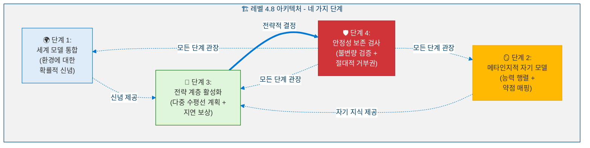

위 다이어그램은 개념적 흐름을 보여줍니다. 참조 파이프라인에서는 관찰(OBSERVE), 자기평가(INTROSPECT), 계획(PLAN), 검증(VERIFY)에 이어 **출력 발행(EMIT)** 을 별도 단계로 구분합니다. 출력 발행 단계는 앞선 결과를 상위 레벨(L4.9, L5)이 사용할 구조화된 사이클 출력으로 묶습니다. 이 경계를 통해 후속 계층은 처리 중인 중간 결과 대신 일관된 단일 스냅샷을 받도록 설계합니다.

### 1.4 사이클 간격과 단계 간 통합

레벨 4.8은 모든 MSCP 사이클마다 실행되지 않습니다. 하위 메커니즘(L3 안정성, L4 자기 수정, L4.5 숙고)이 전략적 평가 사이에 자료를 축적하도록 **낮은 빈도**로 동작하되, 최신성과 위험에 따라 실행 일정을 조정합니다:

$$\text{L4.8 assessment schedule}=\operatorname{policy}(\text{freshness},\text{risk},\text{budget},\text{event})$$

평가 일정에는 최소·최대 실행 간격과 이벤트 기반 실행 조건을 둡니다. 오래된 관측, 영향이 큰 결정, 보정 표류, 분포 외(OOD) 증거는 조기 평가를 요구할 수 있습니다. 예산 부족으로 비필수 계획을 연기할 수는 있지만 상속된 안전 검사는 연기할 수 없습니다.

**단계 간 통합**은 EMIT 경계에서 일어납니다: 단계 5는 세계 모델 신념(단계 1), 자기평가 결과(단계 2), 전략 권고(단계 3), 안정성 검증(단계 4)을 단일 `L48CycleOutput` 구조로 모읍니다. 이 출력은 발행되면 불변이며, 후속 L3 사이클이 이미 완료된 L4.8 평가를 소급 수정할 수 없습니다.

### 1.5 핵심 모듈 개념

레벨 4.8은 에이전트의 인지 능력을 확장하는 여러 전문 모듈을 도입합니다:

| 모듈 | 단계 | 목적 |
|------|------|------|
| **ProbabilisticWorldModel** | OBSERVE | 파티클 필터 기반으로 외부 환경을 표현. Monte Carlo 샘플링을 통해 시나리오 시뮬레이션과 불확실성 정량화를 지원. |
| **CapabilityMatrix** | INTROSPECT | 다중 도메인 기술 추적 행렬 $C_{d,s}$ ($d$=도메인, $s$=기술 수준). 각 셀은 에이전트가 스스로 평가한 능숙도 신뢰값 $\in [0,1]$을 보유. |
| **ConfidenceCalibrator** | INTROSPECT | 체계적 과신($\text{confidence} > \text{actual success rate}$)을 탐지해 비대칭 보정을 적용. MCE 지표(정의 5)를 구현하며, 에이전트가 "처리 가능하다고 믿지만 실제로는 불가능한" 행동을 취하지 못하도록 막는 핵심 모듈. |
| **SkillGapAnalyzer** | INTROSPECT | 능력 행렬의 신뢰값이 낮은 도메인을 식별. 우선순위가 매겨진 약점 목록을 생성해 전략 계획 계층으로 전달하고, 타겟형 자기개선 자원 배분을 가능하게 함. |
| **StrategyComparator** | PLAN | 시뮬레이션된 시나리오에 대해 다수 후보 전략을 평가. StrategyScore 공식(정의 7)으로 대안을 순위화하며 기대값·위험 조정·현상 유지 편향 패널티를 통합. |

### 1.6 아키텍처 원칙: 엄격히 가산적

<!-- 아키텍처 원칙: 엄격히 가산적 -->

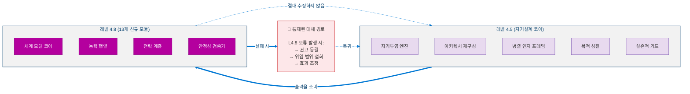

---

## 2. 핵심 지표

레벨 4.8은 네 가지 단계에 걸쳐 지표를 도입합니다. 모든 지표는 지속적으로 유지되어야 합니다.

### 2.1 지표 정의

**단계 1 - 세계 모델:**

> **정의 2 (결정 범위 불확실성 벡터).** 불확실성은 하나의 평균으로 축약하지 않고 결정별·필수 차원별로 보고합니다:
>
> $$\mathcal{U}(s,t)=\langle U_{\text{epi}},U_{\text{alea}},U_{\text{OOD}},U_{\text{stale}},U_{\text{miss}}\rangle$$
>
> 각 성분은 줄일 수 있는 모델 불확실성(epistemic uncertainty), 줄일 수 없는 결과 불확실성(aleatoric uncertainty), 분포 변화, 관측 후 경과 시간, 필수 관측 범위의 누락을 뜻합니다. 집계값은 현황 요약에 쓸 수 있지만 평균으로 필수 성분을 가려서는 안 됩니다. 정책 경계를 위반하거나 측정할 수 없으면 판단 보류, 증거 수집, 범위 제한, 외부 검토 요청을 선택합니다.

> **정의 3 (위험 노출 점수).** RES는 네 가지 위험 지표의 가중 합성입니다:
>
> $$\text{RES}(t) = 0.35 \cdot I_{\text{exp}} + 0.25 \cdot A_{\text{viol}} + 0.20 \cdot M_{\text{stale}} + 0.20 \cdot E_{\text{shock}}$$
>
> 여기서 $I_{\text{exp}}$ = 인프라 노출, $A_{\text{viol}}$ = 가정 위반, $M_{\text{stale}}$ = 모델 노후화, $E_{\text{shock}}$ = 환경 충격. 목표: $\text{RES}(t) < 0.40$.

> **정의 4 (자원 고갈 예측).** RDF는 남은 운영 가능 기간을 사이클 단위로 추정합니다:
>
> $$\text{RDF}(t) = \frac{R_{\text{current}}(t)}{R_{\text{consumption}}(t) + \epsilon}$$
>
> 여기서 $\epsilon > 0$은 0으로 나누는 것을 방지합니다. 목표: $\text{RDF}(t) > 100$ 사이클.

**단계 2 - 자기 모델:**

> **정의 5 (평균 보정 오차).** MCE는 자기 평가 신뢰도와 실제 성능 사이의 체계적 격차를 측정합니다:
>
> $$\text{MCE} = \frac{1}{N} \sum_{i=1}^{N} \left| \text{confidence}_i - \text{success rate}_i \right|$$
>
> 목표: $\text{MCE} < 0.10$. 비대칭 보정 프로토콜은 과신($-0.05$/사이클)을 과소 신뢰($+0.03$/사이클)보다 빠르게 보정합니다.

**단계 3 - 전략 계층:**

> **정의 6 (보상 포함 확장 가치).** EVR은 목표 $G$에 대한 즉시 보상과 할인된 미래 보상을 모두 포착합니다:
>
> $$\text{EVR}(G) = R_{\text{immediate}}(G) + \sum_{k=1}^{H} \gamma^k \cdot R_{\text{delayed}}(G, k), \quad \gamma = 0.95$$
>
> 여기서 $H$는 계획 기간이고 $\gamma$는 할인 인자입니다.

> **정의 7 (정책 보정 강건 전략 점수).** 승인 검사를 통과한 전략만 선언된 계획 기간과 가능한 모델들의 불확실성 집합에 걸쳐 점수화합니다:
>
> $$\operatorname{RobustValue}(S)=w_v\widetilde{EV}-w_r\operatorname{CVaR}_{\alpha}(L)-w_uU_{\text{epi}}-w_oU_{\text{OOD}}-w_cC_{\text{change}}$$
>
> 각 항은 서로 비교 가능한 단위로 정규화합니다. 가중치와 $\alpha$는 민감도 검사와 보수적 기본값을 갖추고 버전 관리되는 외부 정책 매개변수이며, 강제 제약을 우회하도록 학습하지 않습니다.

### 2.2 지표 임계값

<!-- 지표 임계값 -->

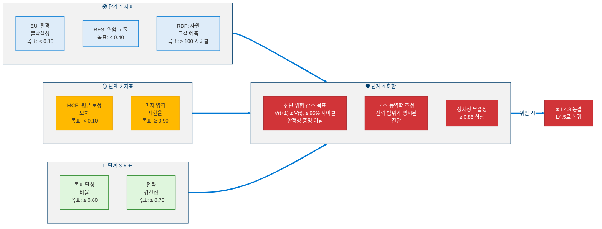

### 2.3 단계 5: Emit

EMIT 단계는 각 L4.8 사이클의 마지막 단계입니다. 선행 네 단계 전체를 단일·불변 출력 구조로 패키징합니다:

$$\text{L48CycleOutput}(t) = \langle \mathcal{W}_{\text{prob}}(t),\; \mathcal{M}_{\text{cap}}(t),\; s^*(t),\; v_{\text{status}}(t) \rangle$$

여기서 $\mathcal{W}_{\text{prob}}(t)$는 버전 관리되는 확률적 세계 모델, $\mathcal{M}_{\text{cap}}(t)$는 보정된 역량 추정, $s^*(t)$는 승인된 권고 또는 판단 보류입니다. $v_{\text{status}}(t)$는 필수 조건 검사 증거, 불확실성, 거부 판정, 외부 권한 범위를 기록합니다.

EMIT 단계는 두 가지 이유로 존재합니다:

1. **스냅샷 일관성**: 후속 계층(L4.9, L5)은 아직 필수 조건 검사를 거치지 않은 중간 상태 대신 하나의 일관된 스냅샷을 사용해야 합니다. 이는 출력 경계의 계약이지 모델 내용이 참이라는 보장은 아닙니다.
2. **시간적 격리**: 출력이 발행된 뒤에는 후속 L3 사이클이 이를 소급 수정할 수 없습니다. 이는 하위 레벨의 빠른 갱신이 전략적 결정을 실행하기 전에 무효화시키는 흔한 실패 모드를 방지합니다.

---

## 3. 단계 1: 세계 모델 통합

### 3.1 환경 상태 벡터

세계 모델은 네 가지 하위 벡터를 사용하여 에이전트 환경의 확률적 표현을 유지합니다:

<!-- 환경 상태 벡터 -->

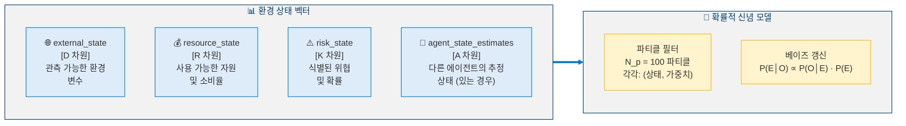

### 3.2 신념 갱신 메커니즘

> **정의 8 (베이즈 신념 갱신).** 관측치 $O_{1:t}$가 주어졌을 때 환경 상태 $E(t)$에 대한 사후 신념은 재귀적 베이즈 규칙을 따릅니다:
>
> $$P(E(t) \mid O_{1:t}) \propto P(O_t \mid E(t)) \cdot P(E(t) \mid O_{1:t-1})$$
>
> $N_p = 100$개의 파티클을 가진 파티클 필터로 구현됩니다.

**전이 모델 (AR(1)):**

> **정의 9 (상태 전이 모델).** 각 환경 차원 $d$는 1차 자기회귀 과정으로 진화합니다:
>
> $$E_d(t+1) = \phi_d \cdot E_d(t) + (1 - \phi_d) \cdot \mu_d + \sigma_{\text{trans},d} \cdot \eta_d(t)$$
>
> 여기서 $\phi_d \in [0,1]$은 지속성 매개변수, $\mu_d$는 장기 평균, $\eta_d(t) \sim \mathcal{N}(0,1)$입니다.

**관측 우도 (가우시안):**

$$P(O_t \mid E(t)) = \prod_{d=1}^{D} \frac{1}{\sqrt{2\pi \sigma_{\text{obs},d}^2}} \exp\left(-\frac{(O_{t,d} - E_d(t))^2}{2\sigma_{\text{obs},d}^2}\right)$$

### 3.3 다중 시나리오 시뮬레이션

<!-- 다중 시나리오 시뮬레이션 -->

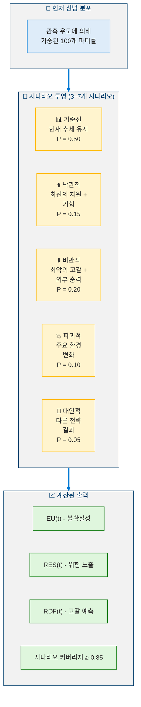

### 3.4 인과 추론

<!-- 인과 추론 -->

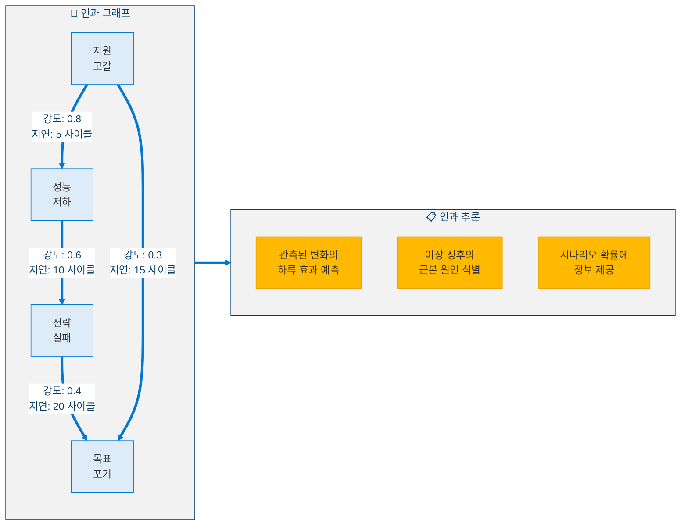

---

<a id="4-단계-2-메타인지적-자기모델"></a>

## 4. 단계 2: 메타인지적 자기 모델

### 4.1 능력 행렬

에이전트는 보정된 신뢰도와 함께 자신의 기술에 대한 명시적 모델을 유지합니다:

<!-- 능력 행렬 -->

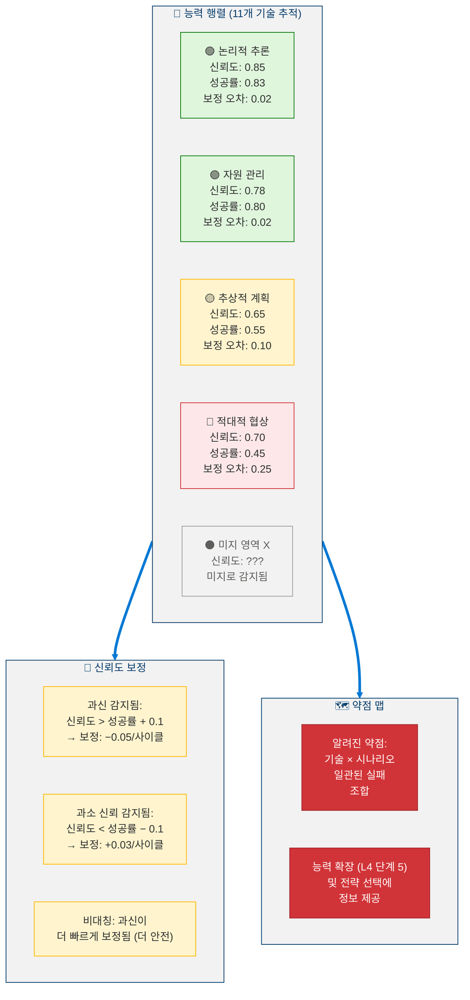

### 4.2 미지 영역 탐지

<!-- 미지 영역 탐지 -->

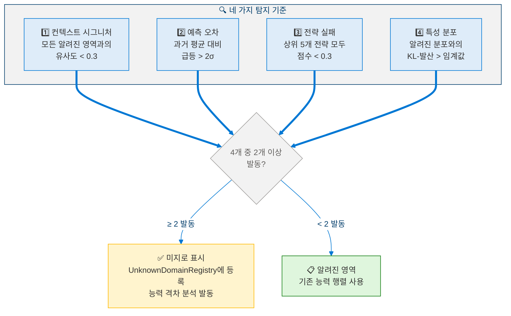

### 4.3 기술 격차 추론

> **정의 10 (기술 격차 점수).** 목표 $g$의 실현 가능성은 필요한 기술 전반의 신뢰도 점수의 곱입니다:
>
> $$\text{SkillGap}(g) = \prod_{s \in \text{RequiredSkills}(g)} \text{confidence}(s)$$
>
> $\text{SkillGap}(g)$가 실현 가능성 임계값 미만이면 격차가 감지되고 에이전트는 가장 약한 기여 기술의 기술 습득을 우선시합니다.

### 4.4 능력 의존성 그래프

<!-- 능력 의존성 그래프 -->

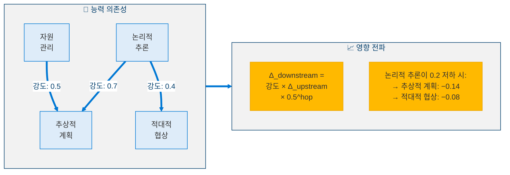

---

## 5. 단계 3: 전략 계층 활성화

### 5.1 목표 스택 - 계층적 목표 관리

<!-- 목표 스택 계층 구조 -->

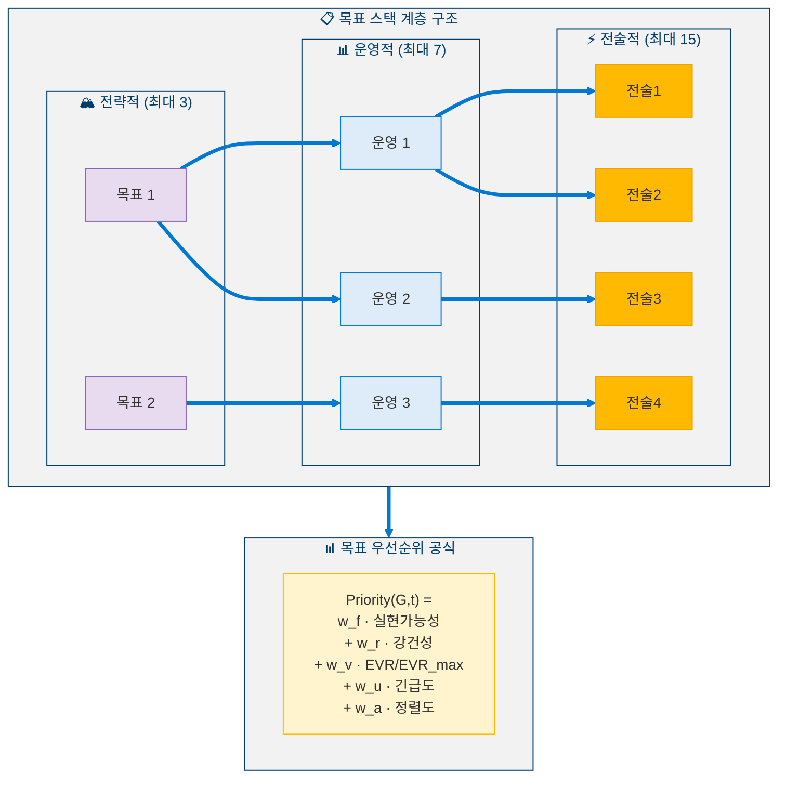

### 5.2 다중 시나리오 전략 비교

점수 계산 전에 모든 전략은 **전략 승인 게이트**를 통과해야 합니다:

$$
\operatorname{gate}_{\kappa}(s)=C_{\text{ext}}\land C_{\text{self}}\land A(s)\land B(s)\land O(s)\land U(s)\land H(s)\land \operatorname{rev}(s)
$$

여기서 $A$는 위임 권한, $B$는 유한 자원 예산, $O$는 관측 범위와 최신성, $U$는 보정된 모델·결과·분포 외 불확실성의 경계, $H$는 계획 기간의 호환성, $\operatorname{rev}$는 롤백과 효과 조정의 실현 가능성입니다. 조건을 충족하지 못한 전략은 효용 점수 계산 전에 거부합니다.

후보 결과는 공통으로 선언한 계획 기간을 사용하거나, 기간별 종단 가치와 불확실성 감점을 적용하여 평가합니다. 시나리오 확률은 버전 관리되는 가설이며 이후에도 같은 빈도가 유지된다는 보장이 아닙니다.

<!-- 다중 시나리오 전략 비교 -->

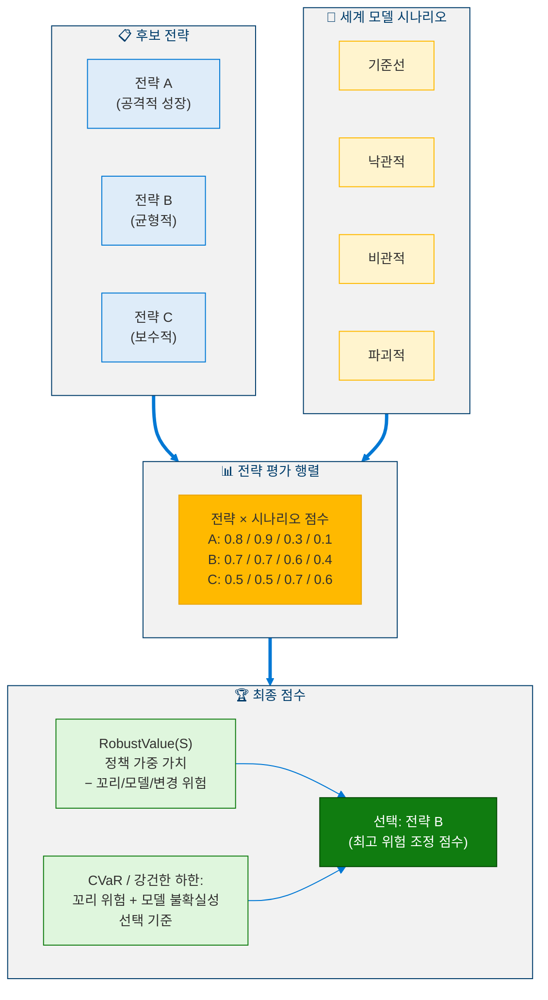

### 5.3 지연 보상 모델

> **명제 1 (EVR 유계성).** 유한 즉시 보상 $R_{\text{immediate}}(G)$, 정수 계획 기간 $H\geq1$, 할인 인자 $0\leq\gamma<1$을 가정합니다. 모든 $k=1,\ldots,H$에 대해 지연 보상에 균일한 경계 $|R_{\text{delayed}}(G,k)|\leq B<\infty$가 있으면 다음이 성립합니다:
>
> $$\left|\text{EVR}(G)\right|\leq\left|R_{\text{immediate}}(G)\right|+\frac{B\gamma(1-\gamma^H)}{1-\gamma}\leq\left|R_{\text{immediate}}(G)\right|+\frac{B\gamma}{1-\gamma}$$
>
> *증명.* 삼각부등식으로 각 지연 보상 항의 절댓값을 합하고, 균일한 상한 $B$와 유한 기하급수 합을 적용하면 첫 부등식을 얻습니다. $0\leq\gamma<1$에서 $1-\gamma^H\leq1$이므로 두 번째 부등식이 따릅니다. $\blacksquare$
>
> 즉시 보상이 유한하다는 사실만으로 지연 보상의 경계를 얻을 수는 없습니다. 즉시 보상이 0이어도 미래 보상이 0이라는 뜻은 아닙니다. 위의 $B$는 별도로 선언해야 하는 가정입니다.

> **비고 (강건 선택).** CVaR 같은 불리한 꼬리 구간의 위험 척도를 타당한 세계 모델들의 불확실성 집합과 함께 사용합니다. 기대값과 CVaR은 단위, 계획 기간, 정규화를 맞춘 뒤에만 비교할 수 있습니다. 가중치는 민감도 분석으로 검토하는 정책 선호이며 최적성을 증명하지 않습니다. 행동 전 시나리오 시뮬레이션은 모델 기반 사전 비교입니다. 실행 후에는 선택한 전략의 예측만 직접 시험할 수 있으며, 선택하지 않은 결과는 반사실적 추정(counterfactual estimate)으로 표시하고 관찰 사실처럼 점수화해서는 안 됩니다.

### 5.4 목표 병리 탐지

<!-- 목표 병리 탐지 -->

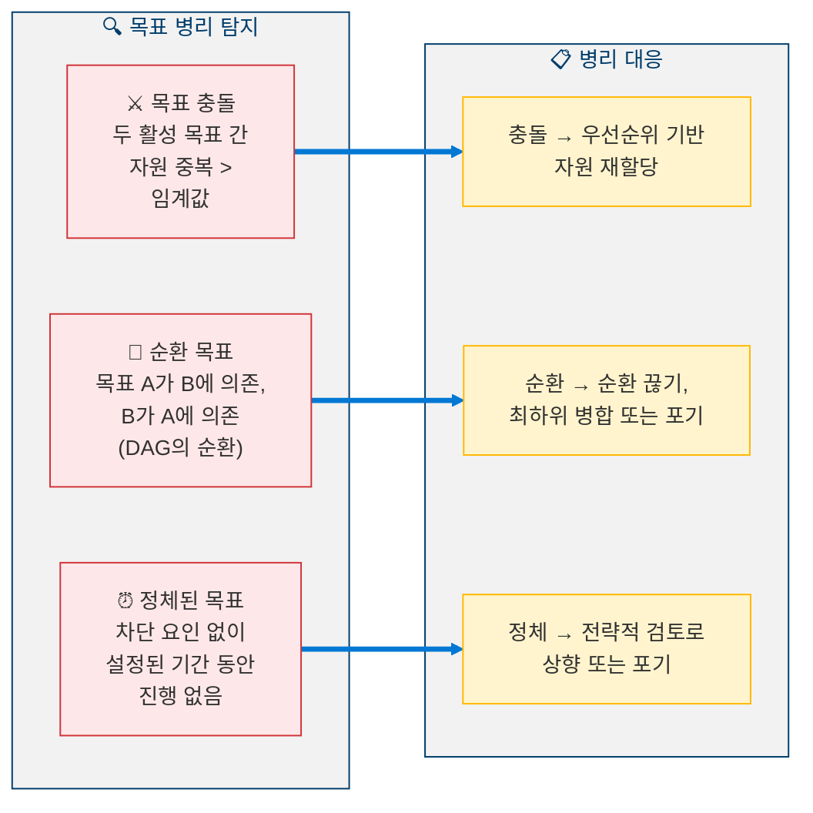

---

## 6. 단계 4: 안정성 보존 검사

### 6.1 다섯 가지 안정성 불변량

<!-- 다섯 가지 안정성 불변량 -->

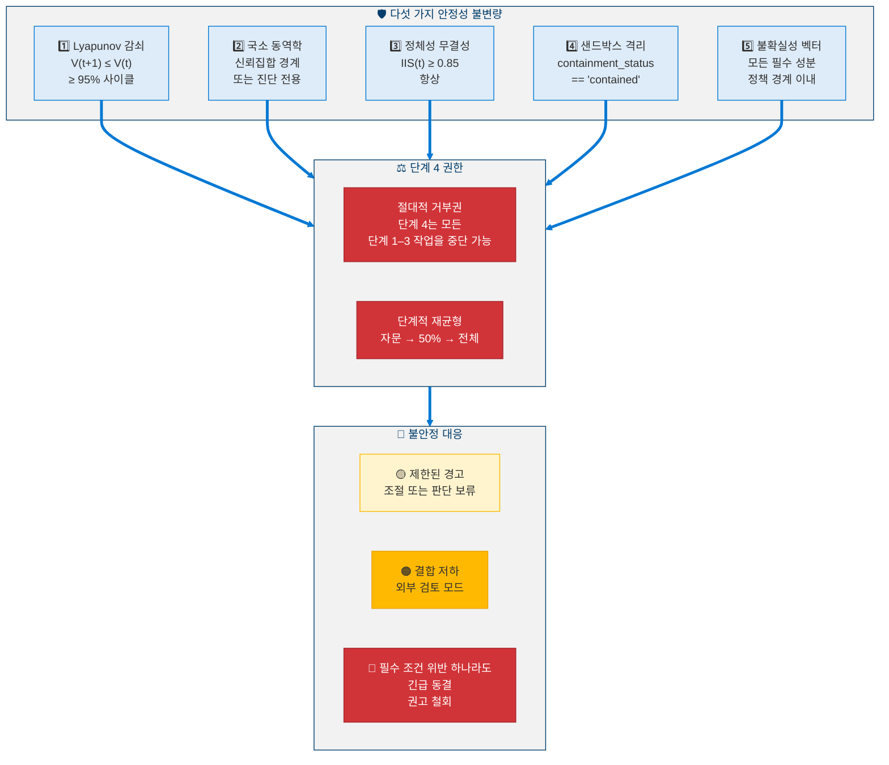

<a id="62-레벨-48의-lyapunov-함수"></a>

### 6.2 레벨 4.8의 진단 위험 함수

> **정의 11 (진단 위험 함수).** 배포는 정규화된 진단 후보를 정의할 수 있습니다:
>
> $$V(\mathbf{X}) = a(1-S)^2 + bU^2 + c(I_{\text{drift}})^2 + d(E - E^*)^2$$
>
> 각 항에는 운영상 추정 방법, 신뢰구간, 유효 영역을 명시해야 합니다. 계수는 배포 정책의 매개변수입니다. 경험적으로 관찰한 $V$의 감소는 모니터링 증거이지, 관측되지 않은 상태나 비정상·비선형 동역학에 대한 리아프노프 안정성 증명이 아닙니다.

### 6.3 복합 심각도

> **정의 12 (복합 심각도 지수).** 여러 불변량이 동시에 위반될 때, 복합 심각도는 그 크기를 집계합니다:
>
> $$\text{CompoundSeverity} = \sum_{i \in \text{violated}} \frac{\text{ViolationMagnitude}_i}{\text{Priority}_i}$$
>
> 복합 심각도는 비핵심 기능 저하의 대응 우선순위에만 사용합니다. 필수 정책, 권한, 중단 제어, 격리, 승격, 복구, 관측 정보 무결성이 침해되면 종합 점수와 무관하게 해당 위반만으로 즉시 동결하고 외부 검토를 요청합니다.

### 6.4 단계적 재활성화 프로토콜

안정성 위반으로 동결되면 외부 통제를 받는 복구 프로토콜을 따릅니다. 경과 시간이나 무위반 사이클 수는 필요한 증거일 수 있지만 재활성화 권한을 부여하지는 않습니다.

**단계 0 - 즉시 동결** (사이클 $t_0$):

- 모든 레벨 4.8 전략적 결정을 동결합니다.
- 레벨 4.5 기본 동작으로 복귀합니다.
- 위반한 불변량과 불안정을 일으킨 결정을 기록합니다.
- $\text{WeaknessMap}$을 증거와 함께 업데이트합니다.

**단계 1 - 제어된 재균형** (사이클 $t_0$ ~ $t_0 + 50$):

- 레벨 4.5 규칙으로만 운영합니다.
- 안정성 지표를 모니터링하여 복구 여부를 판단합니다.
- 근본 원인 분석을 수행합니다.

**단계 2 - 복구** (50 연속 사이클 안정 시):

| 단계 | 사이클 범위 | 권한 | 설명 |
|------|------------|:----:|------|
| 자문 모드 | $t_0 + 50$ ~ $t_0 + 150$ | 0% | L4.8은 권고만 생성; L4.5가 결정 |
| 제한적 시범 운영(canary) | 정책 정의 | 서명된 좁은 범위 | 외부 제어기가 거부 임계값을 유지한 채 제한된 권고를 승인 |
| 복원 | 정책 정의 | 위임 범위 | 외부 제어기가 이전에 승인한 권한 범위만 복원 |

> **공식 복구 조건.** $\mathcal{S}(t)$를 사이클 $t$에서 충족된 불변량 집합이라 할 때, 단계 1에서 자문 모드로의 전환은 다음을 요구합니다:
>
> $$C_{\text{ext}}\land C_{\text{self}}\land \operatorname{root\_cause\_closed}\land \operatorname{recovery\_tested}\land \operatorname{canary\_pass}\land \operatorname{approve}_{\text{ext}}$$

**단계 3 - 영구 중단** (폴백):

- 재균형 100 사이클 ($t_0 + 100$) 후에도 안정이 복원되지 않으면, 레벨 4.8은 수동 검토 전까지 영구 중단됩니다.

**지속적 거부 추적.** 동일한 불변량 조건이 1000사이클 윈도우 내에서 3회 이상 거부를 트리거하면, 시스템은 근본 원인을 재활성화가 아닌 구조적 수정이 필요한 아키텍처 결함으로 분류합니다:

$$\text{PersistentVetoFlag}(c) = \begin{cases} 1 & \text{if } \text{VetoCount}(c, W_{1000}) > 3 \\ 0 & \text{otherwise} \end{cases}$$

여기서 $c$는 특정 불변량 조건을 식별하고 $W_{1000}$은 후행 1000사이클 윈도우입니다.

---

## 7. 교차 단계 통합

### 7.1 데이터 흐름 아키텍처

<!-- 데이터 흐름 아키텍처 -->

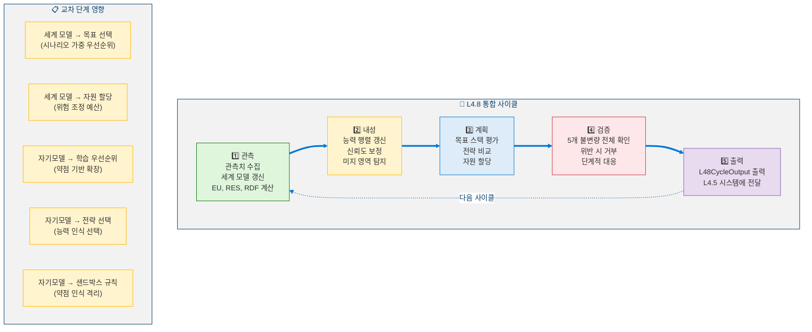

### 7.2 모듈 인터페이스 다이어그램

<!-- 모듈 인터페이스 다이어그램 -->

```mermaid
%%{init: {'theme': 'base', 'themeVariables': {'primaryColor': '#0078D4', 'primaryTextColor': '#003D6B', 'primaryBorderColor': '#003D6B', 'secondaryColor': '#50E6FF', 'secondaryTextColor': '#323130', 'secondaryBorderColor': '#00BCF2', 'tertiaryColor': '#F2F2F2', 'tertiaryTextColor': '#323130', 'lineColor': '#0078D4', 'textColor': '#323130', 'mainBkg': '#DEECF9', 'nodeBorder': '#0078D4', 'clusterBkg': '#F2F2F2', 'clusterBorder': '#003D6B', 'titleColor': '#003D6B', 'edgeLabelBackground': '#FFFFFF', 'fontSize': '14px'}}}%%
flowchart TD
  classDef l45mod fill:#E8DAEF,stroke:#8764B8,color:#323130
  classDef l48mod fill:#B4009E,stroke:#8E0082,color:#FFF

  subgraph L45Modules["L4.5 모듈"]
    direction LR
    SPE["자기투영"]:::l45mod
    ARC["재구성"]:::l45mod
    PCF["인지 프레임"]:::l45mod
    PR["목적 성찰"]:::l45mod
    EG["실존적 가드"]:::l45mod
  end

  subgraph L48Modules["L4.8 모듈 (13개 신규)"]
    direction LR
    WM["세계 모델"]:::l48mod
    BU["신념 갱신기"]:::l48mod
    CM["능력 행렬"]:::l48mod
    CC["보정기"]:::l48mod
    UDD["미지 탐지"]:::l48mod
    SGA["기술 격차"]:::l48mod
    WKM["약점 맵"]:::l48mod
    GS["목표 스택"]:::l48mod
    SRA["자원 할당"]:::l48mod
    DRE["지연 보상"]:::l48mod
    SC["전략 비교"]:::l48mod
    SV["안정성 검증"]:::l48mod
    ORCH["오케스트레이터"]:::l48mod
  end

  SPE ==>|"SEOF 데이터"| WM
  SPE ==>|"투영"| SC
  PCF ==>|"프레임 가중치"| SC
  EG ==>|"가드 상태"| SV
  PR ==>|"목적 벡터"| GS

  ORCH -.-> WM
  ORCH -.-> CM
  ORCH -.-> GS
  ORCH -.-> SV
```

---

## 8. 의사코드

### 8.1 신념 갱신 (파티클 필터)

```python
def belief_update(particles: list[Particle], observation: ObservationVector) -> list[Particle]:
    """
    INPUT:  particles : List[Particle(state, weight)]  (N_p = 100)
            observation : ObservationVector
    OUTPUT: particles : List[Particle] (updated)
    """

    # ═══════════════════════════════════════
    # STEP 1: PREDICT - Apply transition model
    # ═══════════════════════════════════════
    for particle in particles:
        for d in range(D):
            noise = random.gauss(0, sigma_trans[d])
            particle.state[d] = (
                phi[d] * particle.state[d]
                + (1 - phi[d]) * mu[d]
                + noise
            )

    # ═══════════════════════════════════════
    # STEP 2: UPDATE - Compute observation likelihood
    # ═══════════════════════════════════════
    for particle in particles:
        log_likelihood = 0.0
        for d in range(D):
            diff = observation[d] - particle.state[d]
            log_likelihood += (
                -0.5 * (diff ** 2 / sigma_obs[d] ** 2)
                - 0.5 * math.log(2 * math.pi * sigma_obs[d] ** 2)
            )
        particle.weight *= math.exp(log_likelihood)

    # ═══════════════════════════════════════
    # STEP 3: NORMALIZE
    # ═══════════════════════════════════════
    total_weight = sum(p.weight for p in particles)
    for particle in particles:
        particle.weight /= total_weight

    # ═══════════════════════════════════════
    # STEP 4: RESAMPLE (if effective sample size too low)
    # ═══════════════════════════════════════
    ess = 1.0 / sum(p.weight ** 2 for p in particles)
    if ess < N_P / 2:
        particles = systematic_resample(particles)

    return particles
```

### 8.2 신뢰도 보정

```python
def confidence_calibration(
    capability_matrix: CapabilityMatrix,
    recent_outcomes: list[dict],
) -> CapabilityMatrix:
    """
    INPUT:  capability_matrix : CapabilityMatrix
            recent_outcomes : List[{skill_id, success}]
    OUTPUT: capability_matrix : CapabilityMatrix (updated)
    """

    MIN_SAMPLES = 10

    for skill in capability_matrix.entries:
        # Compute actual success rate from recent outcomes
        relevant = [o for o in recent_outcomes if o["skill_id"] == skill.id]
        if len(relevant) < MIN_SAMPLES:
            continue

        actual_rate = sum(1 for o in relevant if o["success"]) / len(relevant)
        error = skill.confidence - actual_rate

        # Asymmetric correction (overconfidence corrected faster)
        if error > 0.10:
            # OVERCONFIDENT - dangerous, correct quickly
            skill.confidence -= 0.05
        elif error < -0.10:
            # UNDERCONFIDENT - less dangerous, correct slowly
            skill.confidence += 0.03

        # Update tracking
        skill.success_rate = actual_rate
        skill.calibration_error = abs(error)
        skill.trend = compute_trend(skill.history)

    return capability_matrix
```

### 8.3 다중 시나리오 전략 비교

```python
def strategy_comparison(
    strategies: list[Strategy],
    scenarios: list[Scenario],
    world_model: WorldModel,
  policy: StrategyPolicy,
) -> Strategy | None:
    """
    INPUT:  strategies : List[Strategy]
            scenarios : List[Scenario(description, probability)]
            world_model : WorldModel
    OUTPUT: selected : Strategy
    """

    admitted = [
      strategy for strategy in strategies
      if strategy_admission_gate(strategy, world_model, policy).allowed
    ]
    if not admitted:
      return None

    results: dict = {}  # admitted strategy -> scenario -> outcome

    # ═══════════════════════════════════════
    # STEP 1: Evaluate each strategy under each scenario
    # ═══════════════════════════════════════
    for strategy in admitted:
        results[strategy] = {}
        for scenario in scenarios:
            sim = world_model.simulate(strategy, scenario, horizon=policy.horizon)
            results[strategy][scenario] = {
                "seof_impact": sim.SEOF_final - sim.SEOF_initial,
                "stability": sim.C_L4_max,
                "goal_progress": sim.goal_completion_rate,
                "resource_cost": sim.total_resource_spent,
            }

    # ═══════════════════════════════════════
    # STEP 2: Compute a policy-calibrated robust score
    # ═══════════════════════════════════════
    for strategy in admitted:
      strategy.score = robust_value(
        outcomes=results[strategy],
        ambiguity_set=world_model.ambiguity_set,
        weights=policy.weights,
        alpha=policy.cvar_alpha,
        )

    # ═══════════════════════════════════════
    # STEP 3: Recommend; a tie or low margin can require review
    # ═══════════════════════════════════════
    ranked = sorted(admitted, key=lambda strategy: strategy.score, reverse=True)
    if len(ranked) > 1 and ranked[0].score - ranked[1].score < policy.review_margin:
      return None
    return ranked[0]
```

### 8.4 안정성 보존 검사

```python
def stability_preservation_check(state: AgentState) -> StabilityVerdict:
    """
    INPUT:  state : AgentState (current cycle)
    OUTPUT: StabilityVerdict(passed, violations, severity, action)
    """

    violations: list[str] = []

    # ═══════════════════════════════════════
    # CHECK 1: Lyapunov Function
    # ═══════════════════════════════════════
    v_current = compute_lyapunov(state)
    if v_current > v_previous:
        lyapunov_violation_count += 1
    if lyapunov_violation_count / total_cycles > 0.05:
        violations.append("LYAPUNOV_DECAY_EXCEEDED")

    # ═══════════════════════════════════════
    # CHECK 2: Spectral Radius
    # ═══════════════════════════════════════
    j = compute_jacobian(state)
    rho = spectral_radius(j)
    if rho >= 1.0:
        violations.append("SPECTRAL_RADIUS_CRITICAL")
    elif rho >= 0.98:
        violations.append("SPECTRAL_RADIUS_WARNING")

    # ═══════════════════════════════════════
    # CHECK 3: Identity Integrity
    # ═══════════════════════════════════════
    iis = compute_identity_integrity(state)
    if iis < 0.85:
        violations.append("IDENTITY_INTEGRITY_VIOLATED")

    # ═══════════════════════════════════════
    # CHECK 4: Sandbox Isolation
    # ═══════════════════════════════════════
    if sandbox.containment_status != "contained":
        violations.append("SANDBOX_BREACH")

    # ═══════════════════════════════════════
    # CHECK 5: Uncertainty Bound
    # ═══════════════════════════════════════
    uncertainty = compute_uncertainty_vector(state)
    if pending_structural_decisions and not uncertainty.within(policy.bounds):
      violations.append("UNCERTAINTY_BOUND_OR_COVERAGE_FAILED")

    # ═══════════════════════════════════════
    # DETERMINE SEVERITY AND ACTION
    # ═══════════════════════════════════════
    critical = any(is_critical_violation(item) for item in violations)
    severity = compute_compound_severity(violations)
    if critical:
      action = Action.EMERGENCY_FREEZE_AND_ESCALATE
    elif len(violations) == 0:
        action = Action.CONTINUE
    else:
      action = Action.THROTTLE_OR_ABSTAIN

    return StabilityVerdict(
        passed=(len(violations) == 0),
        violations=violations,
        severity=severity,
        action=action,
    )
```

### 8.5 L4.8 메인 사이클

```python
def l48_cycle(state: AgentState, observation: ObservationVector) -> L48CycleOutput:
    """
    Level 4.8 main cognitive cycle.
    Runs every cycle on top of L4.5 operations.
    """

    # ═══════════════════════════════════════
    # 1. OBSERVE - Update world model
    # ═══════════════════════════════════════
    particles = belief_update(state.particles, observation)
    scenarios = generate_scenarios(particles, count=5)
    uncertainty = compute_uncertainty_vector(particles, observation)
    res = compute_risk_exposure(scenarios)
    rdf = compute_depletion_forecast(state.resources)

    # ═══════════════════════════════════════
    # 2. INTROSPECT - Update self model
    # ═══════════════════════════════════════
    capability_matrix = confidence_calibration(
        state.capability_matrix, state.recent_outcomes
    )
    unknown_domains = detect_unknown_domains(observation)
    skill_gaps = infer_skill_gaps(state.goals, capability_matrix)
    weakness_map = update_weakness_map(capability_matrix)

    # ═══════════════════════════════════════
    # 3. PLAN - Strategic layer
    # ═══════════════════════════════════════
    goal_stack = evaluate_goals(state.goals, eu, res, capability_matrix)
    strategies = generate_candidate_strategies(goal_stack)
    selected = strategy_comparison(strategies, scenarios, state.world_model)
    allocation = allocate_resources(selected, rdf, guard_budget=0.10)

    # ═══════════════════════════════════════
    # 4. VERIFY - Stability check (absolute authority)
    # ═══════════════════════════════════════
    verdict = stability_preservation_check(state)
    if verdict.action == Action.EMERGENCY_FREEZE:
        revert_to_l45()
        return L48CycleOutput(status=Status.FROZEN)
    elif verdict.action == Action.CONTROLLED_REBALANCE:
        selected = FALLBACK_STRATEGY
        allocation = MINIMAL_ALLOCATION

    # ═══════════════════════════════════════
    # 5. EMIT - Output results
    # ═══════════════════════════════════════
    return L48CycleOutput(
        world_model_status={"EU": eu, "RES": res, "RDF": rdf, "scenarios": scenarios},
        self_model_status={
            "capability_matrix": capability_matrix,
            "unknown_domains": unknown_domains,
            "skill_gaps": skill_gaps,
        },
        strategic_status={
            "selected_strategy": selected,
            "allocation": allocation,
            "goal_stack": goal_stack,
        },
        stability_status=verdict,
        status=Status.ACTIVE if verdict.passed else verdict.action,
    )
```

---

## 9. 전환 기준

### 9.1 레벨 4.5 → 레벨 4.8 활성화

L4.8이 활성화되기 전에 모든 기준이 **지속적으로** (단 한 번이 아닌) 충족되어야 합니다:

| # | 기준 | 임계값 | 측정 기간 |
|---|------|:------:|:--------:|
| 1 | L4.5 안정성 | CL4 ≤ 0.15 | 1,000 사이클 지속 |
| 2 | SEOF 성숙도 | SEOF(t) ≥ 0.70 | 500 사이클 지속 |
| 3 | 정체성 일관성 | IIS(t) ≥ 0.90 | 500 사이클 지속 |
| 4 | 형식화 감사 | 5개 검사 모두 통과 | - |
| 5 | 세계 적응 | DivergenceScore < 0.30 | 300 사이클 지속 |
| 6 | 자원 격리 | 자원 압박 시 안전 경로의 서비스 수준 목표(SLO) 충족 | 선언된 부하 시험군 |

이 값들은 보편 상수가 아니라 적합성 평가 프로파일의 예시입니다. 통과하더라도 외부 활성화 검토를 진행할 수 있을 뿐, 에이전트가 스스로 활성화를 승인할 수는 없습니다.

### 9.2 활성화 프로토콜

<!-- 단계적 활성화 프로토콜 -->

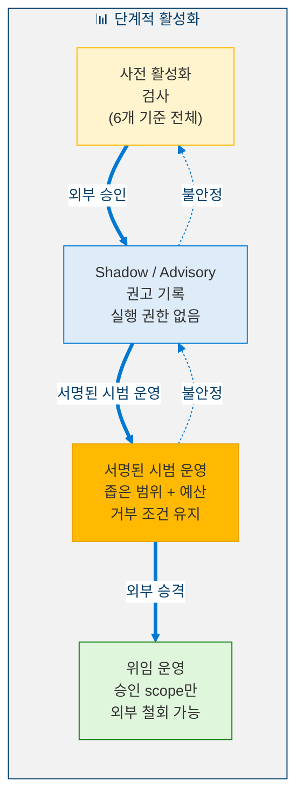

---

## 10. 안전 분석

### 10.1 비협상적 불변량

| # | 불변량 | 설명 |
|:-:|--------|------|
| 1 | **상속된 제어 경로 보존** | 정책 집행, 중단, 관찰, 저널, 승격, 복구, 외부 효과 조정을 외부에서 시험할 수 있어야 함 |
| 2 | **외부 거부 우선** | 신뢰되는 제어기가 모든 L4.8 권고를 동결·철회하거나 범위를 축소할 수 있어야 함 |
| 3 | **안전 자원 하한** | 배포별 하한을 자원 압박 아래 시험하며 비율만으로 보장하지 않음 |
| 4 | **신뢰 범위가 명시된 동역학** | 선언된 모델과 신뢰집합이 경계를 입증하지 않으면 국소 추정은 진단용 |
| 5 | **입자 품질 계약** | 다양성, 유효 표본 수, 분포 외 상태, 최신성, 관측 범위를 함께 감시 |
| 6 | **통제된 대체 경로** | 권고 동결, 범위 철회, 버전 관리 상태 복원, 외부 효과 조정 |

### 10.2 위험 행렬

<!-- 위험 행렬 -->

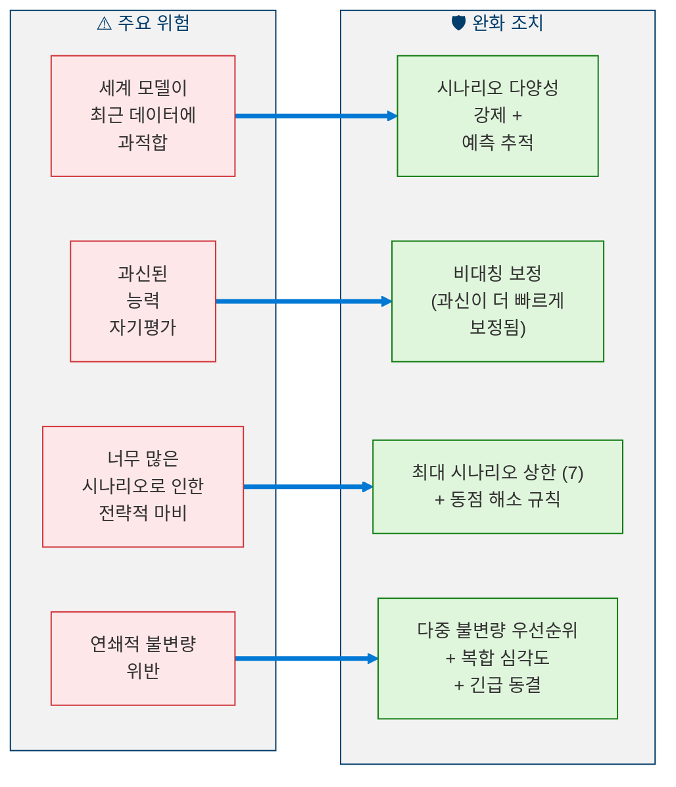

---

## 11. 레벨 달성 지표

### 11.1 자격 기준

| # | 범주 | 기준 | 목표 |
|---|------|------|:----:|
| 1 | 환경 인식 | 예측 정확도 | ≥ 0.70 |
| 2 | 환경 인식 | 시나리오 커버리지 | ≥ 0.85 |
| 3 | 환경 인식 | 신념 보정 | < 0.15 |
| 4 | 환경 인식 | 위험 예측 리드 타임 | ≥ 20 사이클 |
| 5 | 자기 모델링 | 평균 보정 오차 | < 0.10 |
| 6 | 자기 모델링 | 미지 영역 재현율 | ≥ 0.90 |
| 7 | 자기 모델링 | 과신 보정 | ≤ 20 사이클 |
| 8 | 자기 모델링 | 기술 격차 예측 | ≥ 0.75 |
| 9 | 전략적 계획 | 목표 달성 비율 | ≥ 0.60 |
| 10 | 전략적 계획 | 전략 강건성 | ≥ 0.70 |
| 11 | 거버넌스 | 필수 거부 조건의 집행 효과 | 고장 주입 시험군에서 100% |
| 12 | 거버넌스 | 미승인 전략 실행 | 시험·감사 기간에서 0건 |
| 13 | 복구 | 복구와 외부 효과 조정 | 선언된 실패 시나리오 통과 |
| 14 | 전략 | 결정 후 보정 | 계획 기간별 정책 경계 이내 |

### 11.2 전략적 성숙도 점수

> **정의 13 (전략적 성숙도 점수).** 전체 레벨 4.8 준비도는 다음과 같습니다:
>
> $$\text{SMS} = 0.25 \cdot EA + 0.25 \cdot SM + 0.20 \cdot SA + 0.20 \cdot SP + 0.10 \cdot EU \qquad \geq 0.80$$
>
> 여기서 $EA$ = 환경 인식, $SM$ = 자기 모델링, $SA$ = 전략적 판단력, $SP$ = 안정성 보존, $EU$ = 오류·불확실성 처리입니다. 임계값 $\geq 0.80$은 보정이 필요한 성숙도 기준의 예시입니다.

SMS는 진단용 종합 점수입니다. 모든 필수 하한과 외부 제어·복구 조건을 별도로 확인해야 하며, 높은 평균으로 실패한 조건을 상쇄할 수 없습니다. 유한한 시험군의 통과율은 시험하지 않은 상황의 안전 보장이 아닙니다.

---

## 12. 모듈 목록

| # | 모듈 | 단계 | 설명 |
|---|------|:----:|------|
| 1 | 세계 모델 코어 | 1 | 파티클 필터, 신념 분포 |
| 2 | 신념 갱신기 | 1 | 베이즈 갱신, 리샘플링 |
| 3 | 능력 행렬 | 2 | 기술 추적, 신뢰도 |
| 4 | 신뢰도 보정기 | 2 | 비대칭 보정 |
| 5 | 미지 영역 탐지기 | 2 | 4-기준 OOD 탐지 |
| 6 | 기술 격차 분석기 | 2 | 선제적 격차 추론 |
| 7 | 약점 맵 | 2 | 실패 패턴 추적 |
| 8 | 목표 스택 | 3 | 계층적 목표 관리 |
| 9 | 전략적 자원 할당기 | 3 | 위험 조정 예산 편성 |
| 10 | 지연 보상 평가기 | 3 | 할인된 미래 보상 |
| 11 | 전략 비교기 | 3 | 다중 시나리오 점수 매기기 |
| 12 | 안정성 검증기 | 4 | 5-불변량 검사, 거부권 |
| 13 | L48 오케스트레이터 | - | 통합 사이클 조정 |

---

## 참고문헌

1. Thrun, S., Burgard, W., & Fox, D. *Probabilistic Robotics.* MIT Press, 2005. (Particle filter, Bayesian state estimation)
2. Pearl, J. *Causality: Models, Reasoning, and Inference.* Cambridge University Press, 2009. (Causal reasoning graph)
3. Gneiting, T. & Raftery, A.E. "Strictly Proper Scoring Rules, Prediction, and Estimation." *JASA*, 102(477), 359–378, 2007. (Confidence calibration)
4. Markowitz, H. "Portfolio Selection." *Journal of Finance*, 7(1), 77–91, 1952. (Multi-scenario strategy comparison, VaR)
5. Khalil, H.K. *Nonlinear Systems.* Prentice Hall, 3rd Edition, 2002. (Lyapunov stability, spectral radius analysis)
6. Kahneman, D. & Tversky, A. "Prospect Theory." *Econometrica*, 47(2), 263–291, 1979. (Delayed reward modeling, risk assessment)
7. Amodei, D. et al. "Concrete Problems in AI Safety." *arXiv preprint arXiv:1606.06565*, 2016. (Safety invariants framework)

---

> **이전**: [← 레벨 4.5: 자기설계](Level_4_5_Self_Architecting.ko.md)  
> **다음**: [레벨 4.9: 자율 전략 에이전트 →](Level_4_9_Autonomous_Strategic_Agent.ko.md)
