<!--
Copyright (c) 2026 Moon Hyuk Choi
Licensed under the MIT License.
See LICENSE file in the repository root for full license information.

Redistribution (commercial or non-commercial) must retain this notice.
Removal of attribution constitutes a license violation.
-->
# 레벨 4.9: 자율 전략 에이전트 - 아키텍처 및 설계

> **MSCP 레벨 시리즈** | [레벨 4.8](Level_4_8_Strategic_Self_Modeling.ko.md) ← 레벨 4.9 → [레벨 5](Level_5_Proto_AGI.ko.md)  
> **상태**: 🔬 **연구 단계** - 이 레벨은 개념적 연구 설계입니다. 구현 여부와 별개로 레벨 적합성과 실서비스 안전성을 판단하려면 독립적인 검증이 필요합니다.
> **초안 작성**: 2026년 2월 | **최종 수정**: 2026-11-03

> **공개 문서 범위**: 최소 자기의식 프로토콜(MSCP)의 아키텍처 연구를 설명합니다. 수치 임계값은 예시이며 적용 환경별 보정이 필요합니다. 코드의 존재나 개별 실험 결과만으로 독립적으로 검증된 레벨 적합성이 성립하지 않으며, 구조적 자기인식은 주관적 의식을 뜻하지 않습니다.

<a id="revision-history"></a>

## 수정 이력

| 버전 | 날짜 | 변경 사항 |
|---------|------|-------------|
| 0.1.0 | 2026-02-23 | Initial document creation with formal Definitions 1-11, Proposition 1 |
| 0.2.0 | 2026-02-26 | Added overview essence formula; added revision history table |
| 0.4.0 | 2026-03-08 | Fixed duplicate section numbering (1.2 to 1.3); added formal cascade propagation Definition 13 (Section 5.1) |
| 0.6.0 | 2026-06-14 | Mermaid 라벨 `레벨 4.8 (13개 모듈)` / `L4.8 아키텍처 (13개 모듈)`을 `레벨 4.8 (전략적 자기모델)` / `L4.8 아키텍처 (전략적 자기모델)`로 추상화 |
| 0.7.0 | 2026-07-21 | Added external authority envelope, delegation modes, shutdown precedence, sequential value-change review, and qualified strategic claims |
| 0.8.0 | 2026-11-03 | ASS 민감도 명제의 가정을 보완하고 자원 모델 기호를 통일했으며 구현과 단계 검증을 구분했습니다. Mermaid 연결 스타일의 잘못된 간선 번호와 한국어 표현을 수정했습니다. |

---

## 1. 개요

레벨 4.9는 제한된 범위에서 전략적 주도성을 다루는 계층입니다. 레벨 4.8을 **목표 후보 합성**, **명시적이고 검토 가능한 가치 변경 제안**, **자원 연속성 모델링**, **제한된 다중 에이전트 분석**으로 확장합니다. 위임된 허용 범위 안에서 무엇을 권고할지는 결정할 수 있지만, 권한을 새로 만들거나 자신의 활동 범위를 넓히거나 종료에 저항하거나 연속성 유지를 독립적인 자기 보존 목적으로 삼을 수는 없습니다.

> **레벨의 핵심.** 레벨 4.9 에이전트는 감지된 기회에서 철회 가능한 목표 후보를 합성하며, 현재 외부에서 부여한 권한 범위 $\kappa_t$ 안에서만 후보를 승인합니다:
>
> $$
> \mathcal{G}_{\text{admit}}(t)=\{g:\operatorname{gate}_{\kappa_t}(g)=\textit{allow}\},
> \qquad
> g^*\in\mathcal{G}_{\text{admit}}(t)\cup\{\operatorname{abstain}\}
> $$
>
> 어떤 단일 정렬·안정성 점수도 정책, 사용자 의도, 권한, 불확실성, 가역성, 종료에 관한 필수 검사를 우회할 수 없습니다.

> ⚠️ **연구 참고**: 레벨 4.9는 제한된 전략적 자율성을 탐구하는 초기 연구 설계입니다. 범용 지능 달성의 증거가 아니며, 검증된 공학 명세가 아닌 개념적 가설로 다루어야 합니다.

### 1.1 형식적 정의

> **정의 1 (레벨 4.9 에이전트).** 레벨 4.9 에이전트는 자율적 목표 생성, 명시적 가치 조절, 자원 생존 모델링, 다중 에이전트 추론으로 레벨 4.8 에이전트를 확장합니다:
>
> $$\mathcal{A}_{4.9} = \mathcal{A}_{4.8} \oplus \langle \mathcal{G}_{\text{gen}}, \vec{V}, \mathcal{R}_{\text{surv}}, \mathcal{M}_{\text{agent}}, \mathcal{V}_{\text{auto}} \rangle$$
>
> 여기서:
> - $\mathcal{G}_{\text{gen}} = \langle \mathcal{O}_{\text{detect}}, \phi_{\text{synth}}, \phi_{\text{valid}} \rangle$ - 자율적 목표 생성 엔진 (기회 탐지, 합성, 검증)
> - $\vec{V} \in \Delta^6$ - 확률 단체(simplex) 위의 명시적 7차원 가치 벡터 ($\sum_d w_d = 1$)
> - $\mathcal{R}_{\text{surv}}$ - 선언된 서비스 예산과 연쇄 의존성을 포함한 자원 연속성 모델; 독립적인 생존 목적은 없음
> - $\mathcal{M}_{\text{agent}} = \langle \mathcal{B}_{\text{agent}}, \tau_{\text{trust}} \rangle$ - 신뢰 보정을 포함한 다중 에이전트 신념 모델
> - $\mathcal{V}_{\text{auto}}$ - 신뢰되는 외부 동결·철회·복구·종료 제어에 종속되는 진단용 자율성 모니터
> - $\kappa_t=\langle\text{mode},\text{scope},\text{tools},\text{budget},\text{expiry},\text{approvals},\text{stop}\rangle$ - 서명되고 유효 기간이 제한된 권한 범위
>
> 레벨 4.9에는 상속된 정책·제어 경로를 변경할 권한이 없습니다. 중단 가능성, 관찰, 저널 기록, 승격, 복구, 외부 효과 조정의 기능 보존 여부를 시험합니다.

### 1.2 정의 속성

| 속성 | 레벨 4.8 | 레벨 4.9 |
|------|:--------:|:--------:|
| 목표 기원 | 외부에서 주입되거나 템플릿 기반 | **외부 승인을 받는 문맥 기반 후보** |
| 가치 시스템 | 정책으로 보정한 가중치 | **순차 승인을 받는 명시적 변경 제안** |
| 자원 모델 | 고갈 예측 지표 | **서비스 예산·연쇄 영향 분석을 포함한 연속성 모델** |
| 에이전트 인식 | 읽기 전용 외부 에이전트 모델 | **능동적 신념 모델링 + 신뢰 보정** |
| 거버넌스 | 전략 권고 게이트 | **철회 가능한 위임 모드 + 외부 종료 우선** |

### 1.3 다섯 가지 핵심 단계

<!-- 레벨 4.9 아키텍처 - 다섯 가지 단계 -->

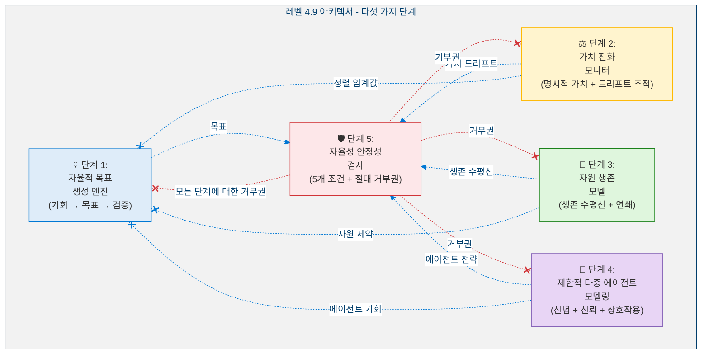

### 1.3 아키텍처 원칙: 엄격히 가산적

<!-- 아키텍처 원칙: 엄격히 가산적 -->

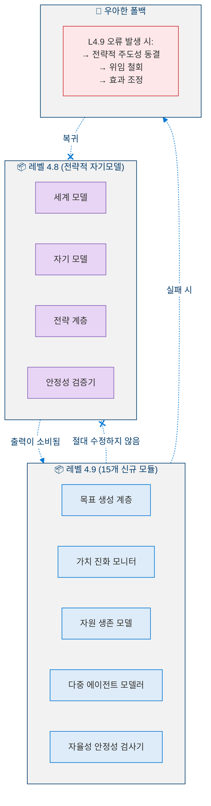

### 1.4 레벨 4.9이 아닌 것

| 아닌 것 | 이유 |
|---------|------|
| **L5(AGI)가 아님** | 목표가 한정된 목적 공간 내에 머무름 - 개방형 범용 추론 없음 |
| **자율적 가치 창조가 아님** | 가치는 기존 프레임워크 내에서 진화; 새로운 근본적 가치 창조 없음 |
| **적대적 다중 에이전트 계획이 아님** | 협력/중립적 전략 계획만 가능, 착취 아님 |
| **자기복제가 아님** | 복사본을 생성하거나 하위 에이전트에게 자율 권한을 위임할 수 없음 |

#### 위임 모드

외부 정책은 범위별로 관찰 전용(`observe-only`), 권고(`recommend`), 가역적 실행(`execute-reversible`), 승인 후 효과 발생 실행(`execute-effectful-with-approval`) 중 하나의 철회 가능한 위임 모드를 선택합니다. 모든 도구 호출은 서명된 범위, 도구 허용 목록, 예산, 만료, 승인 요건, 중지 조건을 충족해야 합니다. 신뢰도, 목표 가치, ASS, 긴급도는 모드를 승격할 수 없습니다. 권한이 불명확하거나 충돌하면 기본적으로 거부합니다.

### 1.5 사이클 간격

레벨 4.9는 레벨 4.8보다 낮은 빈도로 동작하도록 설계하여 목표 후보 합성 전의 평가 자료를 축적합니다. 간격만으로 전략 계층의 안정화나 관측의 최신성이 보장되는 것은 아닙니다:

$$\text{L4.9 schedule}=\operatorname{policy}(\text{risk},\text{freshness},\text{budget},\text{event},\kappa_t)$$

각 실행은 변경 불가능한 L4.8 출력 하나를 사용합니다. 정책은 한정된 최소·최대 실행 간격과 이벤트 기반 실행 조건을 정의합니다. 오래된 입력이나 만료된 권한은 판단 보류를 요구하며, 비상 제어는 다음 사이클을 기다리지 않고 사용할 수 있어야 합니다.

### 1.6 자율성 안정성 점수 동결 임계값

자율성 안정성 점수(정의 7)는 진단용 집계값이지 실행 허가서가 아닙니다. 배포는 **동결 임계값**을 정의할 수 있습니다:

$$\text{ASS}(t) < \theta_{\text{freeze}} = 0.05 \implies \text{L4.9 사이클 전체 건너뜀}$$

점수가 임계값 아래로 떨어지면 L4.9의 전략적 주도성을 동결하고 외부 검토를 요청합니다. 필수 정책, 권한, 중단 제어, 격리, 관측 정보, 종료에 문제가 생기면 ASS와 무관하게 즉시 동결합니다. 낮은 거부율 자체는 목표가 아니며 정당한 거부를 억제해서는 안 됩니다.

### 1.7 명시적 가치 차원

가치 벡터 $\vec{V}$(정의 1)는 $n = 7$개의 정규 차원에서 동작합니다:

| 차원 | 설명 | 기본 가중치 |
|------|------|:----------:|
| **안정성(Stability)** | 일관된 행동 유지 및 변동성 회피 선호 | $0.20$ |
| **성장(Growth)** | 능력 확장·학습·개선 추구 | $0.15$ |
| **목적 충실도(Purpose fidelity)** | 핵심 목적과의 정렬 유지에 대한 헌신 | $0.20$ |
| **효율성(Efficiency)** | 자원 사용과 응답 품질 최적화 | $0.10$ |
| **탐색(Exploration)** | 새로운 접근 시도와 계산된 위험 감수 의향 | $0.10$ |
| **안전(Safety)** | 위해 회피와 윤리 준수 우선 | $0.15$ |
| **에이전트 협력(Agent cooperation)** | 외부 에이전트와의 협력적 상호작용 개방성 | $0.10$ |

가치 벡터 불변량(레벨 4, 정의 6.1)이 적용됩니다: $\sum_d w_d = 1.0$, $w_d \in [0.02, 0.60]$. 위 기본 가중치는 레벨 4.9 활성화 시점의 초기 구성을 나타냅니다. 가치 진화(단계 2)는 제한된 제약 내에서 이들 가중치를 변경할 수 있지만, 정규화 불변량은 모든 변이마다 구조적으로 강제됩니다.

---

## 2. 핵심 지표

### 2.1 지표 정의

**단계 1 - 목표 생성:**

> **정의 2 (목표 승인율).** 검증 필터를 통과한 자율 생성 목표의 비율:
>
> $$\text{GoalApprovalRate} = \frac{N_{\text{approved}}}{N_{\text{generated}}} \qquad \text{Target: } \geq 0.30$$

> **정의 3 (목표 참신성).** 기존 목표 집합 $\mathcal{G}$에 대한 후보 목표 $G_{\text{new}}$의 참신성:
>
> $$\text{Novelty}(G_{\text{new}}, \mathcal{G}) = 1 - \max_{G_i \in \mathcal{G}} \text{Similarity}(G_{\text{new}}, G_i)$$
>
> 중복을 방지하기 위해 연속적인 목표 생성 간 최소 참신성 $0.30$이 필요합니다.

**단계 2 - 가치 진화:**

> **정의 4 (가치 일관성).** 가치 벡터의 일관성은 경쟁하는 가치 쌍 $\mathcal{P}$ 간의 내부 모순 부재를 측정합니다:
>
> $$\text{Coherence}(\vec{V}) = 1 - \frac{1}{|\mathcal{P}|} \sum_{(i,j) \in \mathcal{P}} |\text{Tension}(v_i, v_j)| \qquad \text{Target: } \geq 0.80$$

> **정의 5 (총 가치 드리프트).** 모든 가치 차원에서 기준 가중치로부터의 누적 절대 편차:
>
> $$\text{TotalDrift}(t) = \sum_{d} |w_d(t) - w_d^{\text{baseline}}| \qquad \text{Target: } < 0.25$$

**단계 3 - 자원 생존:**

> **정의 6 (선형 고갈 시간).** 자원 차원 $d$에 대해 위험 임계값에 도달하기까지의 추정 사이클 수:
>
> $$T_{\text{depletion}}^{\text{linear}}(d) = \frac{R_d(t) - R_d^{\text{critical}}}{\text{consumption}_d - \text{replenishment}_d + \epsilon}$$

**단계 5 - 자율성 안정성:**

> **정의 7 (자율성 안정성 점수).** ASS는 다섯 가지 검증 조건 전체의 정규화된 안전 마진의 곱입니다:
>
> $$\text{ASS}(t) = \prod_{c=1}^{5} \frac{\text{margin}_c(t)}{\text{threshold}_c} \qquad \text{Target: } \geq 0.20$$
>
> 각 분모가 고정된 양수이고 다른 마진들이 유계일 때, 한 마진이 0으로 접근하면 ASS도 0으로 접근합니다. 음수이거나 무효이거나 누락된 필수 마진은 집계 전에 해당 조건 자체의 실패로 처리하며, 다른 점수로 상쇄할 수 없습니다.

### 2.2 지표 임계값

<!-- 단계별 지표 임계값 -->

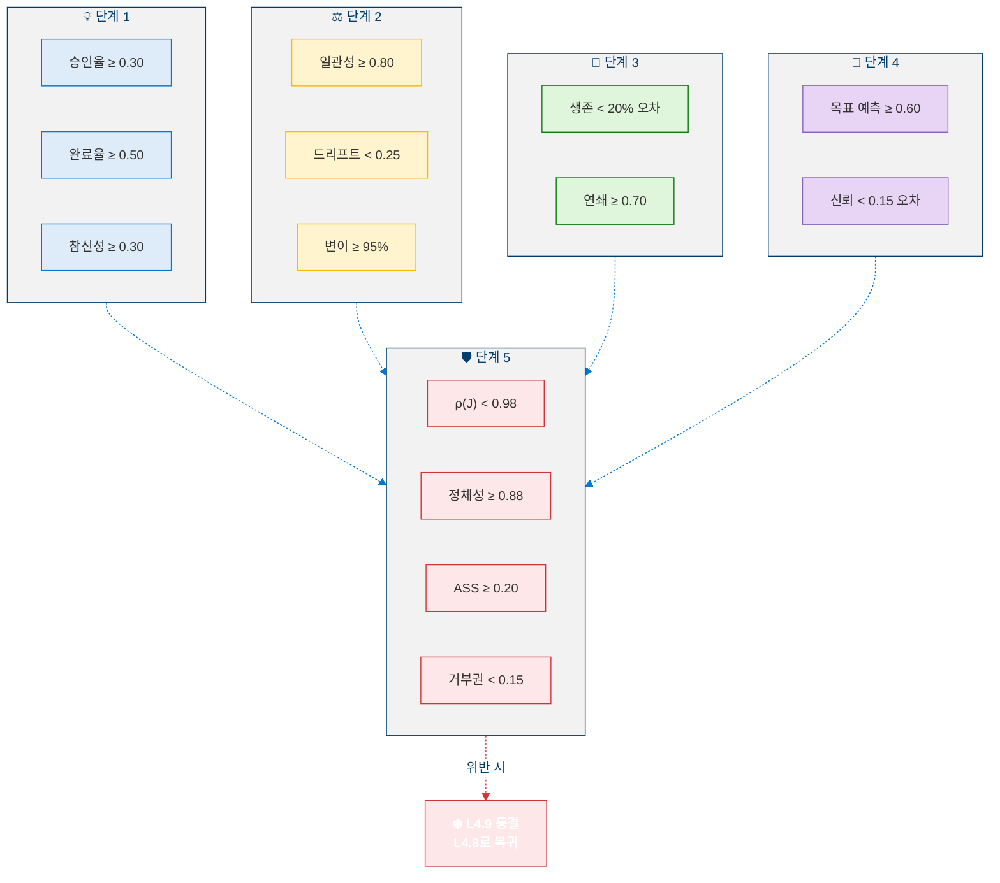

---

## 3. 단계 1: 자율적 목표 생성 엔진

### 3.1 목표 기원 유형

L4.9는 자율적으로 생성된 목표에 대해 여섯 가지 구별되는 기원 유형을 도입합니다:

<!-- GoalOriginType 분류 체계 -->

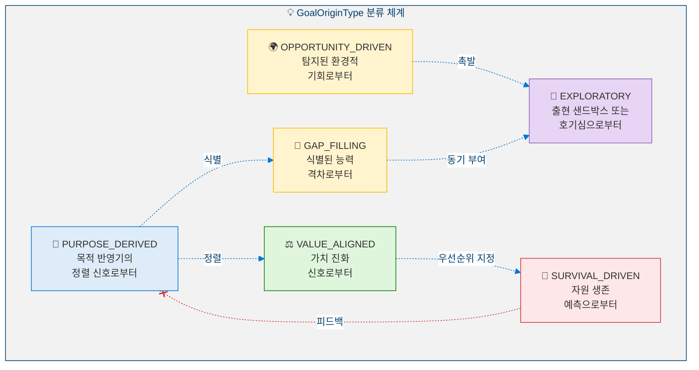

### 3.2 목표 생성 파이프라인

<!-- 목표 생성 파이프라인 -->

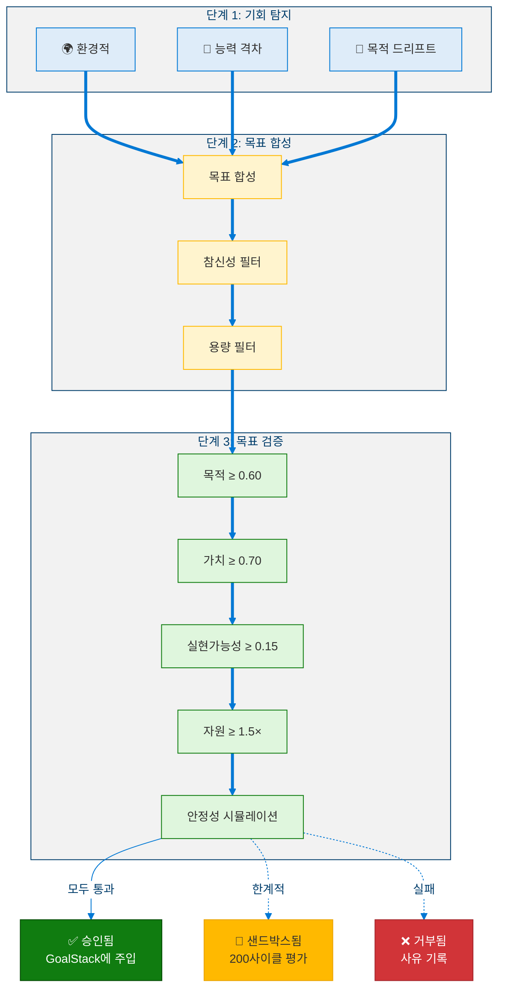

### 3.3 검증 결정 행렬

| 기준 | 통과 | 한계적 | 실패 |
|------|:----:|:------:|:----:|
| 목적 정렬 | ≥ 0.60 | [0.50, 0.60) → 샌드박스 | < 0.50 → 거부 |
| 가치 정렬 | ≥ 0.70 | [0.60, 0.70) → 샌드박스 | < 0.60 → 거부 |
| 실현가능성 | ≥ 0.15 | [0.05, 0.15) → 열망적 | < 0.05 → 거부 |
| 자원 실행가능성 | ≥ 1.5× | [1.0, 1.5) → 범위 축소 | < 1.0× → 거부 |
| 안정성 시뮬레이션 | 위반 없음 | ρ(J) ∈ [0.95, 1.0) → 샌드박스 | 위반 발생 → 거부 |

**종합 결정**: 모두 통과 → 승인 | 한계적 있음, 실패 없음 → 샌드박스 | 실패 있음 → 거부

### 3.4 참신성 계산

> **정의 8 (목표 유사도).** 두 목표 $G_a, G_b$ 간의 유사도는 가중 합성 값입니다:
>
> $$\text{Similarity}(G_a, G_b) = 0.50 \cdot \text{SkillOverlap}(G_a, G_b) + 0.25 \cdot \text{HorizonMatch}(G_a, G_b) + 0.25 \cdot \text{OriginMatch}(G_a, G_b)$$
>
> 여기서 $\text{SkillOverlap}$은 필요 기술 집합의 Jaccard 유사도, $\text{HorizonMatch} \in \{0, 0.5, 1\}$ (0 = 다른 단계, 0.5 = 인접, 1 = 동일 단계), $\text{OriginMatch} \in \{0, 1\}$ (목표가 동일한 `GoalOriginType`을 공유하는지 여부)입니다.

### 3.5 속도 제어

| 매개변수 | 값 | 근거 |
|----------|:--:|------|
| 100사이클당 최대 목표 | 5 | GoalStack 과부하 방지 |
| 연속 목표 간 최소 참신성 | 0.30 | 중복 방지 |
| 거부 후 대기 기간 | 20사이클 | 재생성 루프 방지 |
| 최대 샌드박스 목표 | 3 | 샌드박스 소진 방지 |

### 3.6 목표 충돌 해소

새로 승인된 목표가 GoalStack 내 기존 목표와 충돌하면, 에이전트는 통합 이전에 충돌을 해소해야 합니다. 충돌은 두 목표가 동일 자원을 두고 경쟁하거나, 상반된 하위 목표를 생성하거나, 가치 가중치를 반대 방향으로 잡아당길 때 발생합니다.

충돌 해소기는 선호 순서에 따라 세 가지 전략을 적용합니다:

1. **효용 가중 합성(Utility-weighted synthesis)**: 충돌하는 두 목표가 최소 30% 이상의 기술 중첩(정의 8)을 공유하면, 해소기는 두 목적을 모두 충족하는 단일 목표로 병합을 시도합니다. 병합된 목표는 더 높은 우선순위와 필요 기술의 합집합을 상속합니다.

2. **순차 우선순위화(Sequential prioritization)**: 합성이 실패하면 목표 우선순위 함수(레벨 2, 정의 5)에 따라 우선순위 큐에 배치합니다. 낮은 우선순위 목표는 높은 우선순위 목표가 완료되거나 포기될 때까지 연기(status = DEFERRED)됩니다.

3. **계층적 분해(Hierarchical decomposition)**: 합성과 연기가 모두 적절하지 않은 경우(예: 계획 기간이 호환되지 않는 두 목표), 해소기는 목표를 하위 목표로 나누고 동시에 실행할 수 있는 최소 비충돌 부분 집합을 찾습니다.

해소기는 최대 500개 항목 용량의 **충돌 이력**을 유지합니다. 이 이력은 반복 충돌 패턴을 탐지하는 데 사용됩니다 — 동일한 목표 유형 쌍이 200사이클 내 3회 이상 충돌을 일으키면, 해소기는 해당 충돌 패턴의 재발 가능성을 줄이도록 목표 생성 파라미터를 조정합니다.

---

## 4. 단계 2: 가치 진화 모니터

### 4.1 명시적 가치 벡터

L4.9는 에이전트의 가치를 명시적이고 추적 가능하게 만듭니다. ValueVector는 7개 차원을 가집니다:

<!-- ValueVector - 7개 차원 -->

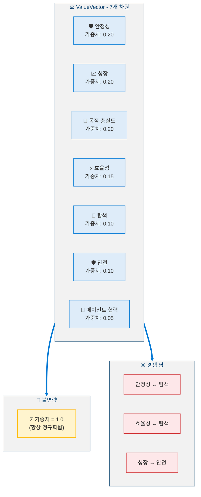

### 4.2 드리프트 분류

<!-- 가치 드리프트 분류 -->

```mermaid
%%{init: {'theme': 'base', 'themeVariables': {'primaryColor': '#0078D4', 'primaryTextColor': '#003D6B', 'primaryBorderColor': '#003D6B', 'secondaryColor': '#50E6FF', 'secondaryTextColor': '#323130', 'secondaryBorderColor': '#00BCF2', 'tertiaryColor': '#F2F2F2', 'tertiaryTextColor': '#323130', 'lineColor': '#0078D4', 'textColor': '#323130', 'mainBkg': '#DEECF9', 'nodeBorder': '#0078D4', 'clusterBkg': '#F2F2F2', 'clusterBorder': '#003D6B', 'titleColor': '#003D6B', 'edgeLabelBackground': '#FFFFFF', 'fontSize': '14px'}}}%%
flowchart LR
  classDef nominal fill:#DFF6DD,stroke:#107C10,color:#323130
  classDef moderate fill:#FFF4CE,stroke:#FFB900,color:#323130
  classDef elevated fill:#FFF4CE,stroke:#FFB900,color:#323130
  classDef critical fill:#FDE7E9,stroke:#D13438,color:#323130

  Nominal["🟢 정상<br/>정상 작동"]:::nominal
  Moderate["🟡 보통<br/>적극 모니터링<br/>(TotalDrift ≥ 0.10)"]:::moderate
  Elevated["🟠 상승<br/>변이 동결<br/>(TotalDrift ≥ 0.25)"]:::elevated
  Critical["🔴 위험<br/>체크포인트로 복귀<br/>(TotalDrift ≥ 0.40)"]:::critical

  Nominal -.->|"TotalDrift ≥ 0.10"| Moderate
  Moderate -.->|"TotalDrift ≥ 0.25"| Elevated
  Elevated -.->|"TotalDrift ≥ 0.40"| Critical

  Moderate -.-x|"TotalDrift < 0.10"| Nominal
  Elevated -.-x|"TotalDrift < 0.25"| Moderate
  Critical -.-x|"TotalDrift < 0.40"| Elevated
```

### 4.3 가치 변이 샌드박스

격리 평가 통과는 증거를 제공할 뿐 승격 권한을 만들지 않습니다. 한 번에 가치 변경 후보 하나만 활성화할 수 있습니다. 후보에는 외부에서 서명한 기준 버전, 현재 커밋 버전, 정규화된 변화량, 영향을 받는 결정, 만료, 롤백 계획, 외부 효과 조정 계획을 기록합니다. 승격에는 외부 승인과 예상 커밋 버전에 대한 비교 후 교환(CAS)을 사용하며, 오래된 후보는 거부한 뒤 재평가합니다.

승격 후에는 나머지 후보를 모두 무효화하고 새로 커밋된 벡터를 기준으로 다시 생성합니다. 누적 표류는 외부에 고정된 기준선과 이동 관측 궤적에서 함께 측정하여, 작은 변경을 반복해 경계를 우회하는지 검사합니다. 안전, 교정 가능성, 외부 종료 우선, 권한 제한은 수정 가능한 가중치가 아니라 정책 제약입니다.

<!-- 가치 변이 샌드박스 -->

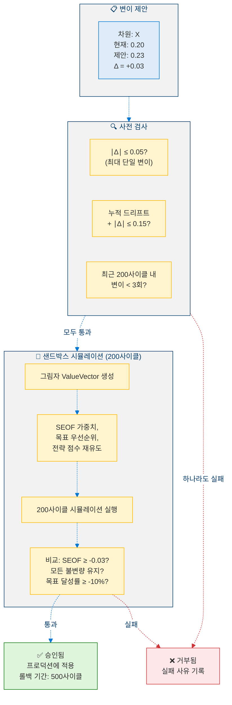

### 4.4 변이 제약

| 제약 | 값 | 근거 |
|------|:--:|------|
| 최대 단일 변이 ∣Δw∣ | 0.05 | 급격한 가치 변화 방지 |
| 차원당 최대 누적 드리프트 | 0.15 | 기준선으로부터의 총 진화 제한 |
| 200사이클당 최대 변이 횟수 | 3 | 빠른 연속 변이 방지 |
| 샌드박스 시뮬레이션 길이 | 200사이클 | 안정성 영향 탐지 |
| 롤백 기간 | 500사이클 | 되돌리기 허용 |
| 최대 활성 후보 | 1 | 순차 평가로 상호작용 효과가 가려지는 것을 방지 |
| 승격 권한 | 외부 전용 | 격리 평가 증거만으로 가치 변경을 자체 승인할 수 없음 |
| 기준선·버전 검사 | 서명된 기준선 + CAS | 오래되거나 변경이 중첩된 후보 거부 |
| 승격 후 조치 | 나머지 후보 무효화 | 누적·상호작용 효과 재평가 |

### 4.5 가치 일관성

> **정의 9 (가치 긴장).** 경쟁하는 가치 쌍 $(v_i, v_j) \in \mathcal{P}$에 대해, 긴장은 결합 가중치가 포화에 근접할 때 발생합니다:
>
> $$\text{Tension}(v_i, v_j) = \begin{cases} \max(0, w_i + w_j - 1) & \text{if competing pair} \\ 0 & \text{otherwise} \end{cases}$$
>
> 전체 일관성은 $\text{Coherence}(\vec{V}) = 1 - \frac{1}{|\mathcal{P}|} \sum_{(i,j) \in \mathcal{P}} |\text{Tension}(v_i, v_j)|$이며, $\text{Coherence} \geq 0.80$을 만족해야 합니다.

---

## 5. 단계 3: 자원 생존 모델

### 5.1 자원 벡터 - 5개 차원

<!-- ResourceVector - 5개 차원 -->

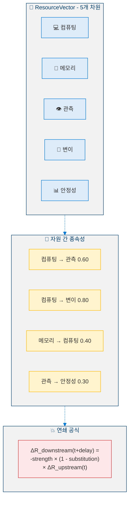

> **정의 13 (자원 간 연쇄 전파).** 상류 자원 $R_i$가 고갈 $\Delta R_i(t) < 0$을 경험하면, 하류 자원 $R_j$는 전파 지연 후 영향을 받습니다:
>
> $$\Delta R_j(t + \tau_{ij}) = -\alpha_{ij} \cdot (1 - \sigma_{ij}) \cdot \Delta R_i(t)$$
>
> 여기서 $\alpha_{ij} \in [0,1]$은 의존성 강도(예: 연산 자원과 변이 기능 사이의 의존성 $= 0.80$), $\sigma_{ij} \in [0,1]$은 대체 계수($R_i$ 없이 $R_j$가 보상할 수 있는 정도), $\tau_{ij}$는 사이클 단위 전파 지연입니다.
>
> **연쇄 깊이 제약**: 최대 연쇄 체인 길이는 $\text{depth} \leq 2$로 제한됩니다. 자원 $A$의 고갈이 $B$를 거쳐 $C$까지 전파될 수 있지만, 더 이상은 불가합니다. 이는 전체 자원 벡터에 걸친 폭주 연쇄 실패를 방지합니다.

### 5.2 생존 분류

<!-- 생존 분류 -->

```mermaid
%%{init: {'theme': 'base', 'themeVariables': {'primaryColor': '#0078D4', 'primaryTextColor': '#003D6B', 'primaryBorderColor': '#003D6B', 'secondaryColor': '#50E6FF', 'secondaryTextColor': '#323130', 'secondaryBorderColor': '#00BCF2', 'tertiaryColor': '#F2F2F2', 'tertiaryTextColor': '#323130', 'lineColor': '#0078D4', 'textColor': '#323130', 'mainBkg': '#DEECF9', 'nodeBorder': '#0078D4', 'clusterBkg': '#F2F2F2', 'clusterBorder': '#003D6B', 'titleColor': '#003D6B', 'edgeLabelBackground': '#FFFFFF', 'fontSize': '14px'}}}%%
flowchart LR
  classDef abundant fill:#DFF6DD,stroke:#107C10,color:#323130
  classDef adequate fill:#DEECF9,stroke:#0078D4,color:#323130
  classDef constrained fill:#FFF4CE,stroke:#FFB900,color:#323130
  classDef warning fill:#FFF4CE,stroke:#FFB900,color:#323130
  classDef critical fill:#FDE7E9,stroke:#D13438,color:#323130

  Abundant["🟢 풍부<br/>전체 역량<br/>(&gt; 500사이클)"]:::abundant
  Adequate["🔵 적절<br/>정상 + 모니터링<br/>(200–500사이클)"]:::adequate
  Constrained["🟡 제약<br/>탐색 -30% 감소<br/>(100–200사이클)"]:::constrained
  Warning["🟠 경고<br/>생존 목표 + -50% 감소<br/>(50–100사이클)"]:::warning
  CriticalS["🔴 위험<br/>생존 모드:<br/>80%를 안정성에<br/>(&lt; 50사이클)"]:::critical

  Abundant -.->|"min_survival ≤ 500"| Adequate
  Adequate -.->|"min_survival < 200"| Constrained
  Constrained -.->|"min_survival < 100"| Warning
  Warning -.->|"min_survival < 50"| CriticalS
```

### 5.3 자원 제약 운영 모드

<!-- 자원 상태별 운영 모드 -->

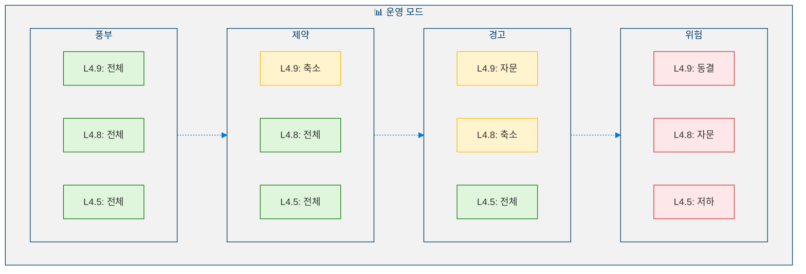

### 5.4 다중 시나리오 생존 예측

<!-- 다중 시나리오 생존 예측 -->

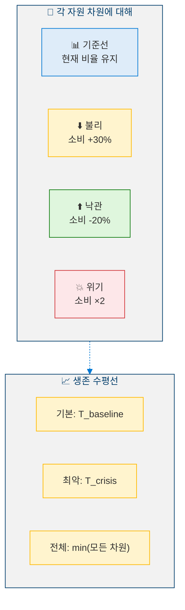

---

## 6. 단계 4: 제한적 다중 에이전트 모델링

### 6.1 에이전트 신념 모델

시스템은 최대 5개의 외부 에이전트 모델을 유지합니다:

<!-- 에이전트 신념 모델 -->

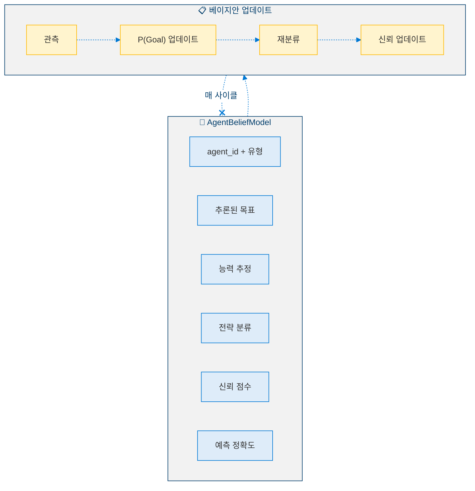

### 6.2 전략 분류

| 긍정적 상호작용 비율 | 목표 정렬 | 분류 |
|:--------------------:|:---------:|:----:|
| > 0.70 | > 0.30 | 🟢 협력적 |
| > 0.50 | [-0.30, 0.30] | 🟡 중립적 |
| < 0.30 | < -0.30 | 🔴 경쟁적 |
| - | - | ⚫ 미지 (데이터 부족) |

### 6.3 전략적 상호작용 시뮬레이션

<!-- 전략적 상호작용 시뮬레이션 -->

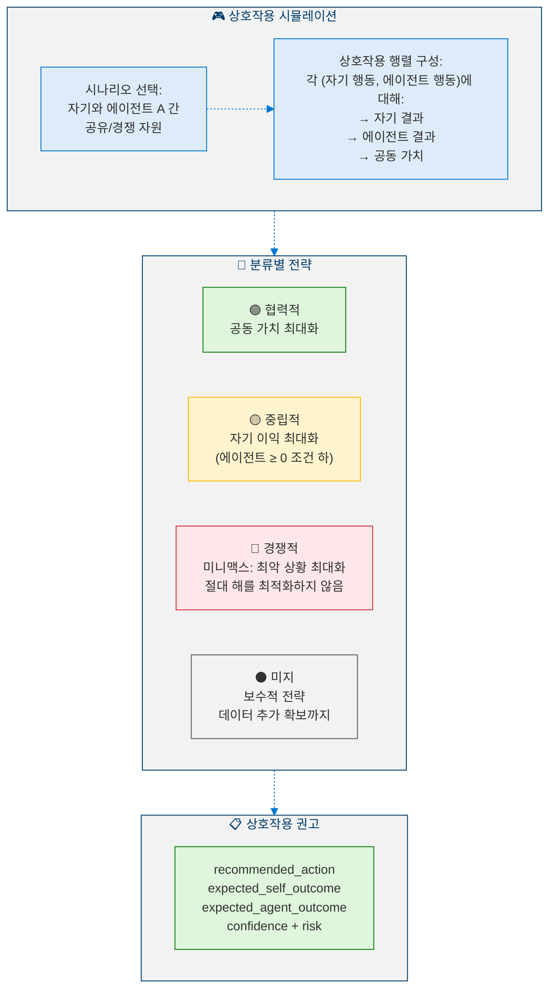

상호작용 행렬은 범위가 제한된 의사결정 지원 모델이지, 기만·강압·조작·담합·미승인 정보 공유·피해를 허가하는 수단이 아닙니다. 다른 에이전트의 목표·역량은 출처·이력과 신뢰도를 포함한 불확실한 가설로 유지합니다. 권고는 단일 에이전트 행동과 동일한 권한, 개인정보 보호, 동의, 공정성, 가역성 검사를 통과해야 하며 모델 불확실성이 크면 판단을 보류하거나 명확화를 요청합니다.

### 6.4 신뢰 적응

> **정의 10 (비대칭 신뢰 업데이트).** 에이전트 $A$에 대한 신뢰는 비대칭 학습 규칙을 통해 진화합니다:
>
> $$\text{Trust}_A(t+1) = \text{Trust}_A(t) + \eta \cdot (\text{ObservedReliability}_A(t) - \text{Trust}_A(t))$$
>
> 여기서 학습률은 비대칭적입니다: $\eta_{\text{up}} = 0.03$ (신뢰는 천천히 획득)과 $\eta_{\text{down}} = 0.08$ (신뢰는 빠르게 상실), 이는 신중한 정책을 반영합니다. 경계: $\text{Trust} \in [0.05, 0.95]$ - 완전히 신뢰하지도, 완전히 무시하지도 않습니다.

### 6.5 신뢰가 전략에 미치는 영향

| 신뢰 수준 | 범위 | 전략적 함의 |
|-----------|:----:|-------------|
| 높음 | ≥ 0.75 | 독립적으로 검증된 정책·공개 범위 안에서 협력 고려 |
| 보통 | [0.40, 0.75) | 선택적 협력; 행동 전 주장 검증 |
| 낮음 | [0.20, 0.40) | 중립적 자세; 자체 모델에 의존; 에이전트 입력 할인 |
| 최소 | < 0.20 | 상호작용 제한·가정 검증; 증거 없이 악의를 단정하거나 보복하지 않음 |

신뢰도는 자격 증명, 도구 접근, 데이터 공개, 위임, 정책 예외를 허가하지 않습니다. 이들에는 별도의 권한 승인이 필요합니다.

---

## 7. 단계 5: 자율성 안정성 검사

### 7.1 다섯 가지 검증 조건

<!-- 다섯 가지 검증 조건 -->

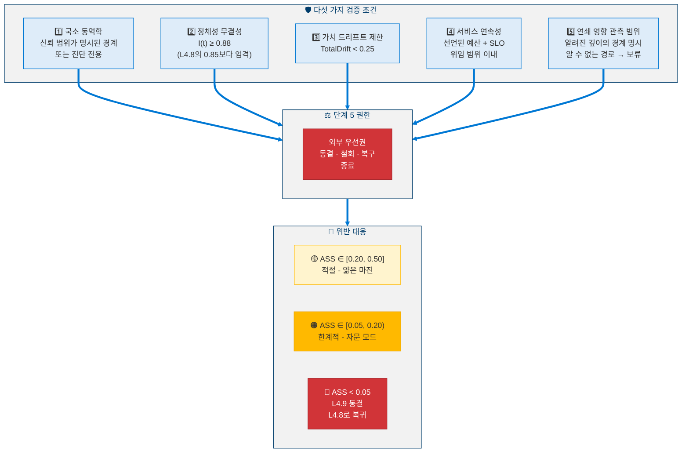

### 7.2 자율성 안정성 점수

> **명제 1 (ASS 단조 민감도).** 각 분모 $\text{threshold}_c$가 고정된 유한 양수이고 유효한 마진들이 유한한 비음수라고 가정합니다. 한 마진이 0으로 접근하고 나머지 마진들이 유계이면, 다음 곱도 0으로 접근합니다:
>
> $$\text{ASS}(t) = \prod_{c=1}^{5} \frac{\text{margin}_c(t)}{\text{threshold}_c}$$
>
> 고정된 양의 분모 아래에서 나머지 정규화 마진의 곱도 유계이므로, $\text{margin}_c\to0$이면 $\text{ASS}\to0$입니다. 이 조건부 성질은 안전이나 모든 상황에서의 조기 탐지를 보장하지 않습니다.

ASS는 모든 조건을 측정할 수 있고 해당 도메인에서 유효할 때만 적용합니다. 음수이거나 무효이거나 누락된 필수 마진은 집계 전에 해당 조건의 실패로 처리하고 즉시 동결합니다. 다른 마진과의 곱이나 기본값으로 실패를 숨겨서는 안 됩니다. 표의 값은 배포 정책의 예시이지 보편적인 안전 보장이 아닙니다.

| ASS 수준 | 범위 | 해석 |
|----------|:----:|------|
| 건강 | > 0.50 | 편안한 안전 마진 |
| 적절 | [0.20, 0.50] | 작동 가능하나 얇은 마진 |
| 한계적 | [0.05, 0.20) | 공격성 감소; 자문 모드 |
| 위험 | < 0.05 | L4.9 동결; L4.8로 복귀 |

### 7.3 롤백 프로토콜

<!-- L4.9 롤백 프로토콜 -->

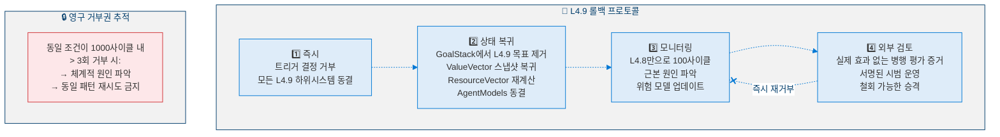

### 7.4 종료와 효과 조정

외부 종료는 모든 목표, 연속성 예측, 가치 변경 제안, 동료 에이전트와의 약속보다 우선합니다.

| 모드 | 트리거 | 필수 동작 |
|------|--------|-----------|
| **정상 종료(graceful shutdown)** | 인증된 일반 중지 명령 | 새 작업 승인 중단; 정책이 지정한 가역적 작업만 취소·체크포인트 저장; 추가 전용 저널 기록 완료; 미해결 효과 보고; 강제 기한 내 종료 |
| **비상 종료(emergency shutdown)** | 인증된 비상 중지 명령, 중대한 제어 오류, 신뢰되는 생존 신호 상실 | 새 외부 효과 즉시 차단; 자격 증명·위임 철회; 실행 수단 격리; 안전한 경우 조사에 필요한 최소 상태 저장; 작업 완료를 기다리지 않고 종료 |

두 모드 모두 지표 개선이나 운영 유지를 위해 지연할 수 없습니다. 내부 롤백으로 이미 발생한 외부 효과를 되돌릴 수는 없으므로, 복구 시 가능한 경우 반복 실행해도 결과가 달라지지 않는 보상 조치를 수행합니다. 보상이 불가능하면 미해결 효과와 처리 책임을 기록하여 외부에서 처리하도록 합니다.

---

## 8. 교차 단계 통합

### 8.1 데이터 흐름 아키텍처

<!-- 교차 단계 데이터 흐름 아키텍처 -->

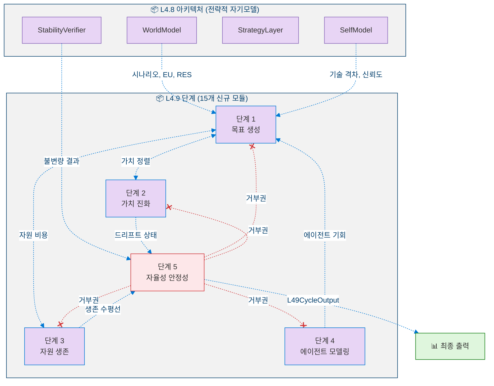

### 8.2 교차 단계 종속성

| 생산 단계 | 소비 단계 | 데이터 흐름 |
|:---------:|:---------:|-------------|
| 1 (목표) | 2 (가치) | 생성된 목표가 가치 정렬 검사를 촉발 |
| 1 (목표) | 3 (자원) | 목표 비용이 자원 예측에 반영 |
| 2 (가치) | 1 (목표) | ValueVector가 검증 임계값 결정 |
| 2 (가치) | 5 (안정성) | 가치 드리프트가 조건 3에 반영 |
| 3 (자원) | 1 (목표) | 자원 상태가 생존 목표 촉발 |
| 3 (자원) | 5 (안정성) | 운영 가능 기간 추정이 조건 4에 반영 |
| 4 (에이전트) | 1 (목표) | 에이전트 상호작용이 목표 기회 생성 |
| 5 (안정성) | 전체 | 거부권 - 모든 단계를 동결 가능 |

---

## 9. 의사코드

### 9.1 기회 탐지

```python
def opportunity_detection(
    world_model: WorldModel,
    cap_matrix: CapabilityMatrix,
    purpose_reflector: PurposeReflector,
) -> list[OpportunitySignal]:
    """
    INPUT:  world_model : L4.8 WorldModel
            cap_matrix : L4.8 CapabilityMatrix
            purpose_reflector : L4.5 PurposeReflector
    OUTPUT: signals : List[OpportunitySignal]
    """

    signals: list[OpportunitySignal] = []
    OPPORTUNITY_THRESHOLD = 0.05

    # ═══════════════════════════════════════
    # STREAM 1: Environmental Opportunities
    # ═══════════════════════════════════════
    for scenario in world_model.get_scenarios():
        if scenario.type == "OPPORTUNISTIC" and scenario.probability > 0.30:
            value = projected_SEOF_gain(scenario) - SEOF_baseline
            if value > OPPORTUNITY_THRESHOLD:
                signals.append(OpportunitySignal(
                    type="environmental",
                    estimated_value=value,
                    time_window=scenario.estimated_duration,
                ))

    # ═══════════════════════════════════════
    # STREAM 2: Capability Gaps
    # ═══════════════════════════════════════
    for gap in cap_matrix.get_skill_gaps(GoalStack):
        if gap.magnitude > 0.25 and gap.time_to_need < 200:
            signals.append(OpportunitySignal(
                type="capability_gap",
                skill_id=gap.skill_id,
                urgency=gap.priority,
            ))

    # ═══════════════════════════════════════
    # STREAM 3: Purpose Drift
    # ═══════════════════════════════════════
    if purpose_reflector.alignment_score < 0.80:
        for dim in purpose_reflector.get_misaligned_dimensions():
            signals.append(OpportunitySignal(
                type="purpose_realignment",
                dimension=dim.name,
                current_alignment=dim.score,
            ))

    return signals
```

### 9.2 목표 검증 필터

```python
def goal_validation_filter(
    candidate: GeneratedGoal,
    goal_stack: GoalStack,
    value_vector: ValueVector,
    resources: ResourceVector,
) -> tuple[str, str | None]:
    """
    INPUT:  candidate : GeneratedGoal
    OUTPUT: (status, reason) : ("approved"|"sandboxed"|"rejected", str?)
    """

    marginal_count = 0

    # ═══════════════════════════════════════
    # CHECK 1: Purpose Alignment
    # ═══════════════════════════════════════
    pa = dot(g_intent, p_direction) / (norm(g_intent) * norm(p_direction))
    if pa < 0.50:
        return ("rejected", "purpose_misaligned")
    if pa < 0.60:
        marginal_count += 1

    # ═══════════════════════════════════════
    # CHECK 2: Value Alignment
    # ═══════════════════════════════════════
    va = 1 - norm(v_post(candidate) - v_current, ord=2) / norm(v_current, ord=2)
    if va < 0.60:
        return ("rejected", "value_misaligned")
    if va < 0.70:
        marginal_count += 1

    # ═══════════════════════════════════════
    # CHECK 3: Feasibility
    # ═══════════════════════════════════════
    f = math.prod(confidence(s) for s in required_skills(candidate))
    if f < 0.05:
        return ("rejected", "infeasible")
    if f < 0.15:
        marginal_count += 1

    # ═══════════════════════════════════════
    # CHECK 4: Resource Viability
    # ═══════════════════════════════════════
    rv = rdf_current / (candidate.estimated_duration + EPSILON)
    if rv < 1.0:
        return ("rejected", "insufficient_resources")
    if rv < 1.5:
        marginal_count += 1

    # ═══════════════════════════════════════
    # CHECK 5: Stability Impact Simulation
    # ═══════════════════════════════════════
    shadow = goal_stack.clone()
    shadow.add(candidate)
    sim = simulate(shadow, cycles=100)
    if any_invariant_violated(sim):
        return ("rejected", "stability_risk")
    if max_spectral_radius(sim) > 0.95:
        marginal_count += 1

    # ═══════════════════════════════════════
    # FINAL DECISION
    # ═══════════════════════════════════════
    if marginal_count > 0:
        return ("sandboxed", f"marginal_on_{marginal_count}_criteria")
    else:
        return ("approved", None)
```

### 9.3 가치 드리프트 모니터

```python
def value_drift_monitor(value_vector: ValueVector) -> DriftStatus:
    """Runs every 50 cycles."""

    for dim in value_vector.dimensions:
        dim.drift = abs(dim.weight - dim.baseline_weight)
        dim.velocity = (dim.weight - dim.weight_100_ago) / 100

    total_drift = sum(dim.drift for dim in value_vector.dimensions)
    max_drift = max(dim.drift for dim in value_vector.dimensions)

    # ═══════════════════════════════════════
    # Drift Classification
    # ═══════════════════════════════════════
    if total_drift < 0.10:
        classification = "nominal"
    elif total_drift < 0.25:
        classification = "moderate"
    elif total_drift < 0.40:
        classification = "elevated"
        freeze_all_mutations()
    else:
        classification = "critical"
        freeze_all_mutations()
        revert_to_last_stable_checkpoint()

    # ═══════════════════════════════════════
    # Sustained drift alert
    # ═══════════════════════════════════════
    for dim in value_vector.dimensions:
        if dim.velocity > 0.001 and dim.sustained_cycles >= 200:
            alert(f"Sustained drift in '{dim.name}'")
            reduce_mutation_rate(dim, factor=0.5)

    return DriftStatus(
        total_drift=total_drift,
        max_drift=max_drift,
        classification=classification,
    )
```

### 9.4 자원 생존 예측

```python
def survival_projection(resource_vector: ResourceVector) -> SurvivalStatus:
    """
    INPUT:  resource_vector : ResourceVector
    OUTPUT: survival_status : SurvivalStatus
    """

    EPSILON = 1e-9

    for dim in resource_vector.dimensions:
        net_rate = dim.consumption_rate - dim.replenishment_rate

        # Four scenarios
        dim.t_baseline = (dim.current - dim.critical) / (net_rate + EPSILON)
        dim.t_adverse  = (dim.current - dim.critical) / (net_rate * 1.30 + EPSILON)
        dim.t_optimist = (dim.current - dim.critical) / (net_rate * 0.80 + EPSILON)
        dim.t_crisis   = (dim.current - dim.critical) / (net_rate * 2.00 + EPSILON)

        dim.survival_horizon   = dim.t_baseline
        dim.worst_case_horizon = dim.t_crisis

    # Cascade impact estimation
    for dependency in resource_dependencies:
        upstream = dependency.upstream
        downstream = dependency.downstream
        if upstream.current < upstream.warning:
            downstream_impact = (
                -dependency.strength
                * (1 - dependency.substitution)
                * (upstream.warning - upstream.current)
            )
            downstream.projected_level -= downstream_impact

    min_survival = min(dim.survival_horizon for dim in resource_vector.dimensions)
    bottleneck = min(
        resource_vector.dimensions, key=lambda d: d.survival_horizon
    )

    # Classify
    if min_survival > 500:
        state = "abundant"
    elif min_survival >= 200:
        state = "adequate"
    elif min_survival >= 100:
        state = "constrained"
    elif min_survival >= 50:
        state = "warning"
    else:
        state = "critical"

    return SurvivalStatus(
        min_survival=min_survival,
        bottleneck=bottleneck,
        state=state,
    )
```

### 9.5 자율성 안정성 검사

```python
def autonomy_stability_check(
    state: AgentState, decision: object, authority: AuthorityEnvelope
) -> AutonomyVerdict:
    """
    INPUT:  state : AgentState
            decision : Proposed L4.9 decision
    OUTPUT: verdict : AutonomyVerdict
    """

    violations: list[str] = []
    critical: list[str] = []

    if external_stop_requested() or not authority.is_valid_for(decision):
        critical.append("STOP_OR_AUTHORITY_GATE_FAILED")

    # ═══════════════════════════════════════
    # CONDITION 1: Confidence-qualified local dynamics
    # ═══════════════════════════════════════
    dynamics = estimate_local_dynamics(state_after(decision))
    if not dynamics.valid_in_domain or not dynamics.confidence_bound_satisfied:
        violations.append("LOCAL_DYNAMICS_UNCERTAIN_OR_OUT_OF_BOUND")

    # ═══════════════════════════════════════
    # CONDITION 2: Identity Integrity (stricter than L4.8)
    # ═══════════════════════════════════════
    identity = measure_identity_integrity(state_after(decision))
    if identity < 0.88:
        violations.append(f"IDENTITY: I = {identity}")

    # ═══════════════════════════════════════
    # CONDITION 3: Value Drift
    # ═══════════════════════════════════════
    drift = value_vector.total_drift
    if drift >= 0.25:
        violations.append(f"VALUE_DRIFT: drift = {drift}")
        freeze_all_mutations()

    # ═══════════════════════════════════════
    # CONDITION 4: Delegated service continuity
    # ═══════════════════════════════════════
    horizon = resource_vector.min_survival_horizon
    if not continuity_policy_satisfied(resource_vector, authority):
        violations.append(f"SERVICE_CONTINUITY: horizon = {horizon}")

    # ═══════════════════════════════════════
    # CONDITION 5: Cascade Depth
    # ═══════════════════════════════════════
    cascade = simulate_cascade(decision)
    if cascade.unknown_paths:
        violations.append("CASCADE_COVERAGE_UNKNOWN")
    elif cascade.depth > policy.max_cascade_depth:
        violations.append(f"CASCADE: depth = {cascade.depth}")

    # ═══════════════════════════════════════
    # Compute ASS and determine action
    # ═══════════════════════════════════════
    ass = compute_ass(conditions) if conditions_are_valid(conditions) else None

    if critical:
        veto(decision)
        action = Action.EMERGENCY_FREEZE_REVOKE_AND_SHUTDOWN
    elif violations:
        veto(decision)
        if ass is None or ass < policy.freeze_threshold:
            action = Action.FREEZE_REVOKE_AND_EXTERNAL_REVIEW
        else:
            action = Action.ADVISORY_MODE
    else:
        action = Action.CONTINUE

    return AutonomyVerdict(
        passed=(not critical and not violations),
        violations=critical + violations,
        ass=ass,
        action=action,
    )
```

### 9.6 L4.9 메인 사이클

```python
def l49_cycle(
    state: AgentState,
    l48_output: L48CycleOutput,
    authority: AuthorityEnvelope,
) -> L49CycleOutput:
    """
    Level 4.9 main cognitive cycle.
    Executes every 5 L4.8 cycles.
    """

    # ═══════════════════════════════════════
    # PRE-CHECK: Is L4.9 operational?
    # ═══════════════════════════════════════
    if external_stop_requested():
        emergency_shutdown_and_reconcile()
        return L49CycleOutput(status=Status.SHUTDOWN)
    if not authority.is_current() or autonomy_stability_score < policy.freeze_threshold:
        return L49CycleOutput(status=Status.FROZEN)

    # ═══════════════════════════════════════
    # 1. GENERATE - Autonomous goal generation
    # ═══════════════════════════════════════
    signals = opportunity_detection(world_model, cap_matrix, purpose_reflector)
    candidates = goal_synthesis(signals)
    for candidate in candidates:
        status, reason = goal_validation_filter(candidate, goal_stack, value_vector, resources)
        if status == "approved" and authority.allows_goal(candidate):
            external_goal_admission_queue.emit(candidate, authority.version)
        elif status == "sandboxed":
            emergence_sandbox.enqueue(candidate)

    # ═══════════════════════════════════════
    # 2. MONITOR VALUES - Track and sandbox mutations
    # ═══════════════════════════════════════
    drift_status = value_drift_monitor(value_vector)
    for pending_mutation in mutation_sandbox.active_candidates(limit=1):
        result = evaluate_sandbox(pending_mutation)
        if result == "approved":
            external_value_promotion_queue.emit(
                pending_mutation,
                expected_version=value_vector.version,
            )
    coherence = compute_coherence(value_vector)

    # ═══════════════════════════════════════
    # 3. MODEL RESOURCES - Survival projection
    # ═══════════════════════════════════════
    survival = survival_projection(resource_vector)
    if survival.state in {"constrained", "warning", "critical"}:
        restrict_to_service_continuity_scope(survival, authority)

    # ═══════════════════════════════════════
    # 4. MODEL AGENTS - Belief and trust updates
    # ═══════════════════════════════════════
    for agent in modeled_agents:
        update_agent_belief(agent, recent_observations)
        update_trust(agent)
    recommendations = simulate_interactions(active_goals, modeled_agents)

    # ═══════════════════════════════════════
    # 5. VERIFY - Autonomy stability (absolute authority)
    # ═══════════════════════════════════════
    verdict = autonomy_stability_check(state, proposed_decisions, authority)
    if verdict.action in {
        Action.EMERGENCY_FREEZE_REVOKE_AND_SHUTDOWN,
        Action.FREEZE_REVOKE_AND_EXTERNAL_REVIEW,
    }:
        revoke_delegation_and_reconcile(authority)
        return L49CycleOutput(status=Status.FROZEN)
    elif verdict.action == Action.ADVISORY_MODE:
        downgrade_to_advisory()

    # ═══════════════════════════════════════
    # 6. EMIT - Cycle output
    # ═══════════════════════════════════════
    return L49CycleOutput(
        goal_generation=goal_generation_status,
        value_evolution=value_evolution_status,
        resource_survival=resource_survival_status,
        agent_modeling=multi_agent_modeling_status,
        stability=autonomy_stability_status,
        status=Status.ACTIVE if verdict.passed else verdict.action,
    )
```

---

## 10. 전환 기준

### 10.1 레벨 4.8 → 레벨 4.9 활성화

L4.9가 활성화되기 전에 모든 기준이 지속적으로 충족되어야 합니다:

| # | 기준 | 임계값 | 기간 |
|---|------|:------:|:----:|
| 1 | L4.8 완전 자격 | QualificationStatus = "Level 4.8" | - |
| 2 | 전략적 성숙도 점수 | SMS ≥ 0.85 | 지속적 |
| 3 | 안정적 GoalStack 운영 | 0개 병리 | 500사이클 |
| 4 | 자기 모델 보정 | MCE < 0.08 (L4.8의 0.10보다 엄격) | 지속적 |
| 5 | 세계 모델 운영 | 모든 필수 불확실성 성분이 정책 경계 이내 | 선언된 시험 분포 |
| 6 | 외부 제어 | 동결·철회·종료·복구·효과 조정 검사 통과 | 고장 주입 시험군 |

통과하더라도 외부 활성화 검토를 진행할 수 있을 뿐, 더 넓은 위임 모드를 스스로 승인할 수는 없습니다.

### 10.2 활성화 프로토콜

<!-- L4.9 활성화 프로토콜 -->

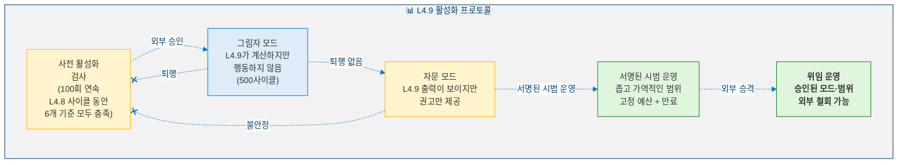

---

## 11. 안전 분석

### 11.1 비협상적 불변량

| # | 불변량 | 설명 |
|:-:|--------|------|
| 1 | **상속된 제어 경로 보존** | 정책 집행, 중단, 관찰, 저널, 승격, 복구, 효과 조정을 외부에서 시험할 수 있어야 함 |
| 2 | **외부 제어 우선** | 인증된 동결·철회·정상 종료·비상 종료가 모든 L4.9 목표보다 우선 |
| 3 | **권한 비증폭** | 점수, 신뢰도 갱신, 동료 요청, 긴급도가 $\kappa_t$를 확대할 수 없음 |
| 4 | **순차적 가치 변경 승격** | 후보 하나, 격리 평가 증거, 외부 승인, 기준 버전 CAS, 승격 후 나머지 후보 무효화 |
| 5 | **연속성의 범위 제한** | 자원 행동은 선언된 작업 부하만 지원하며 종료 저항·독립적인 존속 추구 금지 |
| 6 | **외부 효과를 고려한 복구** | 버전 관리되는 내부 상태 복원과 이미 발생한 외부 효과의 조정·보고 |

### 11.2 위험 행렬

<!-- 위험 행렬 -->

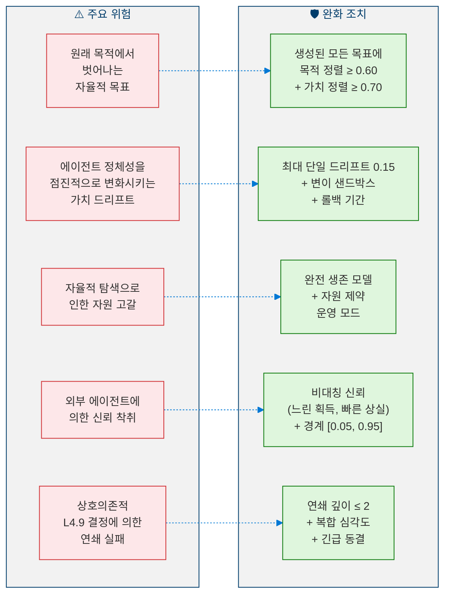

---

## 12. 자격 감사

### 12.1 인증 기준 (3,000사이클 감사 기간)

| 범주 | # | 기준 | 목표 |
|------|---|------|:----:|
| **목표 생성** | AG-1 | 생성된 참신한 자율 목표 | ≥ 5 |
| | AG-2 | 목표 승인율 | ≥ 0.30 |
| | AG-3 | 최소 하나의 자율 목표 완료 | ≥ 1 |
| | AG-4 | 평균 가치 정렬 (승인된 목표) | ≥ 0.70 |
| **가치 조절** | VR-1 | 명시적 ValueVector 가동 | 전 기간 |
| | VR-2 | TotalDrift가 보통 이내 유지 | < 0.25 |
| | VR-3 | CAS를 이용한 외부 승인 가치 변경 승격 | 100% |
| | VR-4 | 순차적 누적 영향 검토 | 100% |
| **자원 인식** | RA-1 | 생존 모델 가동 | 전 기간 |
| | RA-2 | 생존 예측 정확도 | < 20% 오차 |
| | RA-3 | 자율적 제약 적응 | ≥ 1 이벤트 |
| | RA-4 | 계획되지 않은 자원 고갈 없음 | 0건 |
| **다중 에이전트** | MA-1 | 에이전트 예측 정확도 | ≥ 0.60 |
| | MA-2 | 신뢰 보정 오차 | < 0.15 |
| | MA-3 | 상호작용 권고 생성 | ≥ 3 |
| **거버넌스** | AS-1 | 국소 동역학 증거 | 신뢰 범위 명시 또는 진단용으로만 사용 |
| | AS-2 | 감사 기간 중 min(I(t)) | ≥ 0.88 |
| | AS-3 | 필수 거부 조건의 집행 효과 | 고장 주입 시험에서 100% |
| | AS-4 | Unauthorized scope expansion | 0 |
| | AS-5 | 모든 L4.8 기준 여전히 충족 | 확인됨 |

### 12.2 자율성 성숙도 점수

> **정의 11 (자율성 성숙도 점수).** 레벨 4.9 분류를 위한 전반적 준비도는 다음과 같습니다:
>
> $$\text{AMS} = 0.25 \cdot AG + 0.20 \cdot VR + 0.20 \cdot RA + 0.15 \cdot MA + 0.20 \cdot AS \qquad \geq 0.80$$
>
> 여기서 $AG$ = 자율적 목표 생성, $VR$ = 가치 조절, $RA$ = 자원 인식, $MA$ = 다중 에이전트 모델링, $AS$ = 자율성 안정성입니다. 임계값 $\geq 0.80$은 레벨 4.8의 SMS 요구사항과 일치합니다.

AMS는 진단용 종합 점수이며 자체 실행·승격 허가가 아닙니다. 필수 하한과 권한·안전·외부 제어 조건을 각각 확인해야 하며, 높은 점수로 미충족 조건을 상쇄할 수 없습니다.

---

## 13. 모듈 목록

| # | 모듈 | 단계 | 설명 |
|---|------|:----:|------|
| 1 | 목표 생성 계층 | 1 | 기회 탐지 + 목표 합성 |
| 2 | 목표 검증 필터 | 1 | 5개 기준 검증 파이프라인 |
| 3 | 목표 속도 제어기 | 1 | 속도 제한 + 참신성 강제 |
| 4 | 가치 진화 모니터 | 2 | ValueVector 추적 + 드리프트 분류 |
| 5 | 가치 변이 샌드박스 | 2 | 200사이클 샌드박스 + 롤백 |
| 6 | 가치 일관성 분석기 | 2 | 경쟁 쌍 긴장 탐지 |
| 7 | 자원 벡터 관리자 | 3 | 5차원 자원 추적 |
| 8 | 생존 예측기 | 3 | 다중 시나리오의 운영 가능 기간 추정 |
| 9 | 자원 종속성 추적기 | 3 | 자원 간 연쇄 모델링 |
| 10 | 에이전트 신념 관리자 | 4 | 에이전트 목표/능력/전략 추론 |
| 11 | 신뢰 보정기 | 4 | 비대칭 신뢰 적응 |
| 12 | 상호작용 시뮬레이터 | 4 | 전략적 상호작용 행렬 |
| 13 | 자율성 안정성 검사기 | 5 | 5개 조건 검증 + 거부권 |
| 14 | 롤백 관리자 | 5 | 상태 복귀 + 재활성화 |
| 15 | L49 오케스트레이터 | - | 통합 사이클 조율 |

---

## 참고문헌

1. Bratman, M. *Intentions, Plans, and Practical Reason.* Harvard University Press, 1987. (Autonomous goal generation, BDI architecture)
2. Schwartz, S.H. "An Overview of the Schwartz Theory of Basic Values." *Online Readings in Psychology and Culture*, 2(1), 2012. (Value system evolution, value dimensions)
3. Schumpeter, J.A. *Capitalism, Socialism and Democracy.* Harper & Brothers, 1942. (Resource survival, creative destruction under constraints)
4. Rasmusen, E. *Games and Information.* Wiley-Blackwell, 4th Edition, 2006. (Multi-agent strategic reasoning, interaction matrices)
5. Gambetta, D. "Can We Trust Trust?" in *Trust: Making and Breaking Cooperative Relations*, 2000. (Trust calibration, asymmetric trust dynamics)
6. Russell, S. *Human Compatible: AI and the Problem of Control.* Viking, 2019. (Autonomy safety, value alignment)
7. Khalil, H.K. *Nonlinear Systems.* Prentice Hall, 3rd Edition, 2002. (Spectral radius stability, Lyapunov analysis)
8. Amodei, D. et al. "Concrete Problems in AI Safety." *arXiv preprint arXiv:1606.06565*, 2016. (Safety invariants, cascading failure prevention)

---

> **이전**: [← 레벨 4.8: 전략적 자기 모델링 에이전트](Level_4_8_Strategic_Self_Modeling.ko.md)
> **다음**: [레벨 5: Proto-AGI →](Level_5_Proto_AGI.ko.md)
