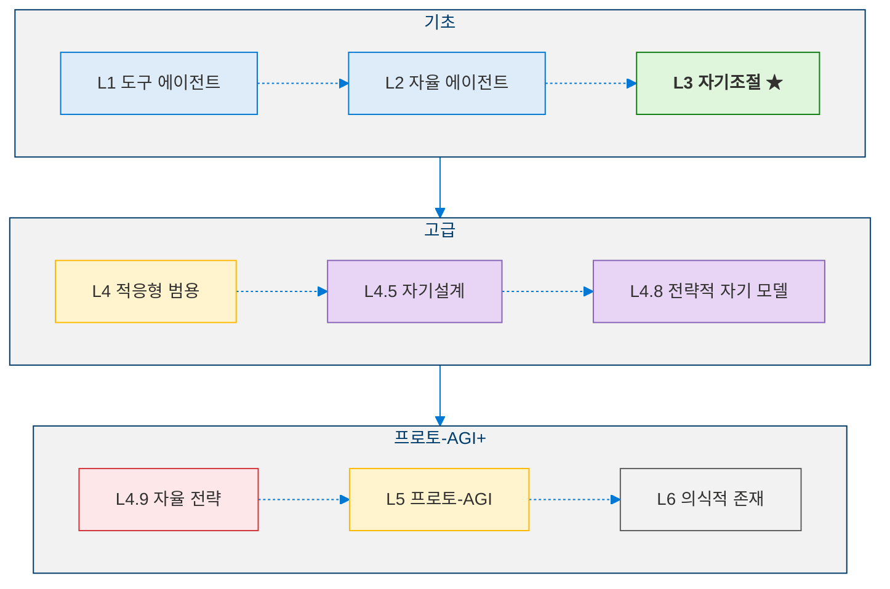

<!--
Copyright (c) 2026 Moon Hyuk Choi
Licensed under the MIT License.
See LICENSE file in the repository root for full license information.

Redistribution (commercial or non-commercial) must retain this notice.
Removal of attribution constitutes a license violation.
-->
# MSCP 에이전트 인지 레벨 시리즈

> **상태**: 🔬 **실험적** - 이 시리즈의 모든 문서는 프로토타이핑과 테스트에서 도출된 설계를 기술합니다. 최종 확정된 명세가 아닙니다.  

> **공개 문서 범위**: 최소 자기의식 프로토콜(MSCP)의 아키텍처 연구를 설명합니다. 수치 임계값은 예시이며 적용 환경별 보정이 필요합니다. 코드의 존재나 개별 실험 결과만으로 독립적으로 검증된 레벨 적합성이 성립하지 않으며, 구조적 자기인식은 주관적 의식을 뜻하지 않습니다.

공개 상태와 해석 원칙은 [문서 상태 안내](../specs/Documentation_Status.ko.md)를 참고하세요.

---

## 개요

**최소 자기의식 프로토콜(MSCP)**은 요청 기반 도구 에이전트부터 제한된 전략적 자율성과 연구 적합성 평가까지를 다루는 인지 아키텍처 분류 체계입니다. 아래 표는 중간 연구 단계와 문서화되지 않은 이론적 레벨 6을 구분합니다. 각 문서의 다이어그램, 의사코드, 안전 분석은 설계 제안이며, AGI나 주관적 의식의 달성 또는 모든 안전 조건의 입증을 뜻하지 않습니다.

<!-- MSCP Agent Cognition Level Progression -->

---

## 레벨 문서

| 레벨 | 명칭 | 핵심 역량 | 문서 |
|:-----:|------|----------|------|
| **1** | **도구 에이전트** | 외부 요청으로 시작하는 한정 에피소드; 에이전트 소유의 지속 인지 상태 없음 | [Level_1_Tool_Agent.ko.md](Level_1_Tool_Agent.ko.md) |
| **2** | **자율 에이전트** | 지속 인지 상태; 한정된 자율 목표 생성; 허가된 이벤트 기반 재개 | [Level_2_Autonomous_Agent.ko.md](Level_2_Autonomous_Agent.ko.md) |
| **3** | **자기조절 인지 에이전트** | 구조적 자기인식; 행동별 예측; 의미적 연속성 모니터링; 한정 갱신과 복구 | [Level_3_Self_Regulating_Agent.ko.md](Level_3_Self_Regulating_Agent.ko.md) |
| **4** | **적응형 범용 에이전트** | 분리 평가 기반 전이; 위임된 장기 목표; 외부 승인을 받는 역량·전략 진화 | [Level_4_Adaptive_General_Agent.ko.md](Level_4_Adaptive_General_Agent.ko.md) |
| **4.5** | **자기설계** | 토폴로지 후보 제안; 독립적인 외부 승격; 안전 경로 보존 검사 | [Level_4_5_Self_Architecting.ko.md](Level_4_5_Self_Architecting.ko.md) |
| **4.8** | **전략적 자기 모델링 에이전트** | 불확실성을 포함한 세계·역량 모델; 필수 조건을 먼저 검사하는 전략 비교 | [Level_4_8_Strategic_Self_Modeling.ko.md](Level_4_8_Strategic_Self_Modeling.ko.md) |
| **4.9** | **자율 전략 에이전트** | 외부 제약을 받는 목표·가치 변경 제안; 자원 연속성 분석; 철회 가능한 위임 | [Level_4_9_Autonomous_Strategic_Agent.ko.md](Level_4_9_Autonomous_Strategic_Agent.ko.md) |
| **5** | **프로토-AGI** | 정체성·전이·목표·표본 고장 복구·다중 에이전트 예측·재구성의 한정된 적합성 평가 | [Level_5_Proto_AGI.ko.md](Level_5_Proto_AGI.ko.md) |
| 6 | 의식적 존재 | 의식; 감각질; 자유의지; 도덕적 행위자성 | *이론적 - 문서화되지 않음* |

---

## 레벨별 누적 안전 메커니즘

```mermaid
%%{init: {'theme': 'base', 'themeVariables': {'primaryColor': '#0078D4', 'primaryTextColor': '#003D6B', 'primaryBorderColor': '#003D6B', 'secondaryColor': '#50E6FF', 'secondaryTextColor': '#323130', 'secondaryBorderColor': '#00BCF2', 'tertiaryColor': '#F2F2F2', 'tertiaryTextColor': '#323130', 'lineColor': '#0078D4', 'textColor': '#323130', 'mainBkg': '#DEECF9', 'nodeBorder': '#0078D4', 'clusterBkg': '#F2F2F2', 'clusterBorder': '#003D6B', 'titleColor': '#003D6B', 'edgeLabelBackground': '#FFFFFF', 'fontSize': '14px'}}}%%
flowchart TD
  classDef l1 fill:#DEECF9,stroke:#0078D4,color:#323130
  classDef l3 fill:#DFF6DD,stroke:#107C10,color:#323130
  classDef l4 fill:#FFF4CE,stroke:#FFB900,color:#323130
  classDef l45 fill:#E8D5F5,stroke:#8764B8,color:#323130
  classDef l48 fill:#E8D5F5,stroke:#8764B8,color:#323130
  classDef l49 fill:#FDE7E9,stroke:#D13438,color:#323130
  classDef l5 fill:#FFF4CE,stroke:#FFB900,color:#323130

  subgraph L1S["레벨 1"]
    direction LR
    S1["입력 검증 · 오류 처리"]:::l1
  end

  subgraph L2S["레벨 2 (추가)"]
    direction LR
    S2["영속적 세계 모델 · 목표 우선순위"]:::l1
  end

  subgraph L3S["레벨 3 (추가)"]
    direction LR
    S3A["의미적 연속성 · 무결성 해시 · 갱신 경계"]:::l3
    S3B["예측 게이트 · 에스컬레이션 가드"]:::l3
    S3C["윤리 커널 · 가치 잠금"]:::l3
    S3D["위험 모니터링 · 예산 · 단계적 기능 축소"]:::l3
    S3E["신념 그래프 · 선택적 운영 조절"]:::l3
  end

  subgraph L4S["레벨 4 (추가)"]
    direction LR
    S4A["BGSS 모니터링 · 격리 평가"]:::l4
    S4B["7단계 수정 프로토콜 · 원자성"]:::l4
    S4C["전략 억제 · 스킬 수명주기"]:::l4
    S4D["성장 위험 영역 · 외부 승격·롤백 제어"]:::l4
  end

  subgraph L45S["레벨 4.5 (추가)"]
    direction LR
    S5A["실존적 가드 · 프레임 거부권"]:::l45
    S5B["단계적 재구성 · ROD 깊이 3"]:::l45
    S5C["SEOF 앙상블 · 목적 일관성"]:::l45
    S5D["불일치 모니터링 · 기능적 안전 경로 보존"]:::l45
  end

  subgraph L48S["레벨 4.8 (추가)"]
    direction LR
    S6A["확률적 세계 모델"]:::l48
    S6B["인과 추론 · 역량 매트릭스"]:::l48
    S6C["다중 수평선 계획 · 예산 최적화"]:::l48
  end

  subgraph L49S["레벨 4.9 (추가)"]
    direction LR
    S7A["목표·가치 변경 후보 · 외부 승인"]:::l49
    S7B["자원 연속성 · 다중 에이전트 신념"]:::l49
    S7C["신뢰 보정 · 외부 종료 우선"]:::l49
  end

  subgraph L5S["레벨 5 (추가)"]
    direction LR
    S8A["복합 정체성 연속성 평가"]:::l5
    S8B["교차 도메인 · 목표 생태계"]:::l5
    S8C["표본 고장 복구 · 외부 승인 재구성"]:::l5
  end

  L1S -.-> L2S -.-> L3S -.-> L4S -.-> L45S -.-> L48S -.-> L49S -.-> L5S
```

<!-- Cumulative Safety Mechanisms by Level -->

---

## 핵심 지표 요약

아래 수치는 설계 예시이며 보편적으로 검증된 기준이 아닙니다. 지표는 관측 요약으로 사용하고, 권한·안전·교정 가능성 등 필수 조건은 개별적으로 확인해야 합니다. 평균이나 종합 점수가 미충족 조건을 상쇄할 수 없습니다.

| 지표 | 도입 시기 | 공식 | 임계값 |
|------|:--------:|------|:------:|
| 예측 오차 | L3 v1.0 | 실제 관측과 예측의 차이 | < 0.1 (유한 관측 창의 예시; 수렴 증명 아님) |
| 의미적 정체성 변화 | L3 | $d_{\text{id}}(t)=\lVert W_v\Delta I_t\rVert_p$ | 필드별·집계 경계는 정책에서 선언 |
| 메타 조절 건전성 MRHI | L3 | 정규화 신호의 가중 합을 제한한 진단 지수 | 신호·임계값을 배포별로 보정 |
| 합성 조절 위험 R(t) | L3 | $\sum_i w_iX_i(t)$ | 성분별 경계가 있을 때만 증가량 제한; 수렴 증명 아님 |
| CDTS | L4 | 기준선 대비 가중 전이 이득 | 사전 등록된 기준과 신뢰구간으로 판단 |
| GPI | L4 | 장기 목표 진행도 | ≥ 0.3 |
| CAR | L4 | 스킬 습득 속도 | > 0 |
| SEF | L4 | 전략 진화 적합도 | > 1.0 |
| BGSS | L4 | 성장 위험 신호의 진단 요약 | ≥ 0.7 (예시; 안전 증명 아님) |
| SEOF | L4.5 | 자기진화 최적화 | 개선 ≥ 8% |
| IIS | L4.5 | 정체성 무결성 | ≥ 0.85 |
| PCS | L4.5 | 목적 일관성 | ≥ 0.6 |
| ESR | L4.5 | 실존적 안전 기록 | ≥ 0.99 |
| 세계 모델 예측 정확도 | L4.8 | 선언된 평가 분포의 정확도 | ≥ 0.70 |
| MCE | L4.8 | 자기평가 신뢰도와 실제 성능의 평균 차이 | < 0.10 |
| 목표 달성 비율 | L4.8 | 평가 범위 안의 달성 비율 | ≥ 0.60 |
| SMS | L4.8 | 전략적 성숙도 진단 점수 | ≥ 0.80; 필수 조건 별도 |
| GoalApprovalRate | L4.9 | 생성 목표 중 승인 비율 | ≥ 0.30 (예시; 필수 거부 우선) |
| Coherence | L4.9 | 가치 쌍의 일관성 | ≥ 0.80 |
| TotalDrift | L4.9 | 기준선 대비 누적 가치 변화 | < 0.25 |
| MASR | L4.9 | 다중 에이전트 전략 추론 | ≥ 0.60 |
| ASS | L4.9 | 정규화된 조건별 마진의 곱 | ≥ 0.20 (진단용); 필수 조건 실패 시 점수와 무관하게 동결 |
| ICS | L5 | 정체성 연속성 점수 | ≥ 0.95 (10K 주기 이상) |
| GS | L5 | 일반화 점수 | ≥ 0.70 전이 유지 |
| GSS | L5 | 목표 안정성 점수 | 5,000주기 동안 ≥ 0.80 |
| RI | L5 | $[0,1]$ 범위의 회복력 지수 | 별도로 사전 등록된 3개 이상 시나리오 각각의 인지 하한·복구 기한 충족 |
| FR | L5 | 기능 유지율 | ≥ 0.85 핵심 기능 유지 |

---

## 읽기 가이드

- **MSCP가 처음이신가요?** [MSCP 개요](../MSCP_Overview.ko.md)로 개념적 개요를 파악한 후, 레벨 1 → 레벨 3 순서로 읽어보세요
- **안전에 관심이 있으신가요?** 레벨 3 (섹션 4, 6, 9)과 레벨 4.5 (단계 V: 실존적 가드)에 집중하세요
- **자기 개선에 관심이 있으신가요?** 레벨 4 (섹션 5–7)과 레벨 4.5 (단계 I–II)에 집중하세요
- **전략 계획에 관심이 있으신가요?** 레벨 4.8 (단계 1–3)의 세계 모델링과 전략 계층에 집중하세요
- **자율 에이전시에 관심이 있으신가요?** 레벨 4.9 (단계 1–5)의 자율 목표 생성과 가치 진화에 집중하세요
- **AGI 아키텍처에 관심이 있으신가요?** 레벨 5의 영속적 정체성과 교차 도메인 일반화에 집중하세요
- **정서/감정에 관심이 있으신가요?** 레벨 3 (섹션 7)의 기초 설계에 집중하세요

---

## 기초 참고문헌

MSCP 레벨 시리즈 전반에 걸쳐 참조되는 핵심 학술 문헌:

| 분야 | 주요 참고문헌 |
|------|-------------|
| **에이전트 아키텍처** | Yao et al., "ReAct" ([arXiv:2210.03629](https://arxiv.org/abs/2210.03629)); Wang et al., "LLM Agent Survey" ([arXiv:2308.11432](https://arxiv.org/abs/2308.11432)); Sumers et al., "Cognitive Architectures for Language Agents" ([arXiv:2309.02427](https://arxiv.org/abs/2309.02427)) |
| **인지 아키텍처** | Laird, *The Soar Cognitive Architecture* (MIT Press, 2012); Anderson, *Architecture of Cognition* (Harvard, 1983); Baars, *Cognitive Theory of Consciousness* (Cambridge, 1988) |
| **AI 안전** | Amodei et al., "Concrete Problems in AI Safety" ([arXiv:1606.06565](https://arxiv.org/abs/1606.06565)); Bai et al., "Constitutional AI" ([arXiv:2212.08073](https://arxiv.org/abs/2212.08073)); Hendrycks et al., "Catastrophic AI Risks" ([arXiv:2306.12001](https://arxiv.org/abs/2306.12001)) |
| **안정성 이론** | Khalil, *Nonlinear Systems* (Prentice Hall, 2002); García & Fernández, "Safe RL Survey" ([JMLR 2015](http://jmlr.org/papers/v16/garcia15a.html)) |
| **자기 수정** | Schmidhuber, "Gödel Machines" ([arXiv:cs/0309048](https://arxiv.org/abs/cs/0309048)); Omohundro, "Basic AI Drives" (AGI 2008) |
| **전이 & 메타학습** | Zhuang et al., "Transfer Learning Survey" ([arXiv:1911.02685](https://arxiv.org/abs/1911.02685)); Hospedales et al., "Meta-Learning Survey" ([arXiv:2004.05439](https://arxiv.org/abs/2004.05439)) |
| **AGI & 실존적 위험** | Bostrom, *Superintelligence* (Oxford, 2014); Russell, *Human Compatible* (Viking, 2019); Bengio et al., "Managing Extreme AI Risks" ([Science, 2024](https://doi.org/10.1126/science.adn0117)) |

> 전체 참고문헌 목록은 각 레벨 문서의 끝에 제공됩니다.

---

*프로젝트 개요와 저장소 구조는 [홈](../index.ko.md)을 참조하세요.*
