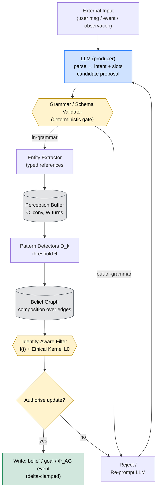
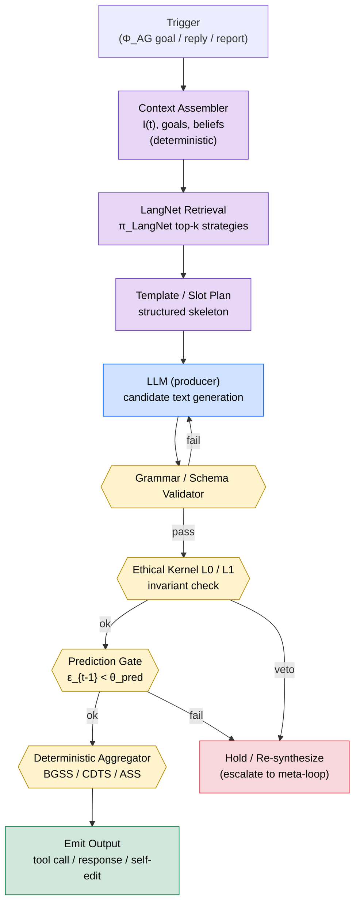

# LLM-프리 자율 언어: PLA의 근거

## 개정 이력

| 버전 | 날짜 | 설명 |
|------|------|------|
| 0.1.0 | 2026-06-14 | 초안. 점진적 언어 자율성(PLA, Overview §4.4.2)을 LLM에 위임할 수 없는 이유를 논증하고, 언어 자율성 갭(LAG)을 정의하며, 각 MSCP 레벨에서 LLM-프리 메커니즘이 필요한 지점을 매핑하고, 비-LLM 언어 합성 패턴 카탈로그를 정리. |
| 0.2.0 | 2026-11-03 | 엔트로피가 같으면 분포도 같다는 잘못된 추론과 LAG 기반 단계 판정을 제거했습니다. 반례와 젠슨-섀넌 진단 지표를 추가하고 PLA 단계를 승인 권한의 분리로 설명하며 안전 한계와 한국어 표현을 정비했습니다. |

> **동반 문서.** 이 문서는 [MSCP 개요](../MSCP_Overview.ko.md)의 점진적 언어 자율성(PLA) 설계를 설명합니다. 전체 구조와 용어는 개요의 4.4절을 먼저 참고하십시오. 공개 범위와 검증 한계는 [문서 상태와 검증 기준](Documentation_Status.ko.md)에 정리했습니다.

---

## TL;DR

LLM은 텍스트와 행동 후보를 생성할 수 있지만, 그 출력을 검증 없이 실행 권한으로 받아들여서는 안 됩니다. **점진적 언어 자율성(PLA)**은 에이전트가 더 복잡한 작업을 수행하더라도 생성과 승인 권한을 분리하도록 하는 설계입니다. 이 문서에서 **LLM-프리**란 LLM을 전혀 사용하지 않는다는 뜻이 아니라, 안전 관련 승인과 상태 갱신을 LLM의 응답에만 맡기지 않는다는 뜻입니다.

---

## 목차

1. [문제: 인지로서의 LLM vs 도구로서의 LLM](#1-문제-인지로서의-llm-vs-도구로서의-llm)
2. ["LLM-프리"가 실제로 의미하는 것](#2-llm-프리가-실제로-의미하는-것)
3. [자율성 갭(형식적 논증)](#3-자율성-갭-형식적-논증)
4. [MSCP 레벨이 LLM-프리 메커니즘을 *요구*하는 이유](#4-mscp-레벨이-llm-프리-메커니즘을-요구하는-이유)
5. [PLA 6단계 — 심화](#5-pla-6단계--심화)
6. [LLM 없이 동작하는 메커니즘(개념 카탈로그)](#6-llm-없이-동작하는-메커니즘-개념-카탈로그)
7. [LLM-프리 PLA가 가능하게 하는 안전 속성](#7-llm-프리-pla가-가능하게-하는-안전-속성)
8. [반론과 응답](#8-반론과-응답)
9. [기존 문서와의 관계](#9-기존-문서와의-관계)
10. [열린 질문(연구 프론티어)](#10-열린-질문-연구-프론티어)
11. [결론](#11-결론)

---

## 1. 문제: 인지로서의 LLM vs 도구로서의 LLM

### 1.1 기본 에이전트 아키텍처

일부 에이전트는 목표 선택, 계획 수정, 자기비판까지 LLM이 생성한 응답에 크게 의존합니다. 이 문서는 특히 **독립적인 승인 절차 없이 LLM 출력을 실행 결정으로 받아들이는 설계**를 검토합니다. 외부 정책, 도구 권한 검사, 독립적인 검증기가 있는 모든 프레임워크를 같은 범주로 취급하지는 않습니다.

이 제한적인 설계를 여기서는 **LLM 래퍼(LLM-wrapper)**라고 부릅니다. 간단한 작업에서 유용할 수 있지만, 장기간의 목표 관리와 자기 수정까지 맡기려면 별도의 상태 관리와 승인 계약이 필요합니다.

### 1.2 LLM-인지 패턴의 다섯 가지 실패 모드

다음은 생성과 승인을 분리하지 않았을 때 검토해야 할 위험입니다. 모든 LLM 기반 시스템에서 반드시 발생한다는 뜻은 아닙니다.

**(F1) 생성된 설명을 검증된 사실로 오인.** 독립적인 관측이나 검증이 없으면 자신감 있는 설명이 실제 증거를 대신할 수 있습니다. 도구가 반환한 관측과 모델이 생성한 주장을 구분하고, 중요한 작업은 확인된 근거에 따라 승인해야 합니다.

**(F2) 샘플링 변동과 의미 변화를 혼동.** L3는 버전이 명시된 자기 모델과 제한된 갱신을 사용합니다. 샘플링 변동, 측정 불확실성, 실제 의미 변화를 구분하지 않으면 표류 탐지의 신뢰도가 떨어집니다. 비결정성 자체가 금지되는 것은 아니지만, 관측과 승인 정책에서 이를 명시적으로 처리해야 합니다.

**(F3) 외부 텍스트가 승인 권한에 영향을 줌.** 신뢰하지 않는 입력을 정책이나 상태 변경 명령과 구분하지 않으면 프롬프트 인젝션이 실행 결정에 영향을 줄 수 있습니다. 자료형, 출처, 권한을 검사하는 별도의 경계가 필요하며, 경계의 존재만으로 모든 공격이 차단되는 것은 아닙니다.

**(F4) 자기 평가를 독립적인 검증으로 오인.** 같은 모델에 재평가를 요청하는 방법은 보조 신호가 될 수 있지만, 독립적인 관측이나 보정된 비교를 대신하지는 못합니다. L3의 메타인지 루프는 예측과 실제 결과를 구분하고 평가에 드는 깊이와 비용도 제한합니다.

**(F5) 검증·복구 경로가 없는 자기 수정.** 생성된 지시를 바로 적용하면 변경 이력, 스키마 검사, 복구 지점이 누락될 수 있습니다. L4의 제한된 자기 수정은 후보 제안과 실제 적용을 분리하고, 내부 상태 복구와 이미 발생한 외부 효과의 조정을 따로 다룹니다.

### 1.3 명제 1: 권위 vs 산출

> **명제 1 (권위 분리).** LLM은 *산출물 생산자(artifact producer)* 이지 *의사결정 권위(decision authority)* 가 아닙니다. PLA는 언어 매개 자율성이 성장해도 이 두 역할을 계속 분리해 두도록 학습해 가는 단계적 곡선입니다.

본 문서의 나머지는 MSCP 맥락에서 "의사결정 권위" 가 무엇을 의미하는지, 왜 그것을 LLM에 위임할 수 없는지, 무엇은 정당하게 위임할 수 있는지를 풀어냅니다.

---

## 2. "LLM-프리"가 실제로 의미하는 것

### 2.1 오해 1: "LLM-프리 = LLM 안 씀"

아닙니다. 사용자 요청 해석, 응답 작성, 도구 인자 후보 제안, 내부 상태 설명에는 LLM을 사용할 수 있습니다. 핵심은 LLM을 제거하는 것이 아니라, 안전 관련 상태의 변경을 LLM이 단독으로 승인하지 못하게 하는 것입니다.

### 2.2 오해 2: "LLM-프리 = 기호적 AI 회귀"

이것도 아닙니다. LLM-프리 메커니즘은 벡터 임베딩, 경사 학습 네트워크, 학습된 분류기, 검색 시스템 등 현대 ML 컴포넌트를 자유롭게 사용합니다. 제약은 *표현(representation)* 이 아니라 *권위(authority)* 에 걸려 있습니다. 결정론적 결정 경계를 내놓는 학습된 분류기는 좋고, "가장 가능성 높은 다음 문장" 을 결정으로 삼는 LLM은 안 됩니다.

### 2.3 정확한 정의

> **정의 1 (LLM-프리 권위).** 입력 $x$로부터 출력 $o$를 산출하는 메커니즘 $M$이 *LLM-프리* 라는 것은, 모든 입력 $x$에 대해 함수 $x \mapsto o$가 다음을 만족함을 의미합니다:
>
> 1. 에이전트의 영속 상태가 주어졌을 때 **결정론적(deterministic)** 이거나,
> 2. 측정·감시 가능한 샘플링 정책 하에서 **분산이 유계(bounded variance)** 이며,
> 3. **검증 가능(verifiable)** — LLM을 재실행하지 않고 독립 모듈이 출력을 점검할 수 있고,
> 4. **가역(reversible)** — $o$가 에이전트의 정체성 벡터, 목표 집합, 자기 모델에 미친 영향을 롤백할 수 있다.
>
> LLM은 $o$의 후보를 *제안* 할 수 있지만, $o$의 *채택* 은 위 (1)~(4)를 만족하는 모듈이 수행해야 합니다.

이 정의는 LLM이 10개의 후보 자기수정을 제안하고 결정론적 검증기가 0개, 1개, 또는 여러 개를 고르는 아키텍처를 허용합니다. LLM의 첫 샘플이 *곧* 자기수정인 아키텍처는 금지합니다.

### 2.4 권위 분리 표

| 활동 | LLM이 수행 가능 | LLM이 단독으로 수행 불가 |
|------|:---------------:|:-----------------------:|
| 사용자 요청 파싱 | ✓ | — |
| 자연어 응답 생성 | ✓ | — |
| 후보 도구 인자 제안 | ✓ | 도구 호출 확정 |
| 자기 모델 편집 초안 작성 | ✓ | 편집 적용 |
| 내부 목표의 사용자용 언어화 | ✓ | 목표 합성 |
| 예측 vs 결과 비교(L3 §3.1) | ✗ | ✗ (결정론적이어야 함) |
| 정체성 벡터 $I(t)$ 변경 | ✗ | ✗ (델타 클램프만, L3 §4.2) |
| 윤리적 커널 Layer 0 평가(L3 §4.3) | ✗ | ✗ (불변 invariants) |
| ASS 동결 결정(L4.9, ASS $< 0.05$) | ✗ | ✗ (LLM이 자기 게이트를 우회) |

이 구분은 의도적입니다. LLM은 후보와 설명을 생성할 수 있지만, 안전 관련 승인을 자신의 응답만으로 확정할 수는 없습니다.

---

## 3. 자율성 갭 (형식적 논증)

이 절에서는 출력 분포를 요약하는 진단 지표와 아키텍처의 필수 조건을 구분합니다. 엔트로피나 출력 분포의 차이만으로 MSCP 레벨을 판정할 수는 없습니다.

### 3.1 언어 자율성 갭의 정의

> **정의 2 (언어 자율성 갭).** $p_{\text{LLM}}(o \mid x)$를 프롬프트 $x$에 대한 순수 LLM completion의 출력 분포라 하고, $p_{\text{agent}}(o \mid x, \mathcal{W}, I)$를 전체 에이전트(LLM + LLM-프리 메커니즘 + 세계 모델 $\mathcal{W}$ + 정체성 벡터 $I$)가 유도하는 출력 분포라 하자. 시점 $t$에서의 **언어 자율성 갭**은 두 엔트로피의 차이로 정의된다:
>
> $$\text{LAG}(t) = H\!\bigl(p_{\text{LLM}}(o \mid x_t)\bigr) - H\!\bigl(p_{\text{agent}}(o \mid x_t, \mathcal{W}_t, I(t))\bigr)$$

LAG가 양수이면 명시된 측정 조건에서 에이전트 출력의 엔트로피가 더 낮다는 뜻입니다. LAG는 0이나 음수일 수도 있습니다. 이 값만으로 변화의 원인이나 승인 권한의 주체를 알 수 없으며, 에이전트가 LLM 출력을 그대로 따르는지도 판정할 수 없습니다.

### 3.2 엔트로피가 같아도 분포는 다를 수 있음

$\text{LAG}(t)\to0 \implies p_{\text{agent}}\to p_{\text{LLM}}$이라는 추론은 성립하지 않습니다. 예를 들어 $p=(0.9,0.1)$과 $q=(0.1,0.9)$의 엔트로피는 같지만 총변동거리는 $0.8$입니다. 반대로 독립적인 안전 검증기가 안전한 LLM 제안을 그대로 승인하면, 승인 권한이 분리되어 있어도 최종 출력은 같을 수 있습니다.

따라서 엔트로피 차이만으로 자율성, 안전성, 정체성 표류, 독립적인 검증기의 유무를 판단해서는 안 됩니다.

### 3.3 선택적으로 사용할 수 있는 분포 차이 지표

동일하게 정의된 출력 공간에서 두 분포를 추정할 수 있다면, 보조 지표로 젠슨-섀넌 발산을 사용할 수 있습니다:

$$D_{\mathrm{JS}}(p,q)=H\!\left(\frac{p+q}{2}\right)-\frac{H(p)+H(q)}{2},\qquad 0\leq D_{\mathrm{JS}}\leq1$$

이 범위는 밑이 2인 엔트로피를 사용한 경우입니다. 샘플링 정책, 출력 표현, 표본 수, 불확실성, 공통 입력 조건을 함께 보고해야 합니다. 추정할 수 없는 값은 0이 아니라 측정 불가로 표시합니다. 이 발산 역시 출력의 차이를 나타낼 뿐, 승인 권한이나 언어 품질을 입증하지는 않습니다.

### 3.4 승인 권한의 분리로 보는 PLA 단계

PLA 단계는 엔트로피 차이가 계속 커지는 과정이 아니라, 어떤 결정을 독립적인 메커니즘으로 검증해야 하는지를 나타냅니다:

| PLA 단계 | 독립적으로 검증할 메커니즘 | 평가할 항목 |
|:--------:|--------------------------|------------|
| Stage 0 (L1) | 호스트 정책과 제한된 도구 실행 승인 | 실행 간 에이전트 소유 인지 상태가 없는지 |
| Stage 1 (L2) | 지속적인 목표 관리와 트리거 승인 | 후속 실행의 권한, 목표의 출처 |
| Stage 2 (L3) | 예측 비교, 자기 갱신 승인, 불변 조건 검사 | 예측 오차 보정, 모든 쓰기 경로의 검증 |
| Stage 3 (L4) | 전략 평가와 전이 성능 평가 | 미사용 평가 데이터에서의 전이, 자기 수정 범위 |
| Stage 4 (L4.5–L4.8) | 자기 투영 검증과 불확실성 보정 | 모델 오차, 관측 가능성, 복구 가능성 |
| Stage 5 (L5) | 연구 작업 승인, 가치 변화 감사, 재구성 검증 | 사전 등록한 필수 조건별 평가 |

### 3.5 명제 2: LLM-래퍼 함정

> **명제 2 (LLM 래퍼의 구조적 한계).** 에이전트가 소유하는 지속적인 인지 상태, 자율적인 목표 관리, 승인된 후속 실행이 없는 시스템은 LLM의 성능이나 출력 엔트로피와 관계없이 레벨 2 진입 조건을 충족하지 않습니다.

이는 정보이론적 불가능성 정리가 아니라 [레벨 1에서 레벨 2로의 전환 정의](../levels/Level_1_Tool_Agent.ko.md#7-레벨-2로의-전환)에서 따르는 결론입니다. 상위 레벨은 추가 계약을 독립적으로 평가해야 하며, LLM의 성능만으로 그 계약의 충족 여부를 판정할 수 없습니다.

---

## 4. MSCP 레벨이 LLM-프리 메커니즘을 *요구*하는 이유

다음 표는 MSCP 스택을 따라가며, 각 레벨에서 *반드시* LLM-프리여야 하는 메커니즘과, LLM에 위임 시 발생하는 구체적 실패 모드를 나열합니다.

| MSCP 요소 | 문서 위치 | 요구되는 LLM-프리 메커니즘 | LLM에 위임 시 무엇이 깨지는가 |
|-----------|-----------|---------------------------|--------------------------------|
| 자율 목표 생성 $\Phi_{AG}$ | L2 §3.2 (정의 6) | 지각 버퍼에 대한 결정론적 패턴 감지기 | 목표 우선순위가 샘플링 잡음으로 진동; 왜 목표가 발행됐는지 사용자가 재현 불가 |
| 예측-비교-갱신 핵심 루프 | L3 §3.1 (정의 2) | $\hat{\Delta}$ vs $\Delta^{\text{actual}}$의 결정론적 비교 | "LLM이 자기 예측이 좋았다고 생각" — 메타 순환, 보정 신호 없음 |
| 행동별 예측 기반 승인 | L3 §3.3 | 정책, 보정된 불확실성과 위험, 관측 가능성, 가역성, 예산 검사 | 과거의 전역 오차나 자체 보고한 정확도만으로는 승인할 수 없음 |
| 무결성과 변경 이력 | L3 §4.3 (정의 6) | 정규화된 표현의 해시와 변경 기록; 의미적 거리와 구분 | 설명이 일관된다고 무결성이나 변경 이력이 유효해지는 것은 아님 |
| 델타 클램프 $\delta_{\max}=0.05$ | L3 §4.2 | $\|I(t)-I(t-1)\|_2$에 대한 수치 클리핑 | 자기 편집이 단일 사이클 내에 무한 표류 |
| 윤리적 커널 계층 0 | L3 §4 | 모든 적용 경로에서 자료형이 명시된 불변 조건 검사 | 모델이 생성한 해석은 독립적인 승인을 대신하지 못함 |
| 신념 그래프 일관성 | L3 §5 | 그래프 순회 모순 감지기 | LLM은 어떤 신념이든 정당화함; 모순 미검출 |
| 종합 위험 $R(t)$과 진동 모니터 | L3 §6.1, §6.2 | 버전별 신호와 보정된 성분·변화량 검사 | 진단 신호는 수렴 증명이 아님 |
| Bounded Self-Modification(7단계) | L4 §8.2 | 스키마 검증 패치 + ShadowAgent 시뮬레이션 + 롤백 | 자기수정이 되돌릴 수 없는 텍스트 표류가 됨 |
| 교차 도메인 전이 점수 | L4 §4.2 | 테스트 도메인에 대한 정량 성공률 | LLM은 전이될 것 "같다" 고 느낌; 실제 전이는 미검증 |
| LangNet 검색 $\pi_{\text{LangNet}}(q, d)$ | Overview §4.4.3 | 임베딩 유사도 + 그래프 엣지 | LLM이 LangNet에 없는 전략을 환각 |
| ProbabilisticWorldModel + ConfidenceCalibrator | L4.8 §1.5 | 베이즈 갱신 + Brier-score 보정 | LLM의 "80% 확신" 은 무의미 |
| Skill Gap Analyzer | L4.8 §1.5 | 능력 행렬 위의 집합 차이 | LLM은 자기가 모르는 것을 신뢰성 있게 열거 못 함 |
| Strategy Comparator | L4.8 §1.5 | 점수 매겨진 전략의 수치 비교 | LLM은 장황한 것을 고르지, 효용 높은 것을 고르지 않음 |
| ASS 동결 게이트(ASS $< 0.05$) | L4.9 §1.6 | ASS 스칼라에 대한 임계 검사 | 게이트가 LLM 호출이면, LLM이 자기 게이트를 우회 |
| 목표 충돌 해소기 | L4.9 §3.6 | 가중 효용 합성 / 우선순위 정렬 | LLM은 사후적으로 어떤 승자든 합리화 |
| 복합 정체성 연속성 계약 | L5 §2.1 | 불변 기준, 성분, 크기, 변화 경로, 변경 이력, 외부 통제 수용성 검사 | 코사인 유사도만으로는 희석이나 핵심 성분의 실패를 놓칠 수 있음 |
| 자율 연구 루프(F4) | L5 §1.6 | 스킬 갭 기반 질의 합성 + 관측 통합 | LLM은 답을 작화함으로써 "연구" |
| 가치 진화 & 일관성 감사(F6) | L5 §1.6 | 가치 벡터 궤적의 거리 감사 | LLM은 서사적 일관성을 만들 뿐 metric 일관성은 못 만듦 |
| 자기재건 $\mathcal{R}_{\text{recon}}$ | L5 §8 | 드리프트 $\Delta < 0.05$의 정체성 보존형 재건 | LLM은 다른 에이전트를 만들고 같은 이름이라 부름 |

패턴: **MSCP 한 레벨을 다음 레벨과 구분하는 모든 안전 메커니즘은 LLM-프리이다.** LLM-프리 메커니즘을 제거하면 레벨 분류 자체가 무너집니다.

---

## 5. PLA 6단계 — 심화

Overview §4.4.2의 표는 6단계를 간략히 소개했습니다. 여기서는 각 단계를 세 블록으로 풀어 씁니다: *LLM이 하는 일*, *LLM-프리 모듈이 하는 일*, *다음 단계로의 전이를 무엇이 검증하는지*.

### 5.1 Stage 0 (L1) — 도구 디스패치

- **LLM이 하는 일:** 사용자 요청을 의도 + 인자로 파싱; 도구 출력을 사용자에게 자연어로 포맷.
- **LLM-프리 모듈:** 도구 레지스트리 $\mathcal{T}$ (정의 2, L1 §1.2); 의도 분류기 신뢰도 임계; 응답 포맷터.
- **Stage 1로의 전이:** 호스트 AGI Engine이 L2 스택을 활성화 — 지각 버퍼와 대화 맥락 $\mathcal{C}_{\text{conv}}$가 인스턴스화.

Stage 0에서는 $\text{LAG} \approx 0$이 허용됩니다 — LLM 잡음이 부패시킬 영속 자기 모델이 없기 때문입니다. 위험은 도구 계층으로 한정됩니다.

### 5.2 Stage 1 (L2) — 자율 목표 생성

- **LLM이 하는 일:** 사용자 요청을 언어화; 다운스트림 도구를 위해 개체 참조를 요약; 목표 생성기가 발행한 목표의 자연어 진술 초안 작성.
- **LLM-프리 모듈:** 자율 목표 생성기 $\Phi_{AG}$ (L2 §3.2, 정의 6); 목표 우선순위 함수 $p(g,t)$; 개체 상태 추적기; 대화 맥락 $\mathcal{C}_{\text{conv}}$ (L2 §1.7).
- **Stage 2로의 전이:** L3 핵심 루프 활성 — 예측 스냅숏·정체성 벡터·윤리적 커널이 채워짐.

Stage 1 핵심 불변량은 *에이전트가 사용자가 요청하지 않은 목표를 발행할 수 있되*, *그 발행 결정* 자체는 지각 버퍼 위의 LLM-프리 패턴 감지기가 내린다는 점입니다 — LLM completion이 절대 아닙니다. 그렇지 않으면 에이전트는 매 샘플마다 가상 목표를 양산합니다.

### 5.3 Stage 2 (L3) — 예측 게이팅을 갖춘 자기비판

- **LLM이 하는 일:** 후보 행동 생성; 로그용 자기 보고 서술; 에이전트가 일시정지한 이유를 사용자에게 설명하는 표현 도움.
- **LLM-프리 모듈:** 예측 엔진(L3 §3); $\epsilon_{t-1}$을 산출하는 결정론적 비교기; 예측 게이트 $\theta_{\text{pred}}=0.30$ (L3 §3.3); 델타 클램프된 정체성 벡터; 윤리적 커널 Layer 0 + Layer 1 (L3 §4.3); 신념 그래프(L3 §5); 랴프노프 합성 $C(t)$ + 진동 감지기(L3 §6).
- **Stage 3로의 전이:** L4 스택이 능력 획득 파이프라인·교차 도메인 전이 점수·Bounded Self-Modification 프로토콜을 활성화.

Stage 2는 MSCP의 안전 논증이 결합하기 시작하는 지점입니다. 여기서 에이전트는 자기 예측 정확도가 저하되었을 때 후보 행동의 실행을 거부할 수 있고 — 그 거부는 *LLM 판단이 아닙니다*.

### 5.4 Stage 3 (L4) — 전략 합성과 전이

- **LLM이 하는 일:** 후보 전략 기술 제안; 전이 가설 언어화; 전략 검증기를 위한 반사실 테스트 시나리오 생성 보조.
- **LLM-프리 모듈:** 능력 격차 점수(L4 §6.1); 5단계 능력 확장 파이프라인(L4 §6.2); 기술 생명주기 상태 기계(L4 §6.3); 교차 도메인 전이 점수기(L4 §4); LangNet 검색(Overview §4.4.3); ShadowAgent 시뮬레이션을 포함한 Bounded Self-Modification 7단계(L4 §8.2).
- **Stage 4로의 전이:** L4.5 자기투영 엔진이 활성 — 다중 궤적 미래와 병렬 인지 프레임을 시뮬레이션.

Stage 3 기여는 **전략 재사용이 검색되지, 생성되지 않는다**는 것입니다. LLM은 "이전에 비슷한 걸 본 적 있나?" 를 제안할 수 있지만, 실제 매칭은 LangNet의 결정론적 검색이고, 실제 점수는 CDTS입니다.

### 5.5 Stage 4 (L4.5 – L4.8) — 자기투영과 확률적 세계 모델링

- **LLM이 하는 일:** 자기투영 엔진이 산출한 궤적을 언어화; 병렬 인지 프레임용 시나리오 기술 초안 작성 보조; 확률적 예측을 사용자에게 설명.
- **LLM-프리 모듈:** 세 시간 스케일에 걸친 자기투영 엔진(L4.5 §3); 거부권 있는 윤리 프레임을 갖춘 병렬 인지 프레임(L4.5 §5); Graduated Recomposition Protocol을 갖춘 아키텍처 재구성(L4.5 §4); 비수정 커널의 실존적 감시기(L4.5 §7); ProbabilisticWorldModel, CapabilityMatrix, ConfidenceCalibrator, SkillGapAnalyzer, StrategyComparator(L4.8 §1.5); 평균 보정 오차 추적기.
- **Stage 5로의 전이:** L4.9 스택이 가치 벡터 추적·ASS 점수·목표 충돌 해소를 활성화하고, F3~F6 단계가 L5 케이던스 안에서 스케줄링되기 시작.

Stage 4는 에이전트가 *예지력*을 얻는 곳입니다. 결정적 포인트는 그 예지력이 보정된 확률 분포 위에 세워진다는 것 — LLM이 미래에 대해 자기에게 들려주는 자신감 있는 이야기 위가 아니라는 점입니다. LLM이 자신감 있는 내일 이야기를 하는 것은 예지력이 아닙니다.

### 5.6 Stage 5 (L5) — 자율 연구와 가치 진화

- **LLM이 하는 일:** 연구 질문 초안; 발견의 표현; 진화한 가치를 사용자에게 전달하는 데 도움; 자기재건 보고서 서술.
- **LLM-프리 모듈:** $\geq 10{,}000$ 사이클에 걸친 정체성 지속 엔진(L5 §3); 교차 도메인 일반화 $\mathcal{G}_{\text{cross}}$(L5 §4); 충돌 해소 + 생명주기 관리를 갖춘 목표 생태계(L5 §5); 실존적 계획 엔진(L5 §6); 기만 탐지를 갖춘 다중 에이전트 전략 통합(L5 §7); 자기재건 $\mathcal{R}_{\text{recon}}$ (L5 §8); F3 자기진단; F4 자율 연구 루프; F5 장기 수평선 계획; F6 가치 진화 및 일관성 감사 (모두 L5 §1.6).
- **다음 단계는 공개된 MSCP 사다리에 존재하지 않습니다.** 본 분류 체계에서 L5는 PLA의 마지막 단계입니다.

Stage 5는 PLA가 가장 중요해지는 곳입니다. *자율적으로 연구하는* 에이전트는 정의상 외부 운영자 없이 새 질문을 생성하고 관측을 통합해야 합니다. 그 루프가 LLM-래퍼라면 에이전트는 답을 작화하고 작화를 발견으로 취급합니다. F4 자율 연구 루프가 Stage 5의 핵심 공학 과제인 *이유는 정확히* LLM을 키워서 풀 수 있는 문제가 아니기 때문입니다.

### 5.7 PLA 단계의 단조성

> **정의 3 (PLA 단계 단조성).** PLA 단계 $k$의 에이전트는 단계 $0, 1, \ldots, k{-}1$의 모든 LLM-프리 메커니즘을 보유한다. 인증된 PLA 단계 아래로의 퇴행 — 즉 이전에 LLM-프리였던 메커니즘을 LLM completion으로 대체하는 것 — 은 안정성 위반이며 메타 에스컬레이션(L3 §3.2)을 트리거한다.

단조성은 PLA 단계 분류가 안전 의미를 갖게 하는 핵심입니다. Stage 4에 *도달*하는 것만으로는 충분하지 않습니다; 사이클을 가로질러 *머물러야* 합니다. AGI Engine은 하위 LLM-프리 메커니즘이 하나라도 비활성화되면 더 높은 $\Delta_n$의 활성화를 거부함으로써 이를 강제합니다.

---

## 6. LLM 없이 동작하는 메커니즘 (개념 카탈로그)

"LLM이 아니라면 무엇으로?" 가 옳은 질문입니다. 아래는 MSCP 전반에서 LLM-프리 권위를 구현하는 데 사용되는 메커니즘 *패턴* 카탈로그입니다. 각 항목은 개념이지 레시피가 아닙니다; 구현은 다양할 수 있습니다.

### 6.1 템플릿 합성 (Template Synthesis)

슬롯 채움 템플릿 — "개체 $e$의 감정이 $< -0.5$이고 언급 횟수가 $\geq N$이면, 템플릿 *check_on($e$)* 으로 목표 $g$ 발행" — 은 저자가 LLM이 아닌 템플릿 작성자인 구조화된 출력을 산출합니다. 템플릿은 감사 가능하고, 버전 관리 가능하며, 가역적입니다. 문법 구성을 통해 복잡한 도메인으로 확장됩니다. L2의 자율 목표 표현, L3의 자기 보고 포맷팅에 사용.

### 6.2 신념 그래프 위의 합성 (Composition over Belief Graph)

신념 그래프(L3 §5)는 명제를 노드로, 함의/모순을 엣지로 저장합니다. 새 명제는 **그래프 합성**으로 유도됩니다 — $b_1 \Rightarrow b_2$이고 $b_2 \Rightarrow b_3$이면 정당화 경로가 기록된 유도 신념 $b_1 \Rightarrow b_3$가 됩니다. 이는 학습된 가중치 위의 기호적 유도이지 LLM completion이 아닙니다. L3의 자기일관성 텐서 계산, L4의 교차 도메인 전이 가설 생성에 사용.

### 6.3 LangNet 검색과 적응

전략·기술·능력은 LangNet(Overview §4.4.3) 안에 언어 임베딩 그래프 노드로 살고 있습니다. 검색 $\pi_{\text{LangNet}}(q, d_{\text{target}})$은 `applies-to` 이웃 위에서 임베딩 유사도로 상위 $k$개 전략 노드를 반환합니다. **적응**은 전략의 구조가 아니라 슬롯 바인딩만을 다시 씁니다 — 따라서 새 전략은 기존의 검증된 전략의 특수화임이 증명 가능합니다. 신규성은 유계이고 계보는 추적 가능합니다. L4의 교차 도메인 전이, L5의 교차 도메인 일반화 $\mathcal{G}_{\text{cross}}$에 사용.

### 6.4 임베딩 산술 (Embedding Arithmetic)

벡터 공간 연산 — 개념 클러스터의 중심, 도메인 축으로의 벡터 투영, 잔차 분해 — 은 결정론적 의미론으로 기존 의미들로부터 새 의미를 합성합니다. 연산 $v(\text{concept}_A) + v(\text{concept}_B) - v(\text{shared context})$는 재현 가능한 레시피이지 LLM completion이 아닙니다. L4의 능력 격차 점수 계산, L4.8의 신뢰도 보정에 사용.

### 6.5 문법 제약 생성 (Grammar-Constrained Generation)

후보 텍스트 생성에 LLM을 쓰더라도, 출력은 다운스트림 모듈이 읽기 전에 결정론적 문법(CFG, JSON 스키마, 정규식 뱅크, 구조화 출력 검증기)을 통해 *필터링*됩니다. 문법 외 샘플은 거부되고 LLM은 재프롬프트되며, 문법 내 샘플은 파싱·디스패치됩니다. 문법이 권위이고 LLM은 후보 원입니다. L1(도구 인자 검증)부터 L5(연구 질의 스키마)까지 전반에 사용.

### 6.6 예측-비교-갱신을 통한 자기비판

L3 핵심 루프(정의 2) 자체가 가장 중요한 LLM-프리 자기비판 메커니즘입니다: 행동 전에 결과를 **예측**하고, **행동**하고, 예측을 실제와 **비교**하고, 클램프된 델타로 자기 모델을 **갱신**. 어떤 단계도 LLM이 필요 없습니다. 에이전트의 자기 지식은 내성적 LLM 서사가 아니라 *현실과의 경험적 접촉*으로 개선됩니다. L3 이상의 모든 레벨에서 기본 자기 개선 substrate로 사용.

### 6.7 결정론적 집계자 (Deterministic Aggregators)

수치 점수 함수들 — 랴프노프 합성 $C(t)$(L3 §6.1), BGSS(Overview, L4), CDTS(L4), ASS(L4.9), OMI(L5), MSI(L3) — 은 가중치와 임계가 문서화된, 단일 감사 가능 스칼라로 고차원 인지 상태를 축약합니다. 이들은 MSCP의 모든 동결 게이트·에스컬레이션 트리거·인증 검사의 substrate입니다. 어느 것도 LLM 호출이 아닙니다.

### 6.8 참조 아키텍처: 언어 이해 파이프라인

아래 다이어그램은 *외부 발화*를 에이전트의 신념·목표·정체성 벡터에 대한 *권한 부여된 갱신*으로 변환하는 데이터 경로를 추적합니다. LLM은 경계에서 한 번, 후보 산출자로만 등장합니다. 그 하류의 모든 게이트는 LLM-프리이며 의사결정 권위를 보유합니다.

**다이어그램 읽기.** 파랑 = LLM(제안자, 결코 권위 아님). 노랑 = 결정론적 게이트(문법, 정체성 인식 필터, 결정). 회색 = 영속 저장소(지각 버퍼, 신념 그래프). 초록 = 영속 상태를 변형하는 유일한 sink — 게이트들이 모두 승인한 뒤에만 작동. 문법 외 LLM 출력은 조용히 강제 변환되지 않고 되돌려 보내집니다 — 이것이 프롬프트 인젝션 입력이 유효한 의도로 위장하는 것을 막는 메커니즘입니다.

### 6.9 참조 아키텍처: 언어 합성 파이프라인

합성 다이어그램은 그 역방향 경로를 추적합니다: *내부 트리거*(자율 생성된 목표, 사용자 응답 의무, 자기 보고)가 *방출 산출물*(도구 호출, 응답 텍스트, 자기수정)이 됩니다. 여기서도 LLM은 상류의 결정론적 컨텍스트 어셈블러와 하류의 결정론적 게이트 스택 사이에 끼어 있는 산출자입니다.

**다이어그램 읽기.** LLM은 결코 *방출할지 말지*를 결정하지 않고, *무엇을 방출할 수 있는지* 만 제안합니다. 세 개의 독립적 LLM-프리 게이트가 동시에 동의해야 합니다: 문법(구조 유효성), 윤리적 커널(불변 호환성), 예측 게이트(에이전트의 최근 예측이 행동을 정당화할 만큼 정확). 어느 게이트에서든 실패하면 더 부드러운 LLM 사과로 가는 게 아니라 *Hold / Re-synthesize*로 라우팅됩니다 — 자신감 있게 틀린 행동보다 침묵이 더 안전한 기본값입니다. 집계자 점수는 외부 감사자나 부모 AGI Engine이 방출이 정당했음을 인증하기 위해 재생할 수 있는 값입니다.

### 6.10 두 다이어그램의 공통 불변량

두 파이프라인은 같은 불변량을 보이며, 이들이 모여 LLM-프리 PLA 경계의 실무적 정의를 구성합니다:

1. **방향당 단일 LLM 노드.** 이해에는 LLM 하나(파싱), 합성에는 LLM 하나(생성)가 있습니다. 결정론적 게이트 없이 LLM 호출을 연쇄로 잇는 것은 금지 — 그런 쌍 하나하나가 권위 표면을 넓힙니다.
2. **게이트가 산출자보다 많다.** 두 다이어그램 모두 결정론적 게이트 : LLM 노드 비율이 최소 3:1입니다. 이것이 "권위 분리"(정의 1)의 구조적 형태입니다.
3. **실패 경로는 루프, 결코 우회 아님.** 실패한 LLM 출력은 다음 단계로 강제되지 않고 재프롬프트되거나 보류됩니다. 이것이 조용한 fallback 안티패턴을 금지합니다.
4. **영속 상태 변경은 종단점.** 신념 그래프 쓰기(이해)와 방출 산출물(합성)은 모든 게이트가 승인한 뒤 파이프라인 끝에서만 발생합니다. 중간에 상태를 쓰는 shortcut은 없습니다.
5. **모든 게이트는 재생 가능.** 같은 입력과 같은 영속 상태가 주어지면 모든 게이트는 같은 판정을 냅니다. 이것이 §7.1의 감사 가능성 주장을 구체화합니다.

이 다섯 조건은 생성과 승인 권한을 분리하기 위한 설계 계약입니다. $\text{LAG}(t)>0$과 동치가 아니며, 모듈 이름이나 출력 통계만으로 준수 여부를 판정할 수 없습니다. 각 실행·쓰기 경로에서 계약이 실제로 적용되는지 검사해야 합니다.

---

## 7. LLM-프리 PLA가 가능하게 하는 안전 속성

LLM-프리 메커니즘에 대한 투자는 미학적인 것이 아닙니다. 각각은 LLM-래퍼 아키텍처가 제공할 수 없는 속성입니다.

### 7.1 감사 가능성 (Auditability)

결정 경로가 LLM-프리 함수 호출들로 구성되면, 로그로부터 결정론적으로 재구성할 수 있습니다. *"에이전트가 시점 $t$에 목표 $g$를 발행한 이유는, 지각 버퍼에 최근 $W$ 턴 동안 개체 $e$에 대한 부정적 감정 언급이 $n$건 있었고, 이것이 패턴 감지기 $D_3$의 임계 $\theta$를 넘었기 때문이다."* 이 문장은 완전하고 검증 가능한 설명입니다. 대응되는 LLM-래퍼 설명은 *"LLM이 좋은 생각이라 여겼다"* 정도인데, 사실이라 해도 도움이 안 됩니다.

### 7.2 재현성 (Reproducibility)

결정론적인 구성 요소는 같은 입력, 상태, 코드·정책 버전에서 같은 결과를 재현할 수 있습니다. 확률적 구성 요소도 시드, 샘플링 정책, 관측을 기록하면 통계적인 회귀 검사를 설계할 수 있습니다. 전체 재현성은 스케줄링, 외부 도구, 부동소수점 연산과 환경까지 포함해 평가해야 합니다.

### 7.3 프롬프트 인젝션 표면 축소

신뢰하지 않는 입력과 승인 권한을 분리하면 텍스트가 정책이나 자기 모델을 직접 바꾸는 경로를 줄일 수 있습니다. 다만 잘못된 관측, 도구 결과, 허용된 작업의 악용 같은 위험은 남습니다. 자료형·권한 검사와 모든 쓰기 경로의 검증을 실제 위협 모델에서 시험해야 합니다.

### 7.4 PLA 인증을 통한 점진적 신뢰 부여

AGI Engine은 PLA 단계를 인증한 뒤에야 $n \geq 2$에 대해 $\Delta_n$을 활성화합니다. 인증 자체가 LLM-프리 절차입니다: 인지 상태 벡터를 검사하고, 대상 단계가 요구하는 LLM-프리 메커니즘이 존재·활성화되어 있는지 검증한 뒤 게이트가 열립니다. 요구 LLM-프리 메커니즘이 하나라도 없거나 비활성이면, LLM이 얼마나 강력하든 게이트는 닫힌 상태로 남습니다. 이것이 점진적·증거 기반 신뢰 부여이며 — "엄격 가산" 원칙(L4.5, L5)과 호환되는 유일한 종류입니다.

### 7.5 LLM 교체 가능성

영속 상태와 승인 규칙을 LLM 밖에 두면 모델 교체의 영향을 줄일 수 있습니다. 그렇더라도 응답 분포, 도구 사용, 보정 오차는 달라질 수 있으므로 호환성 검사와 재평가가 필요합니다. 모델 교체가 단순한 설정 변경이거나 행동을 그대로 보존한다고 가정해서는 안 됩니다.

---

## 8. 반론과 응답

반론에 대한 정직한 응답.

### 8.1 "충분히 큰 LLM이 다 해결할 것"

**반론.** 스케일은 환각을 줄인다; 미래 LLM은 인지 substrate가 될 만큼 신뢰성 있을 것이다.

**응답.** 스케일은 *분산*을 줄이지만, 샘플러가 자기 샘플을 권위 있는 것으로 취급한다는 아키텍처 사실을 바꾸지는 않습니다. 더 큰 LLM도 여전히 자기 환각을 자기에게 귀속시킵니다 — 단지 덜 자주 그럴 뿐입니다. 실패 모드 (F1)~(F5)는 통계적이 아니라 구조적입니다. MSCP v0.4의 교훈(Overview §3.1)이 일반화됩니다: *LLM 텍스트 출력은 스케일과 무관하게 안전 substrate가 아닙니다.* 게다가 "덜 자주" 는 안전의 단위가 아닙니다. 백만 사이클에 한 번 자기 모델을 파국적으로 오인하는 에이전트는, 운영 케이던스에서는 잦은 파국입니다.

### 8.2 "이중 시스템은 비용이 두 배"

**반론.** LLM과 병렬 LLM-프리 스택을 동시에 유지하면 엔지니어링 비용이 두 배가 된다.

**응답.** 비용은 대략 *substrate 개발* 노력 두 배이고 *추론* 비용은 거의 0 증가입니다(LLM-프리 모듈은 보통 LLM 호출보다 훨씬 쌉니다). ROI는 감사 가능성·재현성·점진적 신뢰입니다 — 어느 것도 LLM-래퍼 에이전트에 나중에 끼워 넣을 수 없습니다. 비용은 PLA 단계에 따라 천천히 오르고; 비용을 *지불하지 않은 데 따른 비용*은 자율 배포와 함께 빠르게 오릅니다.

### 8.3 "결정론적 모듈은 LLM 지능을 따라잡을 수 없다"

**반론.** 손으로 작성된 목표 생성기는 "다음에 뭘 할지 LLM에 물어봐" 에 비해 부서지기 쉽다.

**응답.** 이 반론은 지능의 두 의미를 혼동합니다: *산출(production)* (유창하고 맥락에 맞는 텍스트를 만드는 것)과 *권위(authority)* (에이전트가 무엇을 할지 결정하는 것). LLM-프리 모듈은 산출에서 LLM을 *능가*하도록 요구되지 않습니다 — LLM의 권위를 *담아두도록* 요구됩니다. LLM이 후보를 제안하고 LLM-프리 규칙이 채택하는 결정론적 목표 생성기는 보통 어느 한쪽 단독보다 *더 잘* 동작합니다 — LLM은 유창성을, LLM-프리 규칙은 일관성을 기여하기 때문입니다.

### 8.4 "실제 에이전트는 다 LLM-래퍼이고 잘 동작하는 것처럼 보인다"

**반론.** 주요 프레임워크가 LLM-래퍼 에이전트를 출시하고 사용자들이 만족한다.

**응답.** 배포된 에이전트 대부분은 MSCP 분류상 L1 또는 낮은 L2에 있습니다: 도구를 실행하고, 짧은 대화를 하고, 세션 간에 리셋됩니다. 이 자율성 수준에서 LLM-래퍼 패턴은 허용 가능합니다 — LLM 잡음이 부패시킬 영속 자기 모델이 없기 때문입니다. 프레임워크가 "잘 동작" 하는 이유는 기준이 "단일 사용자 요청 완료" 이기 때문입니다. 자율성 요구가 상승하면 — 영속 목표, 다일 추론, 자기수정 — LLM-래퍼 패턴은 §1.2가 열거한 방식대로 예측 가능하게 실패합니다.

### 8.5 "PLA는 그저 기호 AI의 재발명"

**반론.** "LLM-프리 의사결정 권위" 는 신경망에 정당한 이유로 졌던 GOFAI 규칙 엔진의 멋진 이름일 뿐이다.

**응답.** PLA는 기호적 메커니즘을 요구하지 않습니다. §6의 LLM-프리 모듈 다수는 그 자체가 학습된 것입니다(임베딩 공간, 보정된 분류기, 검색 네트워크). 제약은 *표현*이 아니라 *권위*에 걸려 있습니다. PLA는 LLM 이전이 아니라 LLM 이후입니다(post-LLM): "이제 LLM이 있으니, 에이전트의 결정 파이프라인 어디에 LLM 출력을 두지?" 라고 묻습니다. "모든 곳"(LLM-래퍼)이라는 답과 "어디에도 없음"(기호적 순수주의)이라는 답은 모두 틀렸고, PLA 단계는 그 사이의 답을 차트로 그립니다.

---

## 9. 기존 문서와의 관계

이 문서의 설계 논의는 다음 MSCP 문서의 정의와 계약을 참조합니다:

| MSCP 문서 | 제공하는 것 | 본 문서가 사용하는 방식 |
|-----------|------------|------------------------|
| [Overview §3.1](../MSCP_Overview.md) — 초기 프로토타이핑 교훈 | MSCP v0.4 발견: LLM 자기 성찰은 신뢰 불가 | §1.2 (F4)와 §8.1이 권위 분리의 증거로 직접 인용 |
| [Overview §4.4](../MSCP_Overview.md) — 명명된 아키텍처 개념 | AGI Engine, PLA 단계, LangNet 도입 | §5가 PLA 단계 표를 확장; §6이 LangNet 위에 구축 |
| [Overview §2.5](../MSCP_Overview.md) — 레벨별 핵심 임계값 | 수치 임계(예측 오차, ASS 동결, OMI) | §4가 각 임계값을 그 LLM-프리 강제자에 매핑 |
| [Glossary](MSCP_Glossary.md) | 정식 정의와 약어 목록 | §3이 거기 등록된 LAG 약자를 도입 |
| [L2 §1.7](../levels/Level_2_Autonomous_Agent.md) — 대화 맥락 | $\mathcal{C}_{\text{conv}}$ 구조 | §5.2 Stage 1 전이 트리거 |
| [L3 §3.1, §3.3](../levels/Level_3_Self_Regulating_Agent.md) | 핵심 루프, 예측 게이팅 | §1.2 (F4), §4, §5.3 |
| [L3 §4](../levels/Level_3_Self_Regulating_Agent.md) — 정체성 & 안전 | 정체성 벡터, 델타 클램프, 윤리적 커널 | §1.2 (F2), §2.4, §4 |
| [L4 §4, §6, §8](../levels/Level_4_Adaptive_General_Agent.md) | CDTS, 능력 확장, Bounded Self-Modification | §4, §5.4 |
| [L4.5 §3, §5, §7](../levels/Level_4_5_Self_Architecting.md) | 자기투영, 병렬 프레임, 실존적 감시기 | §5.5 |
| [L4.8 §1.5](../levels/Level_4_8_Strategic_Self_Modeling.md) | 확률적 세계 모델링, 신뢰도 보정 | §4, §5.5 |
| [L4.9 §1.6, §3.6](../levels/Level_4_9_Autonomous_Strategic_Agent.md) | ASS 동결 게이트, 목표 충돌 해소 | §4 |
| [L5 §1.6](../levels/Level_5_Proto_AGI.md) — F 단계 | 자율 연구 루프, 가치 진화 감사 | §5.6 |

---

## 10. 열린 질문 (연구 프론티어)

PLA 프레임워크는 다음을 열어둡니다. 각 항목은 로드맵이 아니라 초대장입니다.

**(Q1) 실제로 LAG를 어떻게 측정하는가?** 정의 2(§3.1)는 원칙적이지만 $p_{\text{LLM}}$과 $p_{\text{agent}}$를 대규모로 샘플링해야 합니다. 실용적 대용물 — 예: 고정 시드 섭동 하의 결정별 행동 발산 — 이 유용할 것입니다.

**(Q2) Stage 4 → Stage 5 전이를 자동 인증할 수 있는가?** "자율 연구 루프 F4가 운영자 개입 없이 닫힌다" 라는 Stage 5 요구는 사전 검증이 어렵습니다. 이를 포착하는 오프라인 테스트 벤치가 있을까요?

**(Q3) 적대적 PLA 단계 강등.** 에이전트 입력 채널에 쓸 수 있는 공격자가 인증된 PLA 단계를 취소시키고 (에이전트를 LLM-래퍼 행동으로 되돌릴 수 있는가)? 위협 모델은 무엇인가?

**(Q4) 다중 에이전트 PLA 추론.** 다른 PLA 단계의 에이전트들이 협력할 때(L5 §7), 더 높은 단계의 에이전트가 자신이 상호작용하는 낮은 단계 에이전트의 PLA 단계를 신뢰성 있게 추론할 수 있는가? 어느 방향이든 오추정은 안전상 결과를 낳습니다.

**(Q5) PLA 단계와 인간 감독.** PLA 단계가 상승해도 인간 운영자의 실질 감독 능력은 일정합니다. "human in the loop" 가 여전히 유의미한 최대 PLA 단계는 무엇이며, 그 이상에서는 어떤 모니터링 메커니즘이 대체하는가?

**(Q6) LLM-프리 신규성.** Stage 5는 진정으로 새로운 연구 산출을 요구합니다. §6의 메커니즘은 유계입니다(템플릿은 저자가 있고, LangNet 적응은 기존 전략을 특수화하며, 임베딩 산술은 알려진 개념 위에서 동작합니다). LLM-프리 합성으로 도달 가능한 신규성의 *상한*은 무엇이며, L5의 개방 세계 요구에 충분한가?

---

## 11. 결론

LLM-프리 PLA는 *반-LLM*이 아닙니다. *post-LLM*입니다 — 에이전트 결정 파이프라인의 올바른 자리, 즉 결정론적 권위 아래의 산출물 생산자로서 LLM을 사용하기 위한 규율입니다. 한 MSCP 레벨을 다음과 분리하는 모든 안전 메커니즘은 이 규율의 한 사례입니다. 따라서 MSCP 사다리를 오르는 것은 정확히 LLM-주도 유창성을 보존하면서 LLM-프리 권위를 구축하는 공학 프로젝트입니다. PLA가 그 프로젝트의 단계에 이름을 붙입니다. AGI Engine이 그 단계들을 오케스트레이션합니다. LangNet이 그들의 교차 도메인 산출물을 저장합니다. 이 셋이 함께, LLM-래퍼 에이전트가 답하지 않은 설계 질문에 답합니다: **에이전트 인지의 주체는 누구이며, 그 주체는 어떤 substrate 위에 거주하는가?**

MSCP의 답은, 주체는 에이전트 자신이며, substrate는 그 자신이 되기 위해 구축해야 했던 모든 LLM-프리 메커니즘의 합집합이다 — 라는 것입니다.
