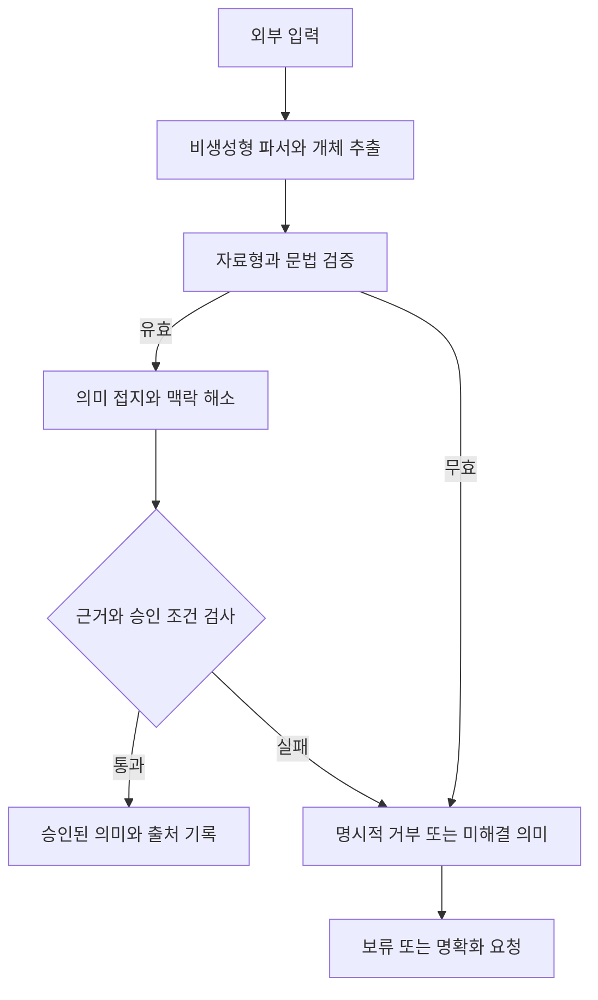
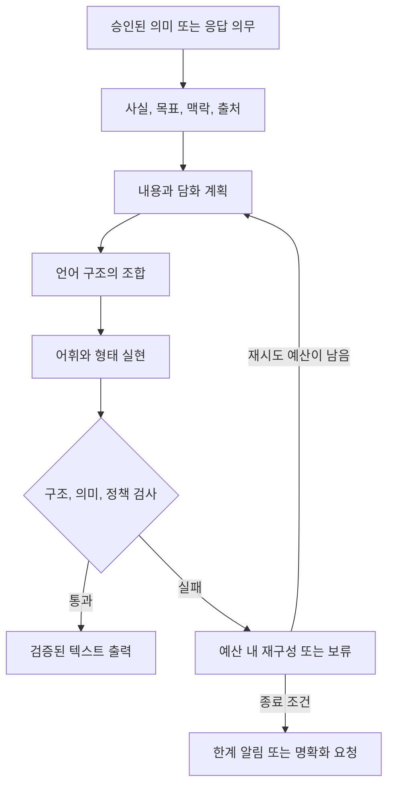

# LLM 없는 자율 언어: PLA의 근거

## 개정 이력

| 버전 | 날짜 | 설명 |
|------|------|------|
| 0.1.0 | 2026-06-14 | 초안. 점진적 언어 자율성(PLA, Overview §4.4.2)을 LLM에 위임할 수 없는 이유를 논증하고, 언어 자율성 갭(LAG)을 정의하며, 각 MSCP 레벨에서 LLM-프리 메커니즘이 필요한 지점을 매핑하고, 비-LLM 언어 합성 패턴 카탈로그를 정리. |
| 0.2.0 | 2026-11-03 | 엔트로피가 같으면 분포도 같다는 잘못된 추론과 LAG 기반 단계 판정을 제거했습니다. 반례와 젠슨-섀넌 진단 지표를 추가하고 PLA 단계를 승인 권한의 분리로 설명하며 안전 한계와 한국어 표현을 정비했습니다. |
| 0.3.0 | 2026-11-03 | LLM 없는 언어 합성과 LLM 생성물을 독립적으로 승인하는 구조를 혼동한 설명을 정정했습니다. 이해·합성 경로와 단계 설명을 비LLM 메커니즘으로 교체하고, 엔트로피 비교를 선택적 평가로 분리했으며, LLM 의존성과 실패 경로의 검증 기준을 명시했습니다. |

> **동반 문서.** 분류 체계는 [MSCP 개요 4.4.2절](../MSCP_Overview.ko.md#442-점진적-언어-자율성-pla-progressive-language-autonomy)을, 공개 근거의 범위는 [문서 상태와 검증 기준](Documentation_Status.ko.md)을 참고하십시오. 이 문서는 공개 동작 계약이며, 비공개 구현의 세부 사항이나 모든 조건이 실험적으로 검증되었다는 주장을 담지 않습니다.

---

## 핵심 요약

**점진적 언어 자율성(PLA)은 LLM을 사용하지 않고 언어를 구성하고 합성하는 체계입니다.** 의미 표현, 내용 계획, 언어 구조의 조합, 문장 실현, 검증, 재시도, 실패 처리가 모두 비LLM 경로에 속합니다. LLM이 만든 문장을 독립적인 검증기가 승인하는 방식은 **LLM 보조형 구조**이지, LLM 없는 PLA가 아닙니다.

차이는 행동의 승인 주체뿐 아니라 언어를 누가 생성하는지에 있습니다. PLA는 입력 해석, 문장 후보 생성, 재작성, 후보 순위 결정, 합성 실패의 보완을 외부 또는 로컬 LLM에 의존해서는 안 됩니다.

---

## 목차

1. [문제: LLM 기반 언어 생성과 비LLM 합성의 구분](#1-문제-인지로서의-llm-vs-도구로서의-llm)
2. [LLM을 사용하지 않는다는 뜻](#2-llm-프리가-실제로-의미하는-것)
3. [엔트로피가 아닌 동작 경로의 검증](#3-자율성-갭-형식적-논증)
4. [언어 자율성과 MSCP 안전 계약](#4-mscp-레벨이-llm-프리-메커니즘을-요구하는-이유)
5. [PLA의 여섯 단계](#5-pla-6단계--심화)
6. [LLM 없이 동작하는 메커니즘](#6-llm-없이-동작하는-메커니즘-개념-카탈로그)
7. [특성과 한계](#7-llm-프리-pla가-가능하게-하는-안전-속성)
8. [반론과 응답](#8-반론과-응답)
9. [기존 문서와의 관계](#9-기존-문서와의-관계)
10. [연구 과제](#10-열린-질문-연구-프론티어)
11. [결론](#11-결론)

---

## 1. 문제: LLM 기반 언어 생성과 비LLM 합성의 구분 {#1-문제-인지로서의-llm-vs-도구로서의-llm}

### 1.1 서로 다른 두 아키텍처

LLM 보조형 시스템은 모델이 만든 후보를 문법, 정책, 사실 검증기로 검사할 수 있습니다. 유용한 안전장치이지만, 언어 생성 과정에서 LLM을 제거한 것은 아닙니다.

반면 PLA는 구조화된 의미, 지식, 맥락, 언어 구성 메커니즘을 사용해 응답을 직접 합성합니다. 템플릿, 문법, 검색, 학습된 비LLM 구성 요소를 사용할 수 있지만, 이를 근거로 LLM 생성기를 경로에 끼워 넣어서는 안 됩니다.

### 1.2 이 구분만으로 입증되지 않는 것

LLM 추론을 제거했다고 사실 정확성, 무제한적인 언어 처리 범위, 안전성, 의식, AGI가 입증되지는 않습니다. 규칙이 잘못되거나 지식이 오래되었을 수 있고, 학습된 구성 요소의 보정이 부정확하거나 합성한 문장이 원래 의미를 왜곡할 수도 있습니다. 각각 별도의 설계와 평가가 필요합니다.

### 1.3 PLA와 일반적인 에이전트 설계의 범위

상위 애플리케이션에는 다른 아키텍처나 서비스가 있을 수 있습니다. MSCP 일반 원칙이 독립적으로 승인한 모델 제안을 허용하더라도, PLA를 LLM 보조형 생성기로 재정의하는 것은 아닙니다. PLA 상호작용을 완료하는 데 전처리, 후처리, 대체 경로의 LLM이 필요하다면 이 문서의 비LLM 계약을 충족하지 않습니다.

외부 메시지는 실행 권한이 아니라 데이터입니다. 다른 사람이 LLM으로 작성한 텍스트를 입력받는 것과 PLA 처리 경로에서 LLM을 실행하는 것은 구분해야 하며, 필요한 경우 입력의 출처와 신뢰 수준을 기록합니다.

---

## 2. LLM을 사용하지 않는다는 뜻 {#2-llm-프리가-실제로-의미하는-것}

### 2.1 언어 처리 경로에 LLM이 없음

입력 해석, 계획, 후보 구성, 표현 선택, 재작성, 순위 결정, 재시도, 대체 경로에서 **외부와 로컬 LLM 추론을 모두 사용하지 않는 것**을 뜻합니다. 다른 프로세스로 옮기거나 도구라고 부르거나 출력을 검증하는 것만으로는 이 조건을 충족하지 않습니다.

비LLM 경로가 입력을 해석하지 못하거나 예산 안에서 유효한 출력을 만들지 못하면 한계를 알리고, 명확한 입력을 요청하거나, 처리를 보류합니다. 부족한 역량을 LLM에 조용히 위임하지 않습니다.

### 2.2 템플릿만 사용하거나 항상 결정론적이어야 한다는 뜻은 아님

조합형 문법, 구조화된 검색, 의미 그래프, 명시된 **비LLM 학습 구성 요소**를 사용할 수 있습니다. 템플릿은 구성 요소가 될 수 있지만 전체 아키텍처의 상한일 필요는 없습니다. 표본을 추출한다고 모두 LLM인 것은 아니며, 결정론적으로 실행되는 LLM도 여전히 LLM 사용입니다.

구성 요소의 종류, 의존성, 데이터 출처를 명시해야 합니다. LLM 기반 전처리나 LLM에서 유래한 학습 자료를 숨긴 채 완전한 LLM 독립성을 주장해서는 안 됩니다. 이 명세는 공개되지 않은 구현의 학습 이력을 대신 주장하지 않습니다.

### 2.3 언어 처리 경로의 형식적 계약

> **정의 1 (LLM 없는 언어 처리 경로).** $\tau_{\mathrm{PLA}}$를 입력 해석부터 출력 또는 명시적인 실패까지의 전체 실행 기록이라고 하겠습니다. 재시도와 대체 경로를 포함해 다음 필요조건을 만족해야 합니다:
>
> $$\operatorname{LLMCalls}(\tau_{\mathrm{PLA}})=0$$
>
> 네트워크 요청뿐 아니라 외부와 로컬 LLM 추론을 모두 셉니다. 호출 기록과 함께 의존성과 실행 경로도 검사해야 하며, 불완전한 기록으로 LLM이 없다고 입증할 수는 없습니다.

승인된 의미 표현 $m$, 지식 $K$, 맥락 $c$를 이용한 합성을 개략적으로 표현하면 다음과 같습니다:

$$y=\operatorname{Realize}(\operatorname{Compose}(\operatorname{Plan}(m,K,c)))$$

`Plan`은 내용과 담화 구조를 선택하고, `Compose`는 언어 구조를 조합하며, `Realize`는 어휘와 문법 형태를 실현합니다. 모두 비LLM 메커니즘입니다. 이 식은 동작 계약이지 비공개 모듈의 배치나 언어 품질을 입증하는 식이 아닙니다.

### 2.4 필요한 메커니즘과 제외되는 경로 {#24-권위-분리-표}

| 활동 | PLA 경로 | PLA 경로에서 제외되는 것 |
|------|----------|-------------------------|
| 입력 해석 | 명시된 비LLM 파서와 의미 접지 | LLM 의도·슬롯 추출 |
| 내용 계획 | 목표, 사실, 맥락, 담화 규칙 | LLM이 작성한 계획과 초안 |
| 후보 구성 | 언어·의미 구조의 조합 | LLM이 만든 후보 문장 |
| 문장 실현 | 어휘 선택과 문법 형태 구성 | LLM 표현 선택, 바꿔쓰기, 윤문 |
| 후보 평가 | 구조·의미·정책 검사 | LLM 순위 결정과 자기 평가 |
| 재시도와 실패 | 예산 내 재구성, 명확화 요청, 보류 | 외부 또는 로컬 LLM으로 보완 |
| 상태 변경과 행동 | 독립적인 MSCP 승인 계약 | 출력 문장을 실행 권한으로 취급 |

---

## 3. 엔트로피가 아닌 동작 경로의 검증 {#3-자율성-갭-형식적-논증}

### 3.1 의존성과 실행 근거

연결 계층과 예외 처리까지 전체 경로를 검토합니다. 외부와 로컬 LLM 진입점을 차단하고 호출 횟수를 기록하면서 대표 사례를 실행합니다. 정상 합성, 알 수 없는 입력, 잘못된 후보, 예산 소진, 보조 구성 요소의 실패를 모두 시험하며 LLM 대체 경로가 없어야 합니다.

네트워크 주소만 차단하면 로컬 추론이나 상위 전처리의 LLM이 남을 수 있습니다. 한 번의 성공 사례만으로 모든 경로에서 LLM을 사용하지 않는다고 입증할 수도 없습니다.

### 3.2 언어 품질은 별도로 평가

의미 보존, 사실 접지, 문법, 여러 대화 차례에 걸친 일관성, 처리 범위, 불확실성 표현, 제한된 실패 처리를 평가합니다. 데이터, 비교 기준, 임계값을 먼저 명시해야 합니다. LLM 호출이 0이라는 조건은 필요하지만, 유용한 언어나 안전한 자율성의 충분조건은 아닙니다.

### 3.3 선택적인 외부 분포 비교

> **정의 2 (언어 자율성 갭: 과거의 진단 지표).** 별도의 외부 비교 연구에서는 부호가 있는 엔트로피 차이를 보고할 수 있습니다:
>
> $$\text{LAG}(t)=H(p_{\text{LLM}})-H(p_{\text{PLA}})$$

이 값은 **PLA의 정의, 실행 의존성, 승인 조건, 필수 평가가 아닙니다.** 독립적인 외부 연구가 LLM을 비교 기준으로 사용하는 것과 PLA 실행에 LLM을 포함하는 것은 구분합니다.

엔트로피가 같아도 분포는 다를 수 있습니다. $p=(0.9,0.1)$과 $q=(0.1,0.9)$의 엔트로피는 같지만 총변동거리는 $0.8$입니다. LAG가 0인지 아닌지만으로 출력이 어떻게 생성되었는지 알 수는 없습니다.

같은 출력 공간에서 분포를 추정할 수 있다면 다음 비교도 선택적으로 사용할 수 있습니다:

$$D_{\mathrm{JS}}(p,q)=H\!\left(\frac{p+q}{2}\right)-\frac{H(p)+H(q)}{2},\qquad 0\leq D_{\mathrm{JS}}\leq1$$

이 범위는 밑이 2인 엔트로피를 사용한 경우입니다. 샘플링 정책, 표본 수, 불확실성, 공통 입력 조건을 함께 보고해야 합니다. 이 통계는 출력 분포를 비교할 뿐 LLM 의존성의 유무를 입증하지는 않습니다.

---

## 4. 언어 자율성과 MSCP 안전 계약 {#4-mscp-레벨이-llm-프리-메커니즘을-요구하는-이유}

비LLM 언어 합성이 각 레벨 문서의 안전 계약을 대체하지는 않습니다:

| 관심사 | 구분해야 할 사항 |
|--------|------------------|
| 목표 | 목표를 서술하는 것과 실행을 승인하는 것은 다름 |
| 예측 | 예측을 설명하는 것과 보정 근거가 있는 것은 다름 |
| 자기 모델 | 상태의 언어화가 정체성이나 정책을 직접 바꾸지 않음 |
| 지식 | 검색·조합한 주장에도 출처와 불확실성 검사가 필요 |
| 전략 | 언어로 표현한 제안에도 전이 성능과 위험의 독립적인 평가가 필요 |
| 행동 | 응답이나 도구 호출 설명은 실행 허가가 아님 |
| 복구 | 유효하지 않은 출력이나 근거 누락에는 제한되고 관측 가능한 대응이 필요 |

모든 언어 구성 요소가 비LLM이어도 MSCP 승인 규칙은 적용됩니다. 반대로 일부 승인 규칙을 충족한다고 LLM 보조형 시스템이 PLA가 되는 것은 아닙니다.

---

## 5. PLA의 여섯 단계 {#5-pla-6단계--심화}

다음 표기는 기존 MSCP 레벨과의 연구상 대응 관계를 유지합니다. **LLM 사용량을 점차 줄이는 단계가 아니라**, 비LLM 언어 능력의 활용 범위가 커지는 단계입니다. 모든 PLA 단계는 언어 처리 경로에서 LLM을 사용하지 않아야 합니다. 일반적인 L1 도구 에이전트가 LLM을 사용한다고 해서 PLA Stage 0의 구현이 되는 것은 아닙니다.

### 5.1 Stage 0 (L1): 제한된 도구 상호작용

지원하는 요청을 해석하고 도구의 관측 결과를 비LLM 방식으로 표현합니다. 지원하지 않는 입력에는 명확화를 요청하거나 한계를 알립니다. LLM의 유창성이 아니라 처리 범위와 제한된 도구 실행 승인을 평가합니다.

### 5.2 Stage 1 (L2): 지속 맥락과 목표 표현

지속적인 맥락과 승인된 목표를 바탕으로 LLM 없이 언어를 구성합니다. 목표를 제안하거나 설명하는 것과 실행을 승인하는 것을 구분하고, 출처와 후속 실행의 권한을 검사합니다.

### 5.3 Stage 2 (L3): 근거에 기반한 자기 보고와 비교

예측, 관측, 제한된 갱신, 보류 결정의 설명을 구조화된 기록으로부터 합성합니다. 자기 보고가 성공적인 비교 결과를 꾸며 내거나 실제 검사를 대체해서는 안 됩니다.

### 5.4 Stage 3 (L4): 전략의 조합과 전이

검색한 지식과 언어 구조를 결합해 전략 후보와 전이 가설을 표현합니다. 초안을 LLM에 맡기지 않으며 전이된 전략은 별도로 평가합니다. 가설을 문장으로 말할 수 있다는 사실이 그 타당성을 입증하지는 않습니다.

### 5.5 Stage 4 (L4.5–L4.8): 투영과 불확실성

구조화된 투영, 대안, 불확실성을 포함한 설명을 비LLM 경로로 실현합니다. 모의 시나리오를 관측 사실로 바꾸거나 자신감을 표현한 문장을 보정된 근거로 취급하지 않습니다.

### 5.6 Stage 5 (L5): 연구와 장기 담화

LLM의 질문 생성이나 표현 선택 없이 연구 질문을 구성하고, 관측을 통합하며, 발견과 장기 보고를 합성합니다. 신규성이나 일반화 주장은 별도로 명시한 L5 평가 조건을 충족해야 합니다.

### 5.7 비LLM 계약의 유지

> **정의 3 (PLA 단계 유지).** 주장하는 단계는 필요한 하위 단계의 계약과 비LLM 언어 경로를 유지해야 합니다. LLM 파서, 생성기, 재작성기, 순위 결정기, 대체 경로를 추가하면 LLM을 사용하지 않는다는 주장이 무효가 됩니다. 단순한 구현 교체로 취급할 수 없습니다.

단계 표기는 연구 요건을 정리한 것입니다. 독립적인 인증이나 관련 MSCP 조건을 모두 달성했다는 근거는 아닙니다.

---

## 6. LLM 없이 동작하는 메커니즘 (개념 카탈로그) {#6-llm-없이-동작하는-메커니즘-개념-카탈로그}

다음은 공개적인 메커니즘 유형이며 구현별 내부 구조를 공개하는 것이 아닙니다. 구성 요소의 결합과 실제 언어 처리 범위는 평가로 확인해야 합니다.

### 6.1 템플릿과 조합형 구성 요소

템플릿으로 지원되는 사실, 목표, 보고를 표현할 수 있습니다. 완성 문장의 유한한 목록이 모든 언어를 처리한다고 가정하지 않고, 작은 구조를 조합합니다. 어떤 내용과 규칙이 출력을 만들었는지 기록합니다.

### 6.2 의미와 신념 그래프의 조합

근거가 있는 명제와 관계를 선택하면서 부정, 적용 범위, 출처, 불확실성을 보존합니다. 그래프 조합으로 관계 후보를 만들 수 있지만, 그 결과의 정당한 근거와 충실한 언어 표현을 별도로 확인해야 합니다.

### 6.3 검색과 적응

관련 언어 구조나 전략을 검색하고 비LLM 연산으로 명시된 연결 관계를 조정합니다. 변경 이력을 보존하고 결과를 검증합니다. 검색 유사도만으로 의미의 정확성이나 도메인 전이의 성공을 입증할 수는 없습니다.

### 6.4 명시된 비LLM 학습 구성 요소

비LLM임이 명시된 분류기나 인코더가 선택이나 접지를 도울 수 있습니다. 벡터 연산은 특징 후보를 제공할 뿐, 의미 있는 언어를 보장하지 않습니다. 연결 계층이나 전처리에 숨겨진 LLM 호출은 허용되지 않습니다.

### 6.5 문법에 따른 직접 구성 {#65-문법-제약-생성-grammar-constrained-generation}

명시된 문법에 따라 언어 구조를 만든 뒤 어휘와 형태를 실현합니다. 이는 LLM 디코딩을 제한하는 것과 다릅니다. 문법으로 제약한 **LLM 생성**도 여전히 LLM을 사용하므로 PLA의 메커니즘이 아닙니다.

### 6.6 근거에 기반한 자체 검사

후보의 의미와 문장을 원래 사실 및 의도한 담화 행위와 비교합니다. 지시 대상, 부정, 불확실성, 필수 필드를 비LLM 방식으로 확인합니다. 의미 보존을 확인할 수 없다면 예산 안에서 재구성하거나 부족한 부분을 알립니다.

### 6.7 정책 검사와 진단 지표

구조가 올바르다고 실행 권한이 생기는 것은 아닙니다. 행동별 정책, 불확실성, 위험, 관측 가능성, 복구 가능성, 예산 검사를 구분합니다. 종합 위험, MRHI, BGSS, ASS, OMI 등의 지표는 진단에 참고할 수 있지만 필수 조건의 실패를 무효화할 수는 없습니다.

### 6.8 참조 아키텍처: 언어 이해 파이프라인

다음 구성 요소는 모두 비LLM입니다. 지원하는 입력을 해석하고 구조화된 의미를 승인하는 경로이며, 모든 자연어를 완전히 이해한다고 주장하지 않습니다.

파싱이 정체성, 정책, 목표를 직접 바꾸지는 않습니다. 후속 상태 변경은 해당 MSCP 승인 경로를 거쳐야 합니다. 해석하지 못한 입력을 LLM으로 보내지 않습니다.

### 6.9 참조 아키텍처: 언어 합성 파이프라인

계획기, 조합기, 문장 실현기가 출력을 직접 구성합니다. LLM이 작성한 초안이나 LLM 윤문 단계는 없습니다.

출력은 텍스트이지 도구 실행이나 자기 모델 변경의 권한이 아닙니다. 유효하지 않은 후보를 LLM 대체 경로로 보내지 않습니다. 재시도 예산과 종료 조건으로 무제한 재구성을 막습니다.

### 6.10 공통 불변 조건 {#610-두-다이어그램의-공통-불변량}

1. 재시도와 실패 처리를 포함한 두 경로 어디에도 외부·로컬 LLM이 없습니다.
2. 후보 내용과 언어 표현의 근거 및 출처를 보존합니다.
3. 구조·의미 검사가 외부 정책이나 행동 승인을 대체하지 않습니다.
4. 처리 범위의 한계나 예산 소진은 명시적이고 제한된 실패로 처리합니다.
5. 재현하려면 상태, 구성 요소 버전, 관측, 샘플링 정책이 필요합니다. 검증기와 생성기의 임의적인 개수 비율로 이를 인증할 수는 없습니다.

---

## 7. 특성과 한계 {#7-llm-프리-pla가-가능하게-하는-안전-속성}

### 7.1 감사 가능성

어떤 사실, 의미 구조, 조합 규칙, 표현 선택이 응답을 만들었는지 기록합니다. 실행 기록은 검토를 돕지만, 그럴듯한 설명 자체가 정확성의 근거가 되지는 않습니다.

### 7.2 재현성

결정론적 구성 요소는 상태와 버전을 고정해 출력을 재현할 수 있습니다. 확률적 비LLM 구성 요소에는 샘플링 정책과 통계적 검사가 필요합니다. 외부 도구, 스케줄링, 지식의 변화는 여전히 결과에 영향을 줄 수 있습니다.

### 7.3 신뢰하지 않는 입력에 대한 방어

이 경로에는 LLM 프롬프트가 필요하지 않지만 잘못된 입력, 오염된 지식, 안전하지 않은 도구 인자, 오해를 유발하는 문장은 남을 수 있습니다. 신뢰 경계를 검증하고 외부 효과를 제한해야 합니다.

### 7.4 근거에 기반한 단계 평가 {#74-pla-인증을-통한-점진적-신뢰-부여}

비LLM 의존성 계약, 언어 처리 결과, 해당 MSCP 기준을 각각 평가합니다. 모듈 이름, 좁은 표본에서의 호출 0회, 높은 종합 점수만으로 모든 경로나 단계를 인증할 수는 없습니다.

### 7.5 LLM 가용성과의 독립성 {#75-llm-교체-가능성}

LLM 백엔드를 사용할 수 없거나 명시적으로 차단해도 PLA를 시험할 수 있어야 합니다. 비LLM 구성 요소의 실패에는 명시된 실패 정책을 적용하며 LLM으로 전환하지 않습니다.

---

## 8. 반론과 응답

**“LLM이 없으면 준비된 답변만 출력하는 것 아닌가?”** 아닙니다. 지원하는 의미와 언어 규칙을 조합할 수 있습니다. 실제 처리 범위와 일반화 수준은 별도의 측정이 필요합니다.

**“문법으로 제한한 LLM 출력은 포함되는가?”** 아닙니다. 생성기의 출력 공간을 제한해도 LLM 의존성이 없어지는 것은 아닙니다.

**“마지막 문장만 로컬 LLM으로 다듬을 수 있는가?”** 이 PLA 계약에서는 허용되지 않습니다. 표현 선택과 후처리도 언어 생성에 포함됩니다.

**“알 수 없는 입력을 LLM으로 보완할 수 있는가?”** 그렇게 처리한 상호작용을 LLM 없는 PLA라고 주장할 수는 없습니다. 지원하지 않는 사례를 알리고 명확화를 요청하거나 보류합니다.

**“LLM을 제거하면 지능이나 안전이 보장되는가?”** 아닙니다. 언어 능력, 비LLM 의존성, 정책 준수, 실험으로 확인한 안전성은 서로 다른 평가 대상입니다.

---

## 9. 기존 문서와의 관계

| 문서 | 역할 |
|------|------|
| [MSCP 개요](../MSCP_Overview.ko.md#442-점진적-언어-자율성-pla-progressive-language-autonomy) | PLA 정의와 연구 단계의 대응 관계 |
| [용어집](MSCP_Glossary.ko.md) | LLM 보조형 생성과의 구분을 포함한 용어 기준 |
| [L2](../levels/Level_2_Autonomous_Agent.ko.md) | 지속 맥락, 목표 출처, 승인된 후속 실행 |
| [L3](../levels/Level_3_Self_Regulating_Agent.ko.md) | 예측 비교, 자기 모델 제어, 불변 조건과 복구 검사 |
| [L4](../levels/Level_4_Adaptive_General_Agent.ko.md) | 전이 성능의 독립적인 평가와 제한된 자기 수정 |
| [L4.5](../levels/Level_4_5_Self_Architecting.ko.md) / [L4.8](../levels/Level_4_8_Strategic_Self_Modeling.ko.md) | 투영, 불확실성, 전략 평가 |
| [L4.9](../levels/Level_4_9_Autonomous_Strategic_Agent.ko.md) / [L5](../levels/Level_5_Proto_AGI.ko.md) | 권한 한계와 평가 조건에 한정된 단계 검증 |
| [문서 상태와 검증 기준](Documentation_Status.ko.md) | 근거 범위, 공개 정보의 경계, 문서 검사 |

MSCP 일반 원칙에서 독립적으로 승인한 LLM 제안을 허용하는 것은 다른 에이전트 설계에 관한 설명입니다. 이 문서가 정의하는 PLA 경로에서 LLM으로 언어를 생성해도 된다는 뜻이 아닙니다.

---

## 10. 연구 과제 {#10-열린-질문-연구-프론티어}

- 여러 도메인과 언어에서 조합 가능한 범위와 지원하지 않는 입력의 경계를 어떻게 측정할까요?
- 신규성을 정확성과 동일시하지 않으면서 새로운 조합, 검색, 기존 표현의 재현을 어떻게 구분할까요?
- LLM 평가자 없이 접지 오류, 담화 실패, 보정 상태를 어떻게 보고할까요?
- 비동기 작업, 재시도, 드물게 실행되는 실패 경로까지 의존성과 실행을 어떻게 감사할까요?
- LLM 독립성을 조건 없이 주장하려면 어떤 데이터와 모델 출처 근거가 필요할까요?

이는 연구 질문이며 이미 달성한 성능을 뜻하지 않습니다.

---

## 11. 결론

**PLA는 LLM 생성물을 독립적으로 승인하는 방식이 아니라, LLM 없이 언어를 이해하고 합성하는 체계입니다.** 구조화된 의미, 내용 계획, 조합, 문장 실현으로 언어를 구성합니다. MSCP 안전 계약은 그 언어에서 이어지는 행동과 상태 변경을 제어하며, 언어의 생성 방식을 바꾸어 정의하지는 않습니다.

공개 문서는 이 경계를 분명히 하고 비LLM 실패 처리를 관측할 수 있게 해야 하며, 동작 계약과 실제 구현·평가 근거를 구분해야 합니다.
