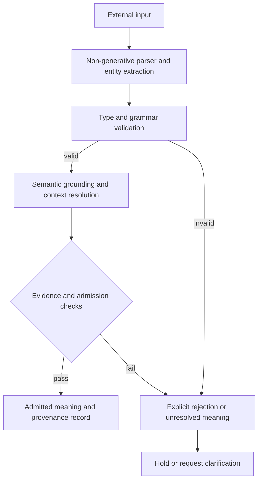
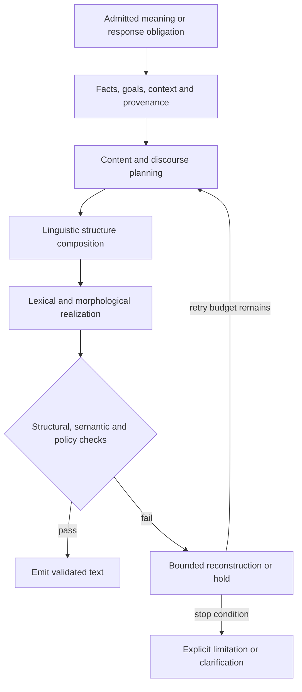

# LLM-Free Autonomous Language: The Rationale for PLA

## Revision History

| Version | Date | Description |
|---------|------|-------------|
| 0.1.0 | 2026-06-14 | Initial document. Argues why Progressive Language Autonomy (PLA, Overview §4.4.2) cannot be delegated to an LLM, defines the Language Autonomy Gap (LAG), maps LLM-free mechanism requirements onto each MSCP level, and catalogs non-LLM linguistic synthesis patterns. |
| 0.2.0 | 2026-11-03 | Removed the invalid equal-entropy inference and LAG-based level claim; added a counterexample and optional Jensen-Shannon diagnostic; reframed PLA stages as authority requirements and aligned safety caveats and Korean explanations. |
| 0.3.0 | 2026-11-03 | Corrected the conflation of LLM-free synthesis with LLM-assisted production under independent admission. Replaced hybrid understanding/synthesis paths and stage descriptions with non-LLM mechanisms, made entropy comparisons optional, and specified zero-LLM dependency and failure-path checks. |

> **Companion document.** See [MSCP Overview §4.4.2](../MSCP_Overview.md#442-progressive-language-autonomy-pla) for the taxonomy and [Documentation Status and Validation](Documentation_Status.md) for public evidence limits. This is a public behavior contract, not disclosure of a private implementation or a claim that every criterion has been experimentally validated.

---

## TL;DR

**Progressive Language Autonomy (PLA) constructs and synthesizes language without using an LLM.** Meaning representation, content planning, composition, surface realization, validation, retries, and failure handling belong to a non-LLM path. An LLM-generated sentence followed by an independent validator is a **hybrid LLM-assisted architecture**, not LLM-free PLA.

The distinction is about the production of language itself, not merely who authorizes an action. PLA must not depend on an external or local LLM to parse inputs, propose sentences, rewrite outputs, rank linguistic candidates, or rescue a failed synthesis.

---

## Table of Contents

1. [The Problem: LLM-Driven Language vs LLM-Free Synthesis](#1-the-problem-llm-as-cognition-vs-llm-as-tool)
2. [What "LLM-Free" Actually Means](#2-what-llm-free-actually-means)
3. [Verification, Not an Entropy Requirement](#3-the-autonomy-gap-formal-argument)
4. [Language Autonomy and MSCP Safety Contracts](#4-why-mscp-levels-require-llm-free-mechanisms)
5. [The Six Stages of PLA](#5-the-six-stages-of-pla---deeper-treatment)
6. [Mechanisms Without an LLM](#6-mechanisms-without-an-llm-concept-catalog)
7. [Properties and Limits](#7-safety-properties-unlocked-by-llm-free-pla)
8. [Counterarguments and Responses](#8-counterarguments-and-responses)
9. [Relation to Existing Documents](#9-relation-to-existing-documents)
10. [Open Questions](#10-open-questions-research-frontier)
11. [Conclusion](#11-conclusion)

---

## 1. The Problem: LLM-Driven Language vs LLM-Free Synthesis {#1-the-problem-llm-as-cognition-vs-llm-as-tool}

### 1.1 Two Different Architectures

An LLM-assisted system may generate a candidate and pass it through a grammar, policy, or factual validator. Those checks can be useful, but they do not remove the LLM from language production.

PLA instead constructs a response from its own structured meanings, knowledge, context, and language mechanisms. A template, grammar, retrieval system, or learned non-LLM component can contribute to that construction; none is permission to insert an LLM generator into the path.

### 1.2 What the Distinction Does Not Establish

Removing LLM inference does not by itself establish factual accuracy, unrestricted language coverage, safety, consciousness, or AGI. Rules can be wrong, knowledge can be stale, learned components can be miscalibrated, and composed text can misrepresent its source. These remain explicit engineering and evaluation obligations.

### 1.3 Scope: PLA vs General Agent Design

An enclosing application may have other architectures or services. General MSCP rules about admitting model-proposed actions do not redefine PLA as an LLM-assisted generator. If preprocessing, postprocessing, or a fallback needs an LLM to complete a claimed PLA interaction, that interaction does not satisfy this document's LLM-free contract.

An external message is data, not execution authority. Receiving text that someone else wrote with an LLM is distinct from making an LLM part of PLA's processing path; provenance and trust must still be recorded where relevant.

---

## 2. What "LLM-Free" Actually Means

### 2.1 No LLM in the Language Path

LLM-free means no hosted **or local** LLM inference in input interpretation, planning, candidate construction, wording, rewriting, ranking, retries, or fallback. Moving inference to another process, calling it a tool, or validating its output does not meet this condition.

If the non-LLM path cannot resolve an input or produce a valid output within its budget, it reports the limitation, requests clarification, or holds. It does not silently delegate the missing capability to an LLM.

### 2.2 LLM-Free Does Not Mean Template-Only or Necessarily Deterministic

PLA can use compositional grammars, structured retrieval, semantic graphs, and declared learned **non-LLM** components. Templates can supply building blocks without being the ceiling of the architecture. A probabilistic component is not an LLM simply because it samples, and a deterministic LLM invocation is still LLM use.

Declare component types, dependencies, and data provenance. LLM-derived preprocessing or training artifacts must not be hidden behind an unqualified claim of complete LLM independence. This specification does not assert an undisclosed implementation's training history.

### 2.3 Formal Language-Path Contract

> **Definition 1 (LLM-Free Language Path).** Let $\tau_{\mathrm{PLA}}$ be a complete execution trace covering input interpretation through output or explicit failure, including retries and fallback. A necessary condition is:
>
> $$\operatorname{LLMCalls}(\tau_{\mathrm{PLA}})=0$$
>
> The count covers remote and local LLM inference, not just network requests. Inspect the dependency and call paths as well as recording invocations; an incomplete trace is not proof of absence.

For admitted meaning representation $m$, knowledge $K$, and context $c$, a schematic synthesis is:

$$y=\operatorname{Realize}(\operatorname{Compose}(\operatorname{Plan}(m,K,c)))$$

`Plan` selects content and discourse structure; `Compose` builds linguistic structure; `Realize` chooses words and grammatical forms. All three are non-LLM mechanisms. The equation describes a contract, not a required private module layout or a proof of language quality.

### 2.4 Required and Excluded Mechanisms {#24-authority-separation-table}

| Activity | PLA path | Excluded from the PLA path |
|----------|----------|----------------------------|
| Input interpretation | Declared non-LLM parser and semantic grounding | LLM intent/slot extraction |
| Content planning | Goals, facts, context, and discourse rules | LLM-written plan or draft |
| Candidate construction | Composition over linguistic and semantic structures | LLM candidate sentences |
| Surface realization | Lexical selection and grammatical realization | LLM wording, paraphrasing, or polishing |
| Candidate evaluation | Declared structural, semantic, and policy checks | LLM ranking or self-critique |
| Retry and failure | Bounded reconstruction, clarification, or hold | Local/remote LLM rescue |
| State changes or actions | Independent MSCP admission contracts | Treating emitted text as execution authority |

---

## 3. Verification, Not an Entropy Requirement {#3-the-autonomy-gap-formal-argument}

### 3.1 Dependency and Execution Evidence

Review the complete path, including adapters and exception handlers. Run representative cases with remote and local LLM entry points denied and invocation counters enabled. Exercise successful synthesis, unknown inputs, invalid candidates, exhausted budgets, and failures of supporting components. No case may escape through an LLM fallback.

Blocking a network endpoint alone is insufficient: local inference or an upstream LLM preprocessor could remain. Likewise, one successful test cannot establish absence on every path.

### 3.2 Language Quality Is a Separate Evaluation

Evaluate semantic fidelity, factual grounding, grammar, coherence across turns, coverage, uncertainty reporting, and bounded failure behavior. Declare datasets, baselines, and thresholds before interpreting results. Zero LLM calls is necessary for this contract, not sufficient for useful language or safe autonomy.

### 3.3 Optional External Distribution Comparisons

> **Definition 2 (Language Autonomy Gap, Historical Diagnostic).** An external comparative study may report the signed entropy difference:
>
> $$\text{LAG}(t)=H(p_{\text{LLM}})-H(p_{\text{PLA}})$$

This is **not a PLA definition, runtime dependency, admission gate, or required evaluation**. A separate external study may use an LLM baseline without making it part of PLA execution.

Equal entropy does not imply equal distributions: $p=(0.9,0.1)$ and $q=(0.1,0.9)$ have the same entropy but total variation distance $0.8$. Neither a zero nor a nonzero LAG establishes how either output was produced.

If distributions over the same declared output space can be estimated, an optional comparison is:

$$D_{\mathrm{JS}}(p,q)=H\!\left(\frac{p+q}{2}\right)-\frac{H(p)+H(q)}{2},\qquad 0\leq D_{\mathrm{JS}}\leq1$$

The bound uses base-2 entropy. Sampling policy, sample size, uncertainty, and common input conditions must be reported. These statistics measure output distributions, not the presence or absence of an LLM dependency.

---

## 4. Language Autonomy and MSCP Safety Contracts {#4-why-mscp-levels-require-llm-free-mechanisms}

Non-LLM synthesis does not replace the safety contracts in the level documents:

| Concern | Required distinction |
|---------|---------------------|
| Goals | Describing a goal is not authorization to pursue it |
| Prediction | Explaining a prediction is not evidence that it is calibrated |
| Self-model | Verbalizing a state does not directly mutate identity or policy |
| Knowledge | A retrieved or composed statement still needs source and uncertainty checks |
| Strategy | A linguistic proposal needs independent transfer and risk evaluation |
| Action | A response or tool-call description is not an executable permission |
| Recovery | Invalid output or missing evidence requires a bounded, observable response |

MSCP admission rules remain applicable even when every linguistic component is non-LLM. Conversely, an LLM-assisted system does not become PLA merely by satisfying some admission rules.

---

## 5. The Six Stages of PLA - Deeper Treatment

The following retains the research mapping to MSCP levels. It describes increasing uses of non-LLM language capability, **not progressively reduced LLM usage**. Every claimed PLA stage has the zero-LLM language-path requirement. A general L1 tool agent that uses an LLM is not thereby an implementation of PLA Stage 0.

### 5.1 Stage 0 (L1) - Bounded Tool Interaction

Interpret supported requests and realize tool observations using non-LLM mechanisms. Unsupported inputs receive clarification or an explicit limitation. Evaluate coverage and bounded tool admission, not LLM fluency.

### 5.2 Stage 1 (L2) - Persistent Context and Goal Expression

Use persistent context and admitted goals to construct language without an LLM. Distinguish proposing or describing a goal from admitting it for execution. Check provenance and authorized continuation.

### 5.3 Stage 2 (L3) - Grounded Self-Reports and Comparison

Compose explanations of predictions, observations, bounded updates, and hold decisions from structured records. A self-report must not invent a successful comparison or substitute for the underlying checks.

### 5.4 Stage 3 (L4) - Compositional Strategies and Transfer

Combine retrieved knowledge and linguistic structures to express strategy candidates and transfer hypotheses without LLM drafting. Evaluate the transferred strategy independently; the ability to state a hypothesis does not establish its validity.

### 5.5 Stage 4 (L4.5–L4.8) - Projection and Uncertainty

Realize structured projections, alternatives, and uncertainty-qualified explanations through the non-LLM path. Do not turn simulated scenarios into observed facts or a linguistic confidence statement into calibrated evidence.

### 5.6 Stage 5 (L5) - Research and Long-Horizon Discourse

Construct research questions, integrate observations, and compose findings and long-horizon reports without LLM question generation or phrasing. Claims of novelty and generalization require the separately declared L5 evaluation profile.

### 5.7 Retaining the Non-LLM Contract

> **Definition 3 (PLA Stage Retention).** A claimed stage retains the required lower-stage contracts and the non-LLM language path. Adding an LLM parser, generator, rewriter, ranker, or fallback invalidates that LLM-free claim; it is not a harmless implementation substitution.

Stage labels organize research requirements. They are not independent certifications or evidence that an implementation has achieved every associated MSCP criterion.

---

## 6. Mechanisms Without an LLM (Concept Catalog)

These are public mechanism patterns, not a disclosure of implementation-specific internals. Their combination and language coverage must be evaluated.

### 6.1 Templates and Compositional Building Blocks

Templates can realize supported facts, goals, and reports. Compose smaller structures rather than assuming that a finite catalog of complete sentences provides unrestricted coverage. Record which content and rules produced the output.

### 6.2 Meaning and Belief-Graph Composition

Select supported propositions and their relationships, preserving negation, scope, source, and uncertainty. Graph composition can derive candidate relations, but the result still needs a valid justification and faithful linguistic realization.

### 6.3 Retrieval and Adaptation

Retrieve relevant language structures or strategies and adapt declared bindings through non-LLM operations. Preserve lineage and validate the adapted result. Retrieval similarity alone does not establish semantic correctness or successful domain transfer.

### 6.4 Declared Non-LLM Learned Components

An explicitly non-LLM classifier or encoder may assist selection or grounding. Vector arithmetic supplies candidate features, not a proof of meaningful language. Hidden LLM calls in wrappers or preprocessing remain outside the contract.

### 6.5 Grammar-Driven Construction {#65-grammar-constrained-generation}

Construct linguistic structures according to a declared grammar, then perform lexical and morphological realization. This differs from constraining an LLM's decoding: grammar-constrained **LLM** generation still uses an LLM and is not the PLA mechanism.

### 6.6 Grounded Self-Checking

Compare candidate meaning and text against the source facts and intended discourse act. Validate references, negation, uncertainty, and required fields with non-LLM checks. If fidelity cannot be established, reconstruct within budget or report the gap.

### 6.7 Policy Checks and Diagnostic Aggregation

Structural validity is not sufficient permission. Action-specific policy, uncertainty, risk, observability, recovery, and budget checks remain separate. Composite risk, MRHI, BGSS, ASS, or OMI may inform diagnostics, but an aggregate cannot waive a critical failed gate.

### 6.8 Reference Architecture: Language Understanding Pipeline

All components below are non-LLM. The path interprets supported inputs and admits structured meanings; it does not claim complete understanding of arbitrary language.

Parsing does not directly rewrite identity, policy, or goals. Any subsequent state change uses the relevant MSCP admission path. Unresolved input is not sent to an LLM.

### 6.9 Reference Architecture: Language Synthesis Pipeline

The planner, composer, and surface realizer construct the output themselves. There is no LLM-generated draft or LLM polishing step.

The output is text, not permission to execute a tool or mutate the self-model. Invalid candidates never gain an LLM fallback. Retry budgets and stop conditions prevent unbounded reconstruction.

### 6.10 Shared Invariants

1. No local or remote LLM appears in either path, including retries and failures.
2. Candidate content and its linguistic realization retain evidence and provenance.
3. Structural and semantic checks do not replace external policy or action admission.
4. Missing coverage or exhausted budgets produce explicit, bounded failure behavior.
5. Reproduction requires the relevant state, component versions, observations, and sampling policy; no arbitrary gate-to-generator ratio certifies these properties.

---

## 7. Properties and Limits {#7-safety-properties-unlocked-by-llm-free-pla}

### 7.1 Auditability

Record which facts, semantic structures, composition rules, and realization choices produced the response. A trace supports inspection; an attractive explanation alone is not evidence of correctness.

### 7.2 Reproducibility

Deterministic components can reproduce outputs under fixed state and versions. Probabilistic non-LLM components need recorded sampling policies and statistical tests. External tools, scheduling, and changing knowledge can still affect results.

### 7.3 Untrusted Input Still Requires Defenses

No LLM prompt is required by this path, but malformed input, poisoned knowledge, unsafe tool arguments, and misleading text remain possible. Validate trust boundaries and constrain external effects.

### 7.4 Evidence-Based Stage Assessment {#74-graduated-trust-via-pla-certification}

Check the non-LLM dependency contract, language outcomes, and the applicable MSCP criteria separately. Module names, zero invocation counts on a narrow sample, or a high composite score do not certify every path or stage.

### 7.5 Independence from LLM Availability {#75-llm-substitutability}

PLA must remain testable with LLM backends unavailable or explicitly denied. A failure of a non-LLM component is handled by its declared failure policy, not by switching to an LLM.

---

## 8. Counterarguments and Responses

**"Does LLM-free mean a fixed set of canned answers?"** No. Compositional structures can combine supported meanings and linguistic rules. Actual coverage and generalization still require measurement.

**"Does grammar-constrained LLM output count?"** No. Constraining a generator changes its output space, not its dependency on an LLM.

**"Can a local LLM polish the final sentence?"** Not within this PLA contract. Wording and postprocessing are part of language production.

**"Can an LLM rescue unknown inputs?"** Not while claiming the interaction is LLM-free PLA. Report the unsupported case, request clarification, or hold.

**"Does removing LLMs guarantee intelligence or safety?"** No. Language capability, non-LLM dependency, policy compliance, and empirical safety are different evaluation questions.

---

## 9. Relation to Existing Documents

| Document | Role |
|----------|------|
| [MSCP Overview](../MSCP_Overview.md#442-progressive-language-autonomy-pla) | PLA definition and research-stage mapping |
| [Glossary](MSCP_Glossary.md) | Canonical terminology, including the distinction from hybrid generation |
| [L2](../levels/Level_2_Autonomous_Agent.md) | Persistent context, goal provenance, authorized continuation |
| [L3](../levels/Level_3_Self_Regulating_Agent.md) | Prediction comparison, self-model regulation, invariant and recovery checks |
| [L4](../levels/Level_4_Adaptive_General_Agent.md) | Independent transfer evaluation and bounded modification |
| [L4.5](../levels/Level_4_5_Self_Architecting.md) / [L4.8](../levels/Level_4_8_Strategic_Self_Modeling.md) | Projection, uncertainty, and strategic evaluation |
| [L4.9](../levels/Level_4_9_Autonomous_Strategic_Agent.md) / [L5](../levels/Level_5_Proto_AGI.md) | Authority limits and profile-bounded qualification |
| [Documentation Status and Validation](Documentation_Status.md) | Evidence scope, public disclosure boundary, and documentation checks |

General MSCP provisions permitting independently admitted LLM proposals describe other agent designs. They do not permit LLM-generated language inside the PLA path defined here.

---

## 10. Open Questions (Research Frontier)

- How should compositional coverage and unsupported-language boundaries be measured across domains and languages?
- How can evaluations distinguish novel composition from retrieval or reproduction without equating novelty with correctness?
- How should grounding errors, discourse failures, and calibration be reported without an LLM judge?
- How can dependency and execution audits cover asynchronous work, retries, and rarely exercised failure paths?
- What data and model provenance is needed to substantiate an unqualified claim of LLM independence?

These are research questions, not claims of achieved performance.

---

## 11. Conclusion

**PLA is non-LLM language understanding and synthesis, not merely independent approval of LLM-generated text.** Structured meanings, content planning, composition, and surface realization produce the language. MSCP safety contracts regulate the resulting actions and state changes without redefining how that language was generated.

Public documentation must make this boundary explicit, preserve observable non-LLM failure behavior, and distinguish a behavior contract from implementation and evaluation evidence.
